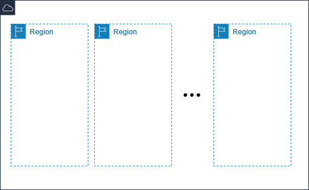
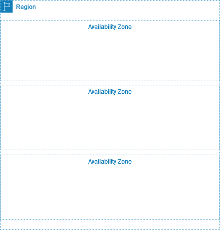
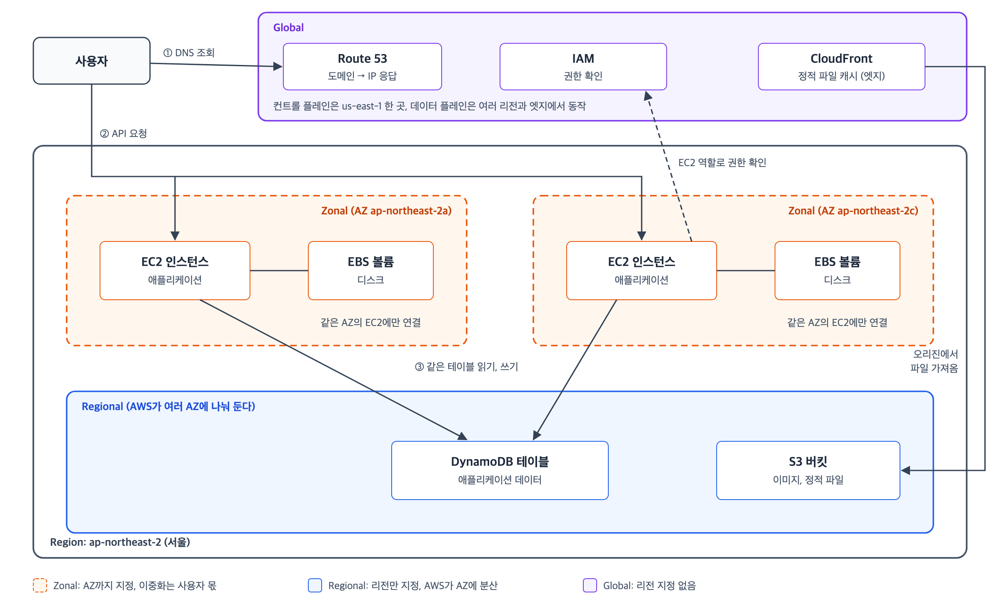

- AWS 서비스는 전 세계 여러 위치에 분산되어 호스팅되며, 이러한 위치들은 AWS Region, Availability Zone, Local Zone, Wavelength Zone으로 구성된다.

## AWS Regions
---
> 물리적으로 분리된 **독립적인 지리적 영역**이다.

_출처 : [https://docs.aws.amazon.com/global-infrastructure/latest/regions/aws-regions-availability-zones.html](https://docs.aws.amazon.com/global-infrastructure/latest/regions/aws-regions-availability-zones.html)_

- 각 Region은 다른 Region과 완전히 격리되도록 설계되었다.
  - 이를 통해 최대 수준의 장애 허용성과 안정성을 달성한다.
- 대부분의 AWS 서비스는 Region 단위 리소스를 지원한다.
- AWS 리소스를 조회할 때는 반드시 Region을 지정해야 하며, 해당 Region에 속한 리소스만 표시된다.
- 일부 리소스는 Region 간 복제가 가능하지만, AWS가 이를 자동으로 수행하지는 않는다.
  - 즉, DR 설계는 사용자 책임 영역

- 각 Region은 여러 개의 독립적인 위치, 즉 Availability Zone으로 구성된다.
  - Region 내의 Availability Zone들은 전용 메트로 광섬유망을 통해 저지연, 고대역폭, 고중복성 네트워크로 상호 연결된다.

- 워크로드를 배포하기 전에, 요구 사항을 가장 잘 충족하는 Region 또는 Regions를 고려해야 한다.
  - 예를 들어, 필요한 AWS 서비스와 기능을 제공하는 Region을 선택해야 하며, 대다수 사용자와 지리적으로 가까운 Region을 선택하면 네트워크 지연 시간을 줄일 수 있다.

### 계정 유형
> 사용자가 사용할 수 있는 Region은 계정 유형에 의해 결정된다.

**일반 AWS 계정**
- 여러 Region을 제공하며, 이를 통해 요구 사항에 맞는 위치에 AWS 리소스를 생성할 수 있다.
  - 예를 들어, 유럽 고객과의 거리 단축이나 **법적 요구 사항**을 충족하기 위해 유럽 Region에 리소스를 생성할 수 있다.

**GovCloud 계정**
- AWS GovCloud (US-West) 및 AWS GovCloud (US-East) Region에 대한 접근을 제공한다.
- 미국 정부·공공기관·규제 산업 전용 계정으로, 일반 AWS 계정과 완전히 분리된 Region 집합

**중국 계정**
- 베이징 및 닝샤(Ningxia) Region에만 접근할 수 있다.
- 즉, 중국 리전은 중국 법규에 따라 완전히 독립 운영

## AWS Availability Zones
---
> 하나의 Region 내부에 존재하는, 서로 격리된 위치이다.

_출처 : [https://docs.aws.amazon.com/global-infrastructure/latest/regions/aws-regions-availability-zones.html](https://docs.aws.amazon.com/global-infrastructure/latest/regions/aws-regions-availability-zones.html)_

- 각 Region에는 **최소 세 개**의 Availability Zone이 존재한다.
- 이는 AWS 상에서 고가용성 애플리케이션을 설계할 수 있도록 하기 위함이다.
  - 즉, 장애 + 유지보수 + 확장 상황을 동시에 고려하기 위함이며
  - AWS에서 말하는 고가용성(HA) 설계는 기본적으로 Multi-AZ를 전제로 한다.

- 각 Availability Zone은 **하나 이상의 독립된 데이터 센터**로 구성되며, 각 데이터 센터는 전원·네트워크·연결의 중복 구성을 갖추고 서로 다른 시설에 위치한다.
  - Availability Zone들은 물리적으로 분리되어 있기 때문에, 화재·토네이도·홍수와 같은 재난이 발생하더라도 **하나의 AZ만 영향을 받도록** 설계되어 있다.

- Availability Zone의 코드는 Region 코드 뒤에 문자 식별자를 붙인 형태이다.
  - 예를 들어, `us-east-2a`, `us-east-2b`, `us-east-2c`는 us-east-2 Region에 속한 Availability Zone들이다.

- 2025년 11월 이전에 생성된 계정의 경우, 일부 오래된 Region에서는 Availability Zone과 AZ 코드 간의 매핑이 AWS 계정별로 독립적으로 이루어진다.
  - 이로 인해, 한 계정에서의 us-east-1a가 다른 계정에서의 us-east-1a와 동일한 물리적 위치가 아닐 수 있다.
  - 반면, 2025년 11월 이후에 생성된 계정은 Availability Zone과 코드가 동일하게 매핑된다.

- 각 Availability Zone에는 AZ ID가 있으며, 이는 모든 AWS 계정에서 동일한 물리적 위치를 의미한다.
  - AZ ID는 Region 코드의 앞 세 글자, Region 코드 끝의 숫자, `-az`, 그리고 숫자를 조합한 형식이다.
  - 예를 들어, `euw1-az1`, `euw1-az2`, `euw1-az3`은 eu-west-1 Region의 Availability Zone에 대한 AZ ID이다.
  - “같은 데이터센터에 두지 않겠다”는 요구 사항은 AZ 코드가 아니라 AZ ID 기준으로 검증해야 함

## 서비스별 장애 격리 범위

---

> AWS 서비스는 리소스가 속하는 범위에 따라 Zonal, Regional, Global로 나뉘고, 장애가 번지는 범위도 이 경계를 따른다.

- 장애의 영향 범위를 제한하는 인프라 경계는 AZ, 리전, 파티션이다.
- 서비스마다 이 중 어느 경계에 맞춰 만들어졌는지가 다르다.

| 범위 | 사용자가 지정하는 것 | 예시 | AZ 장애 시 |
| --- | --- | --- | --- |
| Zonal | 리전 + AZ | EC2 인스턴스, EBS 볼륨, 서브넷 | 그 AZ의 리소스는 함께 영향을 받는다. 여러 AZ에 나눠 두는 건 사용자 몫 |
| Regional | 리전 | S3, DynamoDB, SQS, Lambda | AWS가 내부적으로 여러 AZ에 분산해 두어 단일 AZ 장애를 견딘다 |
| Global | 없음 | IAM, Route 53, CloudFront, Organizations | 데이터 플레인은 여러 리전과 엣지에서 동작하고, 컨트롤 플레인은 특정 리전 하나에 있다 |

### 범위를 나누는 목적

- **장애 영향 범위 제한**: 리소스는 자기 범위 안의 장애에만 영향을 받는다. 범위가 곧 어떤 장애에 함께 멈추는지를 정한다.
- **물리적 위치**: EC2 인스턴스, EBS 볼륨처럼 특정 데이터센터에 놓이는 리소스는 AZ 단위다. EBS 볼륨은 같은 AZ의 인스턴스에만 연결할 수 있다.
- **데이터 위치 보장**: 고객 데이터는 사용자가 고른 리전에 저장된다. AWS는 사용자가 요청한 서비스 제공이나 법적 요구에 필요한 경우를 빼고는 이를 리전 밖으로 옮기거나 복제하지 않는다.
- **이중화 책임 구분**: Zonal은 사용자가 여러 AZ에 나눠 배치하고, Regional과 Global은 AWS가 분산해 둔다.

### Zonal 서비스

- 리소스를 만들 때 AZ까지 지정한다. (`ap-northeast-2a` 에 EC2 인스턴스 생성 등)
- 데이터 플레인이 리전 안의 AZ마다 독립적으로 동작한다.
  - 한 AZ의 장애가 다른 AZ의 리소스로 번지지 않는 대신, 지정한 AZ에 장애가 나면 그 리소스는 같이 멈춘다.
- AZ 장애 대비는 사용자가 여러 AZ에 리소스를 나눠 띄우는 Multi-AZ 구성으로 한다.
  - 장애가 난 뒤 리소스를 새로 띄우는 대신 용량을 미리 확보해 둔다(static stability). 복구 단계에서 프로비저닝이 빠지므로 복구가 빨라진다.

### Regional 서비스

- 사용자는 리전만 고르고, 어느 AZ에 둘지는 AWS가 정한다. 서비스 자체가 여러 AZ 위에 구축되어 있다.
  - 예를 들어 S3는 기본적으로 요청과 데이터를 여러 AZ에 분산하고, 단일 AZ 장애에서 자동으로 복구되도록 설계되었다.
- 다른 리전의 장애로부터도 격리된다.
- 반대로 서비스 자체에 리전 수준의 장애가 나면 그 리전의 모든 AZ가 함께 영향을 받으므로, AZ 이중화로는 막을 수 없다.
  - 이 경우는 멀티 리전 구성으로 대비한다. 리전 간 의존성을 없애고, 페일오버 리전에 용량을 미리 확보하고, 페일오버를 정기적으로 테스트한다.
  - AWS는 단일 AZ나 리전의 가용 용량을 보장하지 않는다. 장애가 난 뒤 다른 리전에서 리소스를 띄우려 하면 용량이 모자랄 수 있다.

### Global 서비스

- 리소스가 특정 리전에 속하지 않는 소수의 서비스다.
- 서비스는 컨트롤 플레인과 데이터 플레인으로 나뉜다.
  - **컨트롤 플레인**: 리소스를 생성, 조회, 수정, 삭제, 나열(CRUDL)하는 관리용 API. (EC2 인스턴스 시작, S3 버킷 생성 등)
  - **데이터 플레인**: 서비스의 본래 기능. (실행 중인 EC2 인스턴스, S3 객체 읽기와 쓰기, Route 53의 DNS 질의 응답 등)
- Global 서비스의 데이터 플레인은 서비스에 따라 각 리전이나 엣지(PoP) 네트워크에서 동작하지만, 컨트롤 플레인은 한 리전에 있다.

  | 컨트롤 플레인 리전 | 서비스 |
  | --- | --- |
  | `us-east-1` | IAM, Organizations, Account Management, Route 53, CloudFront, CloudFront용 WAF와 ACM, Shield Advanced |
  | `us-west-2` | Global Accelerator, Application Recovery Controller, Network Manager |

- 컨트롤 플레인 리전에 장애가 나면 CRUDL 작업을 못 할 수 있다. 데이터 플레인은 계속 동작한다.
  - 예를 들어 IAM의 데이터 플레인은 파티션의 모든 리전에서 동작한다. 하지만 `us-east-1` 에 장애가 나면 서울 리전만 쓰는 서비스라도 IAM 정책 변경이나 Route 53 레코드 수정 같은 작업이 막힐 수 있다.
  - 그래서 복구 절차는 글로벌 컨트롤 플레인이나 글로벌 콘솔에 기대지 않도록 짠다. STS도 글로벌 엔드포인트 대신 리전 엔드포인트를 쓴다.

### 파티션

- 리전들을 묶는 가장 바깥 경계다. 일반 리전(`aws`), 중국 리전(`aws-cn`), GovCloud 리전(`aws-us-gov`)이 각각 별도 파티션이다.
- Global 서비스도 파티션마다 따로 운영되므로, 한 파티션의 데이터 플레인 장애는 다른 파티션에 영향을 주지 않는다.

### 사용자가 챙길 이중화

리전 하나에서 운영할 때 AZ 장애 대비로 사용자가 챙길 대상은 주로 Zonal 리소스다.

| 리소스 | 범위 | 챙길 것 |
| --- | --- | --- |
| EC2 인스턴스 | Zonal | 여러 AZ에 나눠 띄운다 |
| 서브넷 | Zonal (한 AZ 안에만 존재하고 AZ를 걸칠 수 없다) | AZ마다 만든다 |
| NAT Gateway | Zonal | AZ마다 하나씩 둔다. 하나만 두면 그 AZ 장애 시 다른 AZ의 리소스도 인터넷 접근을 잃는다 |
| Aurora 인스턴스 | Zonal | Writer와 다른 AZ에 Reader를 둔다 |

- Regional 서비스라도 AZ를 고르는 설정이 있으면 사용자가 여러 AZ를 골라야 한다.
  - ALB는 서로 다른 AZ의 서브넷을 최소 2개 지정해야 만들 수 있다.
  - VPC에 연결한 Lambda는 지정한 서브넷에 네트워크 인터페이스가 생긴다. 서브넷은 AZ 하나에 속하므로, 서브넷을 하나만 지정하면 AZ 하나에 묶인다.
  - EFS는 Regional과 One Zone 중 고를 수 있고, One Zone은 AZ 하나에 데이터를 저장한다.
- 리전 하나에서만 운영하면 Regional 서비스 자체의 리전 수준 장애는 막을 수 없다. 이 위험을 줄이려면 멀티 리전 구성이 필요하다.
- 이중화는 인프라 장애 대비이고, 실수로 지우거나 덮어쓴 데이터를 되돌리지는 못한다. 삭제나 덮어쓰기도 모든 사본에 그대로 반영되기 때문이다. 되돌리려면 S3 버전 관리, DynamoDB 시점 복구(PITR)처럼 이전 상태를 보관하는 기능을 따로 켠다.

## 참고 자료
---
- [https://docs.aws.amazon.com/global-infrastructure/latest/regions/aws-regions-availability-zones.html](https://docs.aws.amazon.com/global-infrastructure/latest/regions/aws-regions-availability-zones.html)
- [https://docs.aws.amazon.com/global-infrastructure/latest/regions/aws-regions.html](https://docs.aws.amazon.com/global-infrastructure/latest/regions/aws-regions.html)
- [https://docs.aws.amazon.com/global-infrastructure/latest/regions/aws-availability-zones.html](https://docs.aws.amazon.com/global-infrastructure/latest/regions/aws-availability-zones.html)
- ChatGPT
- [AWS Fault Isolation Boundaries (docs.aws.amazon.com/whitepapers)](https://docs.aws.amazon.com/whitepapers/latest/aws-fault-isolation-boundaries/abstract-and-introduction.html)
- [Zonal services (docs.aws.amazon.com/whitepapers)](https://docs.aws.amazon.com/whitepapers/latest/aws-fault-isolation-boundaries/zonal-services.html)
- [Regional services (docs.aws.amazon.com/whitepapers)](https://docs.aws.amazon.com/whitepapers/latest/aws-fault-isolation-boundaries/regional-services.html)
- [Global services (docs.aws.amazon.com/whitepapers)](https://docs.aws.amazon.com/whitepapers/latest/aws-fault-isolation-boundaries/global-services.html)
- [Control planes and data planes (docs.aws.amazon.com/whitepapers)](https://docs.aws.amazon.com/whitepapers/latest/aws-fault-isolation-boundaries/control-planes-and-data-planes.html)
- [Attach an Amazon EBS volume to an Amazon EC2 instance (docs.aws.amazon.com/ebs)](https://docs.aws.amazon.com/ebs/latest/userguide/ebs-attaching-volume.html)
- [Data Privacy FAQ (aws.amazon.com/compliance)](https://aws.amazon.com/compliance/data-privacy-faq/)
- [Subnets for your VPC (docs.aws.amazon.com/vpc)](https://docs.aws.amazon.com/vpc/latest/userguide/configure-subnets.html)
- [NAT gateway basics (docs.aws.amazon.com/vpc)](https://docs.aws.amazon.com/vpc/latest/userguide/nat-gateway-basics.html)
- [Application Load Balancers (docs.aws.amazon.com/elasticloadbalancing)](https://docs.aws.amazon.com/elasticloadbalancing/latest/application/application-load-balancers.html)
- [Giving Lambda functions access to resources in an Amazon VPC (docs.aws.amazon.com/lambda)](https://docs.aws.amazon.com/lambda/latest/dg/configuration-vpc.html)
- [Retaining multiple versions of objects with S3 Versioning (docs.aws.amazon.com/AmazonS3)](https://docs.aws.amazon.com/AmazonS3/latest/userguide/Versioning.html)
- [Point-in-time backups for DynamoDB (docs.aws.amazon.com/amazondynamodb)](https://docs.aws.amazon.com/amazondynamodb/latest/developerguide/PointInTimeRecovery.html)
