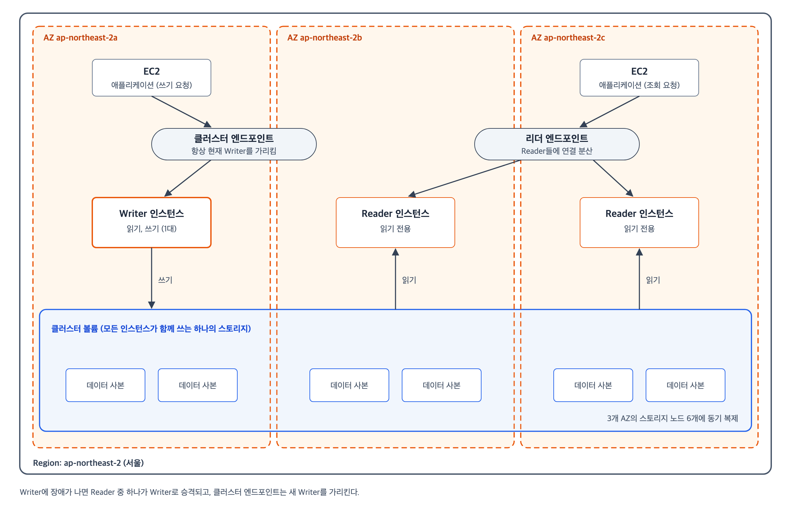

## DB 클러스터

---

> Aurora DB 클러스터는 **DB 인스턴스**와, 그 인스턴스들이 함께 쓰는 **클러스터 볼륨**으로 구성된다.

- 일반 MySQL은 서버 한 대가 자기 디스크에 데이터를 갖고 있다. Aurora는 데이터를 저장하는 계층(클러스터 볼륨)과 쿼리를 처리하는 계층(DB 인스턴스)이 분리되어 있다.
- DB 인스턴스는 역할에 따라 두 종류다.
  - **Writer (primary 인스턴스)**: 읽기와 쓰기를 모두 처리한다. 클러스터에 하나만 있다.
  - **Reader (Aurora Replica)**: 읽기만 처리한다. 클러스터당 최대 15개까지 둘 수 있다.

## 클러스터 볼륨 (스토리지)

---

> 클러스터 볼륨은 한 리전의 **3개 AZ에 걸쳐** 데이터 사본을 두는 스토리지다.

- 쓰기가 일어나면 Aurora가 데이터를 여러 AZ에 걸친 스토리지 노드 6개에 동기 복제한다.
- 클러스터의 모든 인스턴스(Writer와 Reader)는 클러스터 볼륨을 하나의 논리 볼륨으로 본다.
  - 그래서 Reader를 추가할 때 데이터를 복사하는 작업이 거의 필요 없다.
- AZ 하나에 장애가 나도 다른 AZ에 사본이 남아 있으므로 데이터는 유지된다.

## 인스턴스

---

> DB 인스턴스는 클러스터 볼륨이 걸쳐 있는 AZ 중 **하나에 놓인다.**

- 클러스터 볼륨은 여러 AZ에 걸쳐 있지만, 인스턴스는 AZ 하나에 놓인다. 인스턴스가 있는 AZ에 장애가 나면 그 인스턴스는 멈춘다.
- 그래서 Reader는 Writer와 다른 AZ에 두는 것이 권장된다.
  - Reader를 모두 같은 AZ에 두었는데 그 AZ에 장애가 나면, 다른 AZ에 인스턴스를 직접 새로 만들어야 한다.

[AWS 리전과 가용 영역](/posts/aws-regions-and-az/) 글의 분류로 보면, 클러스터 볼륨은 AWS가 여러 AZ에 분산해 두는 Regional에 가깝고, 인스턴스는 AZ 하나에 속하는 Zonal에 가깝다.

## Writer와 Reader

---

> Reader는 Writer와 **같은 클러스터 볼륨**을 읽는다. 데이터를 따로 복제받아 쌓지 않는다.

- Writer가 쓴 내용이 Reader에서 보이기까지 지연(replica lag)이 있다. 보통 100ms보다 훨씬 짧지만, 쓰기가 몰리면 길어질 수 있다. (AWS 문서 기준 수치이며, 직접 측정하지는 않았다.)
- Writer 성능에 영향을 주지 않도록 Reader로의 반영은 비동기로 이루어진다.

### MySQL 복제(source/replica)와 비교

역할은 MySQL의 source(master)와 replica(slave)에 대응하지만, 데이터를 맞추는 방식이 다르다.

| | MySQL source/replica | Aurora Writer/Reader |
| --- | --- | --- |
| 데이터 사본 | 서버마다 자기 디스크에 따로 가진다 | 클러스터 볼륨 하나를 함께 쓴다 |
| 변경 전달 | replica가 source의 binary log를 받아 다시 실행한다 | Reader가 같은 볼륨을 읽는다 |
| Reader(replica) 추가 | 데이터 전체를 복사해야 한다 | 데이터 복사가 거의 필요 없다 |

- Aurora MySQL도 binary log 복제를 쓸 수 있다. 다른 리전의 클러스터나 같은 리전의 다른 Aurora 클러스터로 복제할 때 쓰는 별도 기능이다.

## 엔드포인트

---

> 애플리케이션은 인스턴스 주소 대신 **엔드포인트**로 접속한다.

| 엔드포인트 | 연결 대상 | 용도 |
| --- | --- | --- |
| 클러스터 엔드포인트 | 현재 Writer | 쓰기, DDL, DML |
| 리더 엔드포인트 | Reader들 (연결을 자동으로 분산) | 조회 쿼리 |

- 장애 조치로 Writer가 바뀌어도 클러스터 엔드포인트는 새 Writer를 가리키므로, 애플리케이션의 접속 주소를 바꿀 필요가 없다.
- Reader가 Writer로 승격된 직후 잠깐 동안은 리더 엔드포인트가 새 Writer로 연결될 수 있다.

## 장애 조치 (failover)

---

> Writer에 장애가 나면, Reader가 있느냐에 따라 복구 방식과 시간이 달라진다.

| 상황 | 동작 | 복구 시간 (AWS 문서 기준) |
| --- | --- | --- |
| Reader가 있을 때 | Reader 하나가 Writer로 승격된다 | 보통 60초 이내, 30초 이내인 경우도 많다 |
| Reader가 없을 때 | 같은 AZ에서 Writer 호스트를 자동 복구한다 | 보통 10분 이내 |

- 승격될 Reader는 우선순위(0이 가장 높고 15가 가장 낮다)로 정할 수 있다.
- Reader가 없을 때 같은 AZ에서 복구하는 방식은 AZ 전체 장애에는 대응하지 못한다. 다른 AZ에 Reader를 하나 이상 두는 이유다.

## 참고 자료

---

- [Amazon Aurora DB clusters (docs.aws.amazon.com/AmazonRDS)](https://docs.aws.amazon.com/AmazonRDS/latest/AuroraUserGuide/Aurora.Overview.html)
- [Amazon Aurora storage (docs.aws.amazon.com/AmazonRDS)](https://docs.aws.amazon.com/AmazonRDS/latest/AuroraUserGuide/Aurora.Overview.StorageReliability.html)
- [Replication with Amazon Aurora (docs.aws.amazon.com/AmazonRDS)](https://docs.aws.amazon.com/AmazonRDS/latest/AuroraUserGuide/Aurora.Replication.html)
- [High availability for Amazon Aurora (docs.aws.amazon.com/AmazonRDS)](https://docs.aws.amazon.com/AmazonRDS/latest/AuroraUserGuide/Concepts.AuroraHighAvailability.html)
- [Amazon Aurora endpoint connections (docs.aws.amazon.com/AmazonRDS)](https://docs.aws.amazon.com/AmazonRDS/latest/AuroraUserGuide/Aurora.Overview.Endpoints.html)
- [MySQL Replication (dev.mysql.com/doc/refman/8.4)](https://dev.mysql.com/doc/refman/8.4/en/replication.html)
