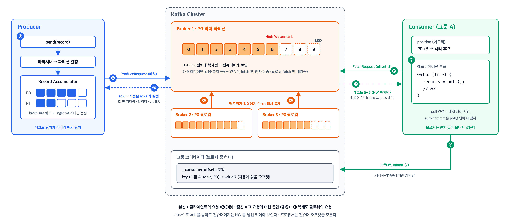
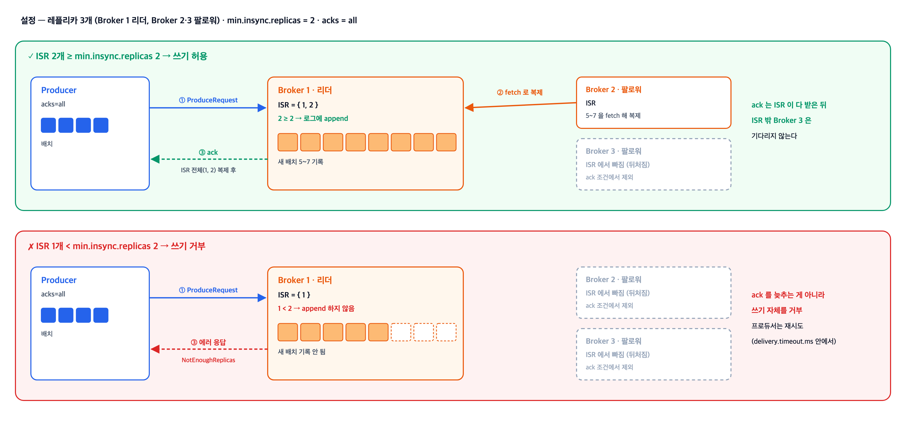
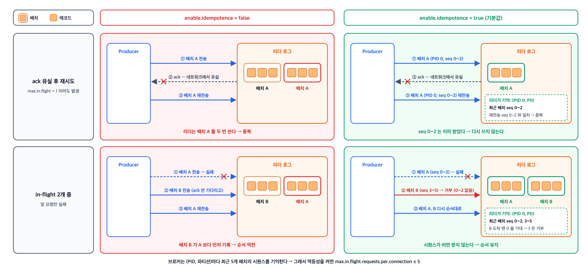
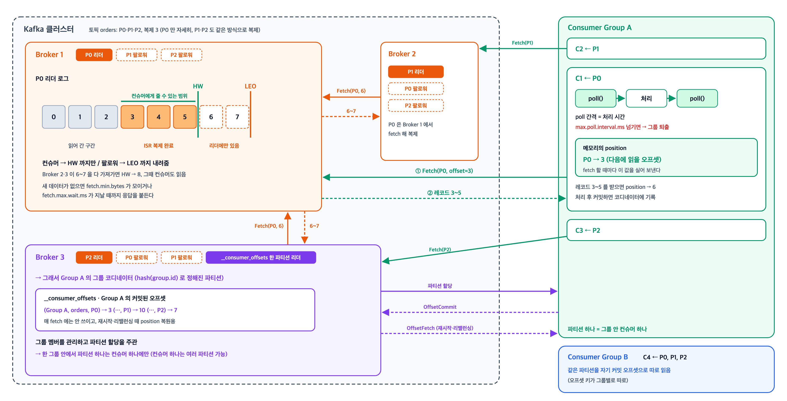
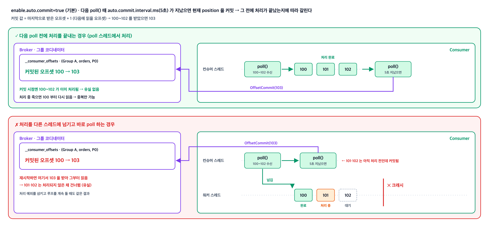
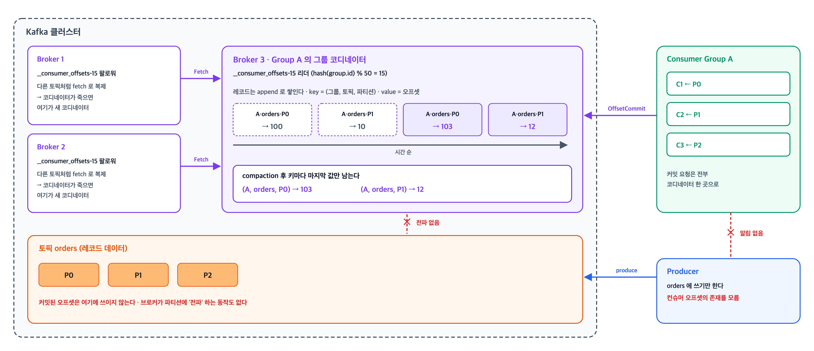

이벤트 하나가 프로듀서에서 발행되어 컨슈머가 처리하고 오프셋을 커밋하기까지의 흐름을 훑는다. <br>
ISR·High Watermark·오프셋 관리 같은 개별 개념의 상세는 별도 글에서 다루고, 여기서는 각 단계에서 누가 무엇을 결정하는지에 초점을 맞춘다.

본문에 나오는 설정 기본값은 **Apache Kafka 4.2** 문서 기준이다.  <br>
`acks`, `enable.idempotence`처럼 버전에 따라 기본값이 바뀐 항목이 있으므로 다른 버전을 쓴다면 해당 버전 문서를 확인해야 한다.

## 전체 흐름

---

> 이벤트는 프로듀서의 배치 버퍼 → 리더 파티션 → 팔로워 복제 → 컨슈머 fetch → 오프셋 커밋 순서로 움직인다. <br> 브로커는 어느 구간에서도 먼저 밀어 보내지 않고, 프로듀서와 컨슈머가 각각 요청을 보내면 응답하는 쪽이다.



```
① Producer  ──   send() → 파티셔너가 파티션 결정 → 배치 버퍼(record accumulator)에 적재
② Producer  ──▶  Broker     배치 단위로 전송
③ Broker    ──   리더 파티션에 append → 다른 브로커의 팔로워 레플리카가 복제
④ Broker    ──▶  Producer   ack 응답 (시점은 프로듀서의 acks 설정이 결정)

⑤ Consumer  ──▶  Broker     fetch 요청 ("이 오프셋부터 주세요")
⑥ Broker    ──▶  Consumer   레코드 배치 응답 (High Watermark까지만)
⑦ Consumer  ──   poll()이 리턴한 배치 처리
⑧ Consumer  ──▶  Broker     오프셋 커밋 → __consumer_offsets 토픽에 저장
```


## 1. 프로듀서 → 브로커

---

> `send()`는 즉시 전송이 아니라 버퍼 적재이고, 응답을 언제 받을지는 프로듀서의 `acks`가 결정한다.

### 배치 단위 전송: `batch.size`, `linger.ms`

- `send()`를 호출하면 파티셔너가 대상 파티션을 정하고, 레코드는 곧바로 나가지 않고 **record accumulator**라는 버퍼에 쌓인다.
  - 배치가 `batch.size`(기본 16384바이트)만큼 차거나 `linger.ms`(기본 5ms)가 지나면 그때 브로커로 전송된다.

- `linger.ms`는 배치가 덜 찼어도 레코드를 더 모으려고 기다리는 최대 시간이고, 배치에 첫 레코드가 들어간 시점부터 잰다.
  - 늘리면 한 번에 보내는 양이 커지는 대신 레코드가 나가기까지의 지연도 그만큼 늘어난다.
  - 기본값은 Kafka 4.0에서 `0`에서 `5`로 바뀌었다.

### ack 시점: `acks`

> 브로커에 도착한 배치는 **리더 파티션**에 쓰이고, 다른 브로커에 있는 **팔로워 레플리카**가 이를 복제해 간다. <br>
> ack를 이 중 어느 시점에 돌려줄지는 프로듀서의 `acks` 설정이 정한다.

| `acks` | ack 시점 |
| --- | --- |
| `0` | 기다리지 않음. 전송한 것으로 간주 |
| `1` | 리더 파티션에 쓰이면 응답 |
| `all` (기본값, Kafka 3.0부터. 이전은 `1`) | ISR 전체에 복제되면 응답 |

- `acks=all`의 "ISR 전체"는 고정된 레플리카 수가 아니라 **그 시점 ISR에 남아 있는 레플리카 전체**다.
- 팔로워가 뒤처져 ISR에서 빠지다 보면 ISR에 리더 하나만 남을 수 있고, 그러면 `acks=all`이어도 리더에만 쓰인 채 ack가 나갈 수 있다. (`min.insync.replicas`로 방어)

### ISR 하한: `min.insync.replicas`
> - `acks=all`일 때 **ISR이 최소 몇 개 있어야 쓰기를 받을지** 정하는 하한

- ISR이 리더 하나로 줄어든 상태에서 쓰기를 받지 않게 하는 브로커·토픽 설정
- ISR이 이 값에 미달하면 브로커는 ack를 늦추는 게 아니라 **쓰기 자체를 거부**한다(`NotEnoughReplicasException`).
  - "이만큼 복제되면 ack"라는 뜻이 아니다.
- 기본값은 `1`이라 따로 올리지 않으면 이 보호는 걸리지 않는다.



### 재시도 범위: `retries`, `delivery.timeout.ms`

- `retries` 기본값은 `2147483647`(`Integer.MAX_VALUE`)이라 횟수로는 사실상 무제한이다.
- 실제로 재시도를 끊는 값은 `delivery.timeout.ms`(기본 120000, 2분)다.
- `send()` 이후 `배치 대기 시간 + 브로커 응답 대기 + 재시도`를 모두 합쳐 이 시간을 넘기는 순간 실패로 확정된다.
- 그래서 재시도를 조절할 때는 `retries`가 아니라 `delivery.timeout.ms`를 본다.

### 재시도 중복과 `enable.idempotence`
> 프로듀서가 재시도해도 레코드가 파티션에 한 번만, 보낸 순서대로 쓰이게 하는 설정

- 재시도는 중복과 순서 역전을 만들 수 있다.
- 리더가 배치를 로그에 썼는데 ack가 네트워크에서 유실되면, 프로듀서는 실패로 보고 같은 배치를 다시 보내고 리더는 그 배치를 한 번 더 쓴다.
- `max.in.flight.requests.per.connection`(기본 `5`)은 한 커넥션에서 ack를 받지 않은 요청을 최대 몇 개까지 동시에 보낼지 정하는데, 1보다 크면 A, B를 연달아 보낸 뒤 A만 실패하고 B가 성공할 수 있다. 이때 A를 재시도하면 로그에는 B, A 순서로 남는다.
- `enable.idempotence=true`(Kafka 3.0부터 기본값)이면 브로커가 이 둘을 걸러낸다.




- 프로듀서는 시작할 때 브로커에게서 **Producer ID(PID)** 를 받고, 파티션마다 레코드에 0부터 이어지는 **시퀀스 번호**를 붙여 보낸다.
- 브로커는 (PID, 파티션)마다 최근 배치의 시퀀스를 기억해, 이미 받은 시퀀스가 다시 오면 쓰지 않고 번호를 건너뛴 시퀀스가 오면 거부한다.
- 앞의 것이 중복을, 뒤의 것이 순서 역전을 막는다.
- 브로커가 기억하는 배치는 **프로듀서당 최근 5개**라, 멱등성을 켜면 `max.in.flight.requests.per.connection`는 5 이하여야 한다.

> 멱등성은 `acks=all`, `retries > 0`, `max.in.flight.requests.per.connection ≤ 5`를 전제로 하고, 이와 충돌하는 값을 주면 결과가 갈린다.

| 설정 | 결과 |
| --- | --- |
| `acks=1` 또는 `retries=0`만 지정 | 예외 없이 멱등성이 꺼진다 |
| 위 설정 + `enable.idempotence=true` 명시 | `ConfigException` |
| `max.in.flight.requests.per.connection`를 6 이상으로 지정 | 명시 여부와 상관없이 `ConfigException` |

- 멱등성이 막는 범위는 **하나의 프로듀서 인스턴스가 살아 있는 동안, 파티션 단위**다.
- 프로듀서가 재시작하면 새 PID를 받으므로 재시작 전후의 중복은 걸러지지 않고(트랜잭션 `transactional.id`의 영역), 애플리케이션이 `send()`를 두 번 호출한 경우도 브로커 입장에서는 서로 다른 레코드라 막지 못한다.

## 2. 브로커 → 컨슈머

---

> 컨슈머는 브로커가 밀어 주는 레코드를 받는 게 아니라, 애플리케이션 루프가 `poll()`을 호출할 때마다 "이 오프셋부터 달라"고 직접 요청한다.



### poll 루프: `max.poll.interval.ms`

- "폴링 주기" 설정은 없다. 실제 구조는 애플리케이션이 도는 루프다.
- `max.poll.interval.ms`(기본 300000)는 폴링 주기가 아니라 **poll 호출 간격의 상한**이다.
  - 한 배치 처리가 이 시간을 넘기면 컨슈머가 죽은 것으로 간주되어 **그룹에서 퇴출되고 리밸런싱이 일어난다.**

```java
while (true) {
    ConsumerRecords<String, String> records = consumer.poll(Duration.ofMillis(100));
    // 레코드 처리
    // (필요하면 커밋)
}
```

- 직전 `poll()`이 리턴한 레코드의 처리가 끝나면 곧바로 다음 `poll()`이 호출된다.
  - 즉 **poll 간격 = 배치 처리 시간**이고, 처리가 빠를수록 poll도 잦아진다.
  - Spring Kafka 같은 프레임워크도 내부적으로 이 루프를 대신 돌려준다.


### 빈 응답 대기: `fetch.min.bytes`, `fetch.max.wait.ms`

- 받아올 레코드가 없을 때 `poll()`이 곧바로 빈손으로 리턴하면 busy-loop가 된다.
- 그래서 브로커는 `fetch.min.bytes`만큼 데이터가 모이거나 `fetch.max.wait.ms`(기본 500)가 지날 때까지 응답을 붙들고 있는다(long polling).

### 읽을 위치: position과 커밋된 오프셋

- 읽을 위치를 정하는 주체는 브로커가 아니다.
  - 컨슈머가 파티션별 **position**(다음에 읽을 오프셋)을 메모리에 들고 있고, fetch 요청에 그 오프셋을 명시해서 보낸다.
- 커밋된 오프셋은 매 요청마다 참조되는 게 아니라, **컨슈머가 재시작하거나 리밸런싱으로 파티션을 새로 할당받을 때 시작 위치를 복원하는 용도**로 쓰인다.
  - 복원할 기록이 없으면 `auto.offset.reset`(기본 `latest`)을 따른다.

### 파티션 할당: 컨슈머 그룹

- 한 컨슈머 그룹 안에서 **하나의 파티션은 하나의 컨슈머만** 소비한다.
- 파티션 할당은 브로커 중 하나인 **그룹 코디네이터**가 주관한다.

### 읽을 수 있는 범위: High Watermark

- 컨슈머는 **High Watermark까지만** 읽을 수 있다.
  - 리더에만 쓰이고 아직 복제 중인 레코드는 컨슈머의 fetch 요청이 와도 내려주지 않는다.
  - 복제 전 레코드를 읽었는데 리더가 죽으면 존재한 적 없는 데이터를 읽은 셈이 되기 때문이다.
  - 팔로워도 리더에게 fetch 요청을 보내 복제하지만, 팔로워에게는 이 제한 없이 LEO까지 내려준다.
- 이 제약은 프로듀서의 `acks`와 무관하다.
  - `acks=1`로 ack를 받았더라도 컨슈머에게는 복제가 끝난 뒤에야 보인다.

## 3. 처리와 오프셋 커밋

---

> 기본값은 auto commit이고, 커밋되는 값은 "처리한 마지막 오프셋"이 아니라 "다음에 읽을 오프셋"이다.



### 커밋 시점: `enable.auto.commit`, `auto.commit.interval.ms`

- 기본값은 `enable.auto.commit=true`다.
  - "처리를 마치면 커밋한다"는 건 auto commit을 끄고 `commitSync()`/`commitAsync()`를 직접 호출했을 때의 이야기다.
- 기본 프로토콜(`group.protocol=classic`)에서 auto commit은 별도 백그라운드 타이머가 아니라 **`poll()` 호출 안에서** 처리된다.
  - `poll()`이 불릴 때마다 마지막 커밋 이후 `auto.commit.interval.ms`(기본 5000)가 지났는지 확인하고, 지났으면 현재 position을 커밋한다.
  - 따라서 실제 커밋 간격은 정확히 5초가 아니라 **"5초 이상, poll 주기에 따라"** 이고, `poll()`을 호출하지 않으면 커밋도 일어나지 않는다.
- `close()`나 리밸런싱 시점에도 커밋한다.

> Kafka 4.x에는 `group.protocol=consumer`(KIP-848)로 켜는 새 컨슈머 그룹 프로토콜이 있고, 여기서는 그룹 관리와 커밋 처리를 백그라운드 스레드가 맡는다. <br>
> 4.2 기준 기본값은 여전히 `classic`이다.

### 커밋 값: 다음에 읽을 오프셋

커밋되는 값은 **마지막으로 처리한 오프셋 + 1**, 즉 다음에 읽을 오프셋이다. 오프셋 100까지 처리했다면 101이 커밋된다.

### auto commit에서 유실이 생기는 경우

- auto commit에서 유실이 생길 수 있는 이유는 커밋 대상이 "처리를 완료한 오프셋"이 아니라 **"poll로 받아간 오프셋"** 이기 때문이다.
- 그래서 다음 `poll()` 전에 처리가 끝났는지에 따라 결과가 갈린다.

| 처리 방식 | 결과 |
| --- | --- |
| poll한 스레드에서 처리를 끝낸 뒤 다음 poll | 커밋 시점엔 처리가 끝나 있으므로 유실 없음. 중복만 가능 |
| 받은 배치를 다른 스레드에 넘기고 바로 다음 poll | 아직 처리 중인 레코드의 오프셋이 커밋됨 → 크래시 후 재시작하면 그 지점부터 읽어 미처리 레코드를 건너뜀 (유실) |
| 처리 중 예외를 삼키고 루프 계속 진행 | 실패한 레코드까지 커밋됨 (유실) |

### auto commit을 끄는 경우

> poll한 스레드에서 처리를 끝내고 다음 `poll()`을 부르는 구조라면 auto commit도 처리 후 수동 커밋과 같은 at-least-once다. <br>
> 커밋이 다음 `poll()` 안에서 일어나고, 그 시점엔 앞 배치 처리가 끝나 있기 때문이다.

아래에 해당하면 `enable.auto.commit=false`로 끄고 `commitSync()`/`commitAsync()`로 직접 커밋한다.

- 처리를 다른 스레드·비동기로 넘긴다 → auto commit이면 처리 전 레코드가 커밋된다.
- 실패한 레코드는 커밋하지 않아야 한다 → 재시도나 DLT 전송이 끝난 뒤에 커밋한다.
- 커밋 시점을 다른 작업에 맞춰야 한다 → 예) DB 트랜잭션 커밋 직후.
- 크래시 시 중복 범위를 줄여야 한다 → auto commit은 `auto.commit.interval.ms`(5초) 단위라 그 사이 처리분이 다시 읽힌다.

Spring Kafka는 2.3부터 `enable.auto.commit`을 명시하지 않으면 `false`로 두고, 기본 `AckMode.BATCH`로 `poll()`이 리턴한 레코드를 리스너가 모두 처리한 뒤 컨테이너가 커밋한다.
- 구조는 위 표의 첫 행과 같고 커밋 주체만 프레임워크다.

## 4. 커밋된 오프셋은 어디에 남는가

---

> 커밋된 오프셋은 `__consumer_offsets`라는 내부 토픽에 **(그룹, 토픽, 파티션)** 을 키로 저장된다. 커밋 요청은 그룹 코디네이터 브로커가 처리한다.



- `__consumer_offsets`의 파티션 수는 `offsets.topic.num.partitions`(기본 50), 복제 계수는 `offsets.topic.replication.factor`(기본 3)다.
- 한 그룹의 오프셋은 `abs(group.id.hashCode()) % 50` 번 파티션 하나에 전부 모이고, **그 파티션의 리더 브로커가 그 그룹의 코디네이터**다.
  - Kafka 4.2.0 단일 브로커에서 그룹 `A`로 커밋하면 `__consumer_offsets-15`에만 기록이 생긴다. (`"A".hashCode()` = 65, 65 % 50 = 15)
- 같은 키로 다시 커밋하면 레코드가 하나 더 append된다. 토픽이 `cleanup.policy=compact`라 compaction이 돌면 키마다 마지막 값만 남는다.

- 브로커가 오프셋을 다른 파티션들에 "전파"하는 동작 같은 건 없고, `__consumer_offsets` 토픽 자체가 다른 토픽처럼 팔로워에게 복제될 뿐이다.
  - 코디네이터 브로커가 죽으면 그 파티션의 새 리더가 코디네이터를 이어받는다.

- 프로듀서 쪽으로 전달되는 것도 없다. 프로듀서와 컨슈머는 완전히 분리되어 있고, 프로듀서는 컨슈머 오프셋의 존재 자체를 모른다.

- 커밋 기록은 영구 보관되지 않는다.
  - 다만 커밋 후 일정 시간이 지나면 지워지는 게 아니라, **그룹에서 컨슈머가 모두 빠진(empty) 뒤** `offsets.retention.minutes`(기본 10080, 7일)가 지나면 만료된다.

- 그룹에 컨슈머가 붙어 있는 동안에는 커밋이 오래돼도 만료되지 않는다. (Kafka 2.1, KIP-211부터. 그 전에는 마지막 커밋 시점부터 쟀다.)
- 그룹 없이 `assign()`으로 파티션을 직접 지정하는 컨슈머는 지금도 마지막 커밋 시점부터 잰다.

## 흔히 오해하는 지점 정리

---

> 위 내용 중 직관과 어긋나기 쉬운 것들을 모았다.

| 오해 | 실제 |
| --- | --- |
| `min.insync.replicas`만큼 복제되면 ack | ack 시점은 `acks`가 결정. `min.insync.replicas`는 `acks=all`일 때 요구되는 ISR 하한이고, 미달이면 쓰기 자체가 거부됨 |
| 컨슈머에 폴링 주기 설정이 있다 | 없음. 애플리케이션 루프가 `poll()`을 직접 호출. `max.poll.interval.ms`는 주기가 아니라 간격의 상한 |
| 브로커가 컨슈머 그룹별로 어디부터 보낼지 판단해서 전송 | 컨슈머가 자기 position을 들고 있다가 fetch 요청에 명시. 커밋된 오프셋은 재시작·리밸런싱 시 복원용 |
| 처리를 완료하면 커밋된다 | 기본값은 auto commit. 처리 완료 기준 커밋은 auto commit을 끄고 직접 호출해야 함 |
| auto commit은 5초마다 백그라운드에서 동작 | `classic` 프로토콜에서는 `poll()` 안에서 검사. poll을 안 부르면 커밋도 없음 |
| 커밋 값은 마지막으로 처리한 오프셋 | 마지막 처리 오프셋 + 1 (다음에 읽을 오프셋) |
| `acks`를 낮추면 컨슈머가 더 빨리 볼 수 있다 | 무관. 컨슈머는 High Watermark까지만 읽으므로 복제 완료 후에야 보임 |

## 참고 자료

---

- [Apache Kafka Design (kafka.apache.org/42/design/design)](https://kafka.apache.org/42/design/design/) — Persistence, The Consumer, Replication
- [Apache Kafka Producer Configs (kafka.apache.org/42/configuration/producer-configs)](https://kafka.apache.org/42/configuration/producer-configs/)
- [Apache Kafka Consumer Configs (kafka.apache.org/42/configuration/consumer-configs)](https://kafka.apache.org/42/configuration/consumer-configs/)
- [Apache Kafka Broker Configs (kafka.apache.org/42/configuration/broker-configs)](https://kafka.apache.org/42/configuration/broker-configs/) — `offsets.retention.minutes` 만료 조건
- [KIP-211: Revise Expiration Semantics of Consumer Group Offsets (cwiki.apache.org)](https://cwiki.apache.org/confluence/display/KAFKA/KIP-211%3A+Revise+Expiration+Semantics+of+Consumer+Group+Offsets)
- [KafkaConsumer javadoc (kafka.apache.org/42/javadoc)](https://kafka.apache.org/42/javadoc/org/apache/kafka/clients/consumer/KafkaConsumer.html) — position과 committed offset의 구분
- [ProducerConfig.java (github.com/apache/kafka, 4.2.0)](https://github.com/apache/kafka/blob/4.2.0/clients/src/main/java/org/apache/kafka/clients/producer/ProducerConfig.java) — `postProcessAndValidateIdempotenceConfigs`의 멱등성 설정 검증
- [Message Listener Containers (docs.spring.io/spring-kafka/reference)](https://docs.spring.io/spring-kafka/reference/kafka/receiving-messages/message-listener-container.html) — `enable.auto.commit` 기본값, `AckMode`
