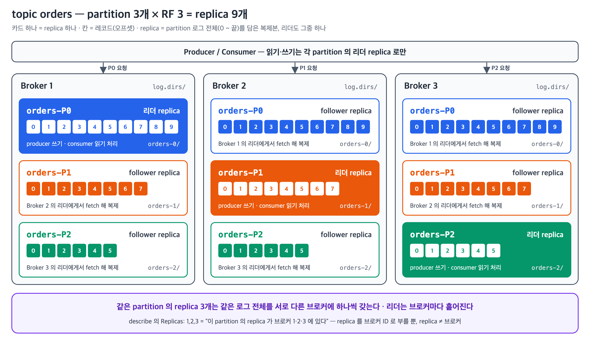
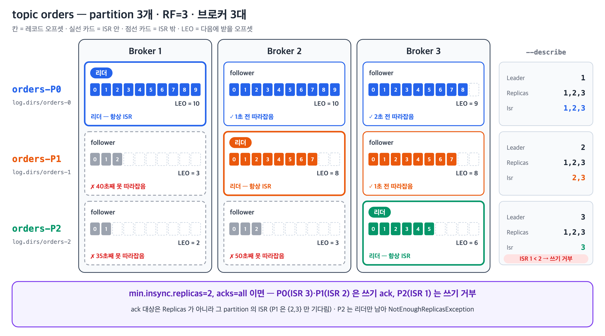
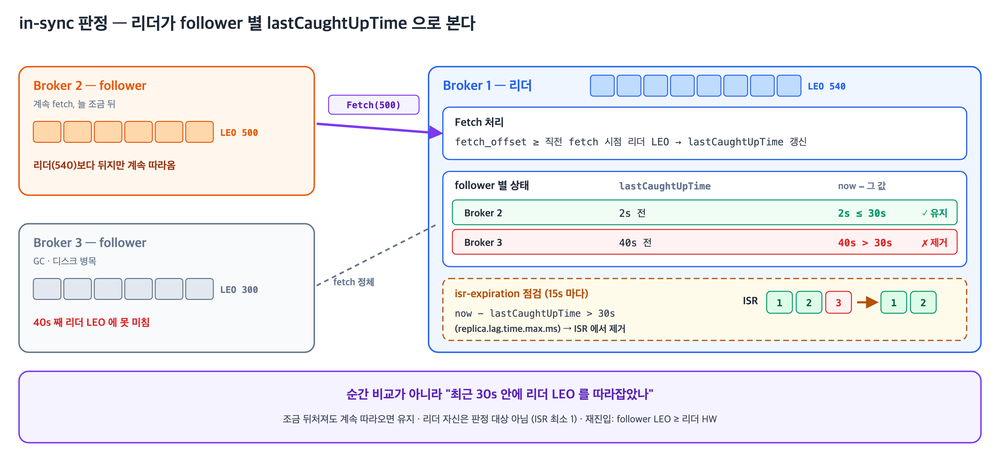
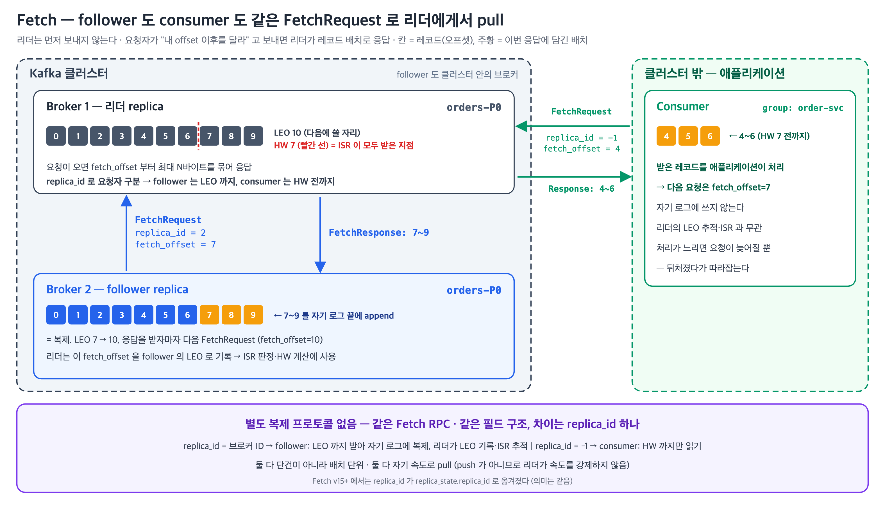
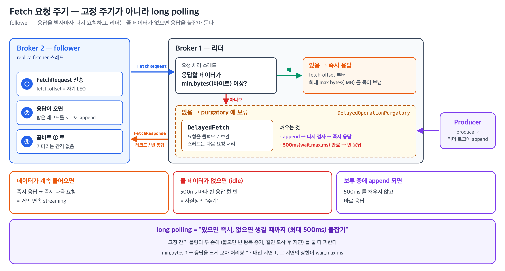
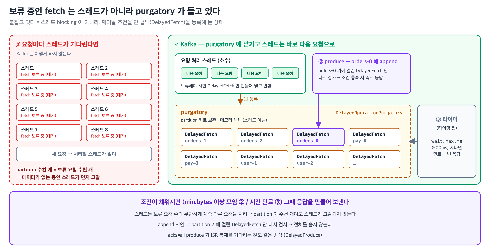

분산 메시지 시스템에서 데이터 유실 방지 + 고가용성을 동시에 달성하려면 복제가 필수. <br>
*"몇 개에 복제됐을 때 ack 할지"*, *"리더 죽으면 누가 새 리더?"* 라는 두 결정을 Kafka 는 **ISR (In-Sync Replicas) 이라는 동적 집합** 으로 추상화. <br>
정적 RF (replication factor) 와 별도로, 런타임에 실제 sync 된 멤버만 ISR 로 추적

> ISR은 Kafka의 핵심 복제 메커니즘. **즉, 가용성과 일관성 사이의 trade off를 따지는 핵심.**

> **선행 개념**: 이 글은 LEO·HW·LSO 같은 파티션 로그의 오프셋 개념을 전제로 한다. 각각이 무엇이고 무엇이 그것을 전진시키는지는 [카프카 파티션 로그의 오프셋들 — LEO, HW, LSO](/posts/kafka-partition-offsets/)에서 정리했다.


## Replica

---

> partition 로그를 브로커 하나에 저장해 둔 **복제본** 하나.



- 원본·사본 구분 없이 같은 partition 의 replica 들은 모두 같은 로그를 가지며, 그중 하나가 **리더** 역할을 맡고 나머지는 **follower** 가 된다.
  - 읽기·쓰기는 리더만 처리하고 follower 는 리더에게 fetch 해 로그를 순서까지 그대로 복제한다.
  - 그래서 리더가 죽으면 follower 가 이어받을 수 있다. 리더가 브로커마다 흩어지므로 부하도 나뉜다. <br> (예외: Kafka 2.4+ 의 fetch-from-follower(KIP-392) — `client.rack` 을 맞추면 가까운 follower 에서 *읽기만* 받을 수 있다)
- 레코드 하나가 아니라 **partition 로그 전체**가 단위이고, 같은 partition 의 replica 들은 서로 다른 브로커에 하나씩 놓인다.
- 한 partition 이 가지는 replica 개수가 **RF (replication factor)** 이고, 리더도 여기에 포함된다.
- `Replicas: 1,2,3` 은 **"이 partition 의 replica 가 브로커 1·2·3 에 있다"는 뜻**
- **RF 는 정적이다.**
  - 토픽 생성 시 `--replication-factor` 로 정하고, 바꾸려면 partition reassignment 가 필요하다.
  - replica 를 몇 개 둘지만 정할 뿐, 그 replica 들이 실제로 따라오고 있는지는 ISR 이 추적한다.


## ISR (In-Sync Replicas)

---

> **ISR**: partition 마다, 리더 replica 와 **충분히 sync 된** follower replica 들의 집합 (+ 리더 replica 자신).

- ISR 은 partition 단위로 따로 관리된다.
- `orders-P0` 의 ISR 이 `{1, 2, 3}` 이면 브로커 1·2·3 에 있는 `P0` replica 셋이 모두 in-sync 라는 뜻이고, 같은 시점에 `orders-P1` 의 ISR 은 `{2, 3}`, `orders-P2` 는 리더만 남은 `{3}` 처럼 다를 수 있다.
- ISR 이 `min.insync.replicas` 보다 작아진 partition 은 `acks=all` 쓰기를 거부한다. 아래 그림의 P2 가 그 경우다. → [§`acks` 와 `min.insync.replicas`](#acks-와-mininsyncreplicas)



> in-sync 판정이 실제로 결정하는 건 두 가지다.

| in-sync 여부가 정하는 것 | 내용 |
|---|---|
| `acks=all` 의 대상 | ack 을 기다릴 replica 집합 = **현재 ISR**. → [§acks 와 min.insync.replicas](#acks-와-mininsyncreplicas) |
| 리더 후보 자격 | 리더가 죽으면 원칙적으로 **ISR 안에서만** 새 리더를 뽑는다. |


## sync 의 기준 (`replica.lag.time.max.ms`)

---

> 어떤 follower 를 ISR 에 남길지 판정하는 유일한 기준. follower 의 fetch 가 제때 리더를 따라잡고 있는지를 시간으로 본다 (fetch 동작은 → [§Fetch 와 Pull 모델](#fetch-와-pull-모델)).

**"sync 됐다" 는 리더와 지금 완전히 똑같다는 뜻이 아니라, 정해진 시간 안에 리더 LEO 를 따라잡은 적이 있다는 뜻이다.**
- 정해진 시간이 바로 `replica.lag.time.max.ms` (기본 30초)다.



**ISR에서 제거되는 조건** (한 번 못 따라잡았다고 즉시 제거 X)

- 리더는 follower 마다 `lastCaughtUpTime` (마지막으로 리더 LEO 를 따라잡은 시각) 을 추적하고, fetch 를 받을 때 갱신한다.
  - `fetch_offset` = 현재 리더 LEO → 이번 fetch 시각
  - `fetch_offset` ≥ **직전 fetch 시점의 리더 LEO** → 직전 fetch 시각
- 쓰기가 계속되면 fetch 가 도착할 때마다 리더 LEO 는 이미 앞서 있다. 그래서 한 fetch 전의 리더 LEO 와 비교한다.
  - 예) t1 리더 LEO 500 → t2 `fetch_offset` 500, 리더 LEO 540 → 500 ≥ 500 이므로 `lastCaughtUpTime = t1`
  - 쌓이는 속도를 못 따라가는 follower 는 직전 LEO 에도 못 미쳐 갱신이 멈춘다.
- `now − lastCaughtUpTime > replica.lag.time.max.ms` (30s) 면 ISR 제거. 점검은 그 절반 주기 (15s) 로 돈다.
- 뒤처진 순간 바로 빼지 않고 30s 유예를 둔다. 몇 초짜리 GC pause·순간 트래픽 급증은 그 안에 회복되므로 ISR 을 들락이는 flapping 이 줄어든다.
- 리더 자신은 판정 대상이 아니라 **항상 ISR 에 포함**된다. 그래서 ISR 의 최솟값은 1 이다.

**이전 (Kafka 0.9 이전)**: 메시지 개수 기준(`replica.lag.max.messages`)도 함께 썼지만 **0.9.0.0 에서 제거**됐다(KIP-16 / KAFKA-1546). 트래픽이 순간적으로 튀면 정상 동작 중인 follower 까지 한꺼번에 ISR 에서 빠지는 문제 때문이다. 지금은 **시간 기준 하나**만 남았다.


### ISR flapping

> follower 가 ISR 을 짧게 들락이며 반복 이탈·재진입하는 상태. 모니터링 노이즈 + Producer ack 지연이 잦아짐.

- **원인**: 주로 follower 의 디스크 IO 병목 / GC pause / 네트워크 jitter
- **감지**: `IsrShrinksPerSec` / `IsrExpandsPerSec` 메트릭
- **대응**: follower 브로커 리소스 진단이 먼저. 설정으로는 `replica.lag.time.max.ms` 를 조금 늘림

**`replica.lag.time.max.ms` 튜닝**

- 너무 짧게 (예: 3s): 잠깐 lag 만 생겨도 flapping
- 너무 길게 (예: 5분): 사실상 죽은 follower 도 ISR 에 남아 → `min.insync.replicas` 보장이 명목상으로만
- **일반적으로 default 유지**. 네트워크 불안정 환경에서만 60~120s 로 조정


## `acks` 와 `min.insync.replicas`

---

> ISR 이 producer 의 쓰기 보장으로 드러나는 지점. 여기가 ISR 을 신경 써야 하는 이유다.

| acks | 동작 |
|------|------|
| 0 | ack 안 기다림 |
| 1 | 리더에만 저장되면 ack |
| all | **현재 ISR 전체** 에 복제되면 ack (`min.insync.replicas` 검증 필수) |

- `acks=all` 의 "all" = 전체 replica 가 아니라 **현재 ISR 전체**.
- ISR 은 앞 절처럼 런타임에 줄었다 늘었다 하므로, **같은 `acks=all` 이라도 시점에 따라 보장 정도가 다르다**.
- ISR=1 (리더만) 이면 사실상 `acks=1` 과 동일해짐.
  - 이 보장이 약해지는걸 보완하는게 `min.insync.replicas`.

> `min.insync.replicas`

- Producer 가 `acks=all` 로 보낼 때 **최소 ISR 수** 검증. 미달이면 쓰기 실패.
- Default: `1`
- 미달 시 에러는 검사 시점에 따라 두 가지다.
  - `NotEnoughReplicasException`: append *전* 검사에서 미달 → 로그에 쓰지 않는다.
  - `NotEnoughReplicasAfterAppendException`: append 는 됐는데, ack 를 기다리는 사이 ISR 이 줄어 ack 시점 재검사에서 미달 → 레코드는 로그에 남는다.
- **`acks=all` 일 때만 적용**. `acks=0` / `acks=1` 에서는 무관


### 가용성과 일관성 트레이드오프

> `min.insync.replicas` 값을 어디에 두느냐가 곧 "장애 때 쓰기를 막을 것인가, 보장을 낮춰서라도 받을 것인가"의 선택이다.

| 설정 | 정상 (ISR=3) | 브로커 2대 다운 (ISR=1) | 성격 |
|------|-------------|------------------------|------|
| `min.insync.replicas=2` | 3중 복제 후 ack | `NotEnoughReplicasException` → **쓰기 실패** | 일관성 우선 |
| `min.insync.replicas=1` | 3중 복제 후 ack | 리더만 저장하고 ack (= `acks=1`) | 가용성 우선 |

- `min.insync.replicas=2` 에서 쓰기가 막히는 건 버그가 아니라 의도된 동작이다.
  - 유실 위험을 감수하고 쓰기를 받느니 실패시키고 producer 에게 판단을 넘긴다.

- `min.insync.replicas=1` 은 ISR 크기에 따라 보장 강도가 자동으로 조정되는 형태다.
  - 정상일 땐 3중 복제, ISR 이 줄면 그만큼 약한 보장.
  - 쓰기가 멈추지 않는 대신 **보장이 약해진 사실이 producer 에게 드러나지 않는다** — 유실이 치명적인 시스템에는 맞지 않는다.


## Fetch 와 Pull 모델

---

> **Fetch**: consumer / follower 가 리더 replica 에게 *"내 offset 이후의 레코드를 (최대 N바이트까지) 달라"* 고 보내는 **pull 요청**. <br> 복제도 이 요청으로 일어나며, 앞의 sync 판정·`acks=all` 과 HW 가 전부 이 fetch 사이클 위에서 돈다.

**consumer 와 follower 가 같은 Fetch RPC 를 쓴다.**
- 별도 복제 프로토콜은 없고, 요청자는 `replica_id` 로만 구분된다 (consumer=-1, follower=broker ID).

**레코드 한 건 단위가 아니다.**
- 요청은 *"`fetch_offset` 부터 최대 N바이트"* 를 달라는 형태이고, 응답에는 그 offset 부터 이어지는 **레코드 묶음(record batch)** 이 담긴다.

**받는 쪽이 속도를 정한다.**
- 다음 `FetchRequest` 를 보내야만 데이터가 오므로, 느린 consumer/follower 는 요청을 늦게 보낼 뿐 받은 데이터에 밀려 넘치지 않는다.
- 한 번에 받는 양도 요청의 최대 바이트로 스스로 제한한다.
- push 였다면 보내는 속도를 리더가 정하므로, 느린 쪽이 "천천히" 라고 알리는 장치(**backpressure**)를 따로 둬야 한다.



> [공식 문서 (Design — Replication)](https://kafka.apache.org/42/design/design/#replication): *"follower 는 일반 Kafka consumer 와 똑같이 리더로부터 메시지를 consume 해 자기 로그에 적용한다. follower 가 리더에게서 pull 하기 때문에, 자기 로그에 적용할 엔트리를 자연스럽게 배치로 묶을 수 있다."*

> [공식 문서 (Design — Push vs. pull)](https://kafka.apache.org/42/design/design/#push-vs-pull): *"데이터는 producer 가 broker 로 push 하고, consumer 는 **broker 에서 pull 한다**."* / *"pull 기반 시스템에서는 consumer 가 그저 뒤처졌다가 여유가 될 때 따라잡는다는 더 나은 성질이 있다."*

> [공식 문서 (Protocol — Batching)](https://kafka.apache.org/42/design/protocol/#batching): *"메시지를 보내는 API 와 가져오는 API 모두 효율을 위해 항상 **단일 메시지가 아니라 메시지 시퀀스** 단위로 동작한다."*


## Fetch 요청 주기 (long polling)

---

> follower 는 fetch 를 고정 주기로 보내지 않는다. 리더가 줄 데이터가 없으면 응답을 붙잡아 두는 **long polling** 이라, follower 는 응답을 받자마자 다음 요청을 보낸다.



**리더는 둘 중 하나가 되면 응답한다**

| 조건 | Broker config | Default |
|---|---|---|
| 응답할 데이터가 최소 바이트 이상 쌓임 | `replica.fetch.min.bytes` | 1 (1바이트라도 있으면 즉시) |
| 최대 대기 시간이 지남 (빈 응답이라도) | `replica.fetch.wait.max.ms` | 500ms |

한 응답의 크기 상한은 `replica.fetch.max.bytes` (기본 1MB) 다.

**그래서 요청 간격은 트래픽이 정한다**

- 데이터가 계속 들어오면: 즉시 응답 → 즉시 재요청 (거의 연속 streaming)
- idle 이면: 500ms 마다 빈 응답 한 번 (사실상의 "주기")

고정 간격 폴링의 두 손해 — 짧으면 빈 왕복 증가, 길면 도착 후 지연 — 를 둘 다 피한다. `min.bytes` 를 올리면 처리량을 얻는 대신 지연이 늘고, 그 상한이 `wait.max.ms` 다.

### 붙잡는 동안 스레드는 blocking 되지 않는다



- 요청마다 스레드를 대기시키면 partition 수천 개 규모에서 스레드가 먼저 고갈된다.
- 리더는 대기 중인 fetch 를 `DelayedFetch` (`kafka.server.DelayedFetch`) 로 만들어 purgatory (`org.apache.kafka.server.purgatory.DelayedOperationPurgatory`) 에 등록하고, 요청 처리 스레드는 바로 다음 요청으로 넘어간다.

> 붙잡힌 fetch 를 깨우는 경로는 둘이다.

- 새 레코드 append → 그 partition 을 기다리던 `DelayedFetch` 를 다시 검사해 조건을 채우면 응답
- 아무 일 없음 → 타이머(타이밍 휠)가 `wait.max.ms` 에 만료시켜 응답

- 즉 "붙잡고 있다" = **스레드 blocking 이 아니라 콜백 등록 상태**다.
  - `acks=all` produce 가 HW 전진을 기다리는 것도 같은 purgatory 메커니즘이다.

## 이어서

---

> 여기까지가 ISR 의 구성과 producer 쪽 계약이다.

커밋 경계인 **HW 가 어떻게 전진하는지**, 그리고 **리더가 바뀔 때 Leader Epoch 으로 로그를 어떻게 맞추는지**는 [카프카 파티션 로그의 오프셋들](/posts/kafka-partition-offsets/)에서 이어진다.

아래 부록 두 개는 이어지는 글에서도 참조하는 레퍼런스다.


## 부록 A — FetchRequest / FetchResponse 필드

---

> 본문 흐름에는 `replica_id`·`fetch_offset`·`high_watermark` 셋이면 충분하다. 나머지 필드는 레퍼런스용.

Kafka wire protocol 의 핵심 RPC. consumer / follower 모두 같은 RPC 사용 (`replica_id` 로 구분). 한 사이클이 어떻게 도는지는 [카프카 파티션 로그의 오프셋들 §리더는 팔로워의 LEO를 어떻게 아는가](/posts/kafka-partition-offsets/#리더는-팔로워의-leo를-어떻게-아는가) 참조.

**FetchRequest (요청)**

| 필드 | 의미 |
|------|------|
| `replica_id` | 누가 보냈는지 → 리더가 이걸로 동작 분기. **consumer=-1** (HW 까지만 응답) / **follower=자기 broker ID** (`broker.id`·KRaft 면 `node.id`, 클러스터 내 고유 정수 / LEO 갱신·ISR 추적·LEO 까지 응답) |
| `max_wait_ms` | long polling 최대 대기 |
| `min_bytes` | 응답까지 모을 최소 바이트 |
| `max_bytes` | 전체 응답 최대 바이트 |
| `session_id`, `session_epoch` | **Incremental Fetch Session** (KIP-227) — 매번 전체 topic/partition 리스트 보내지 않고 변경분만 |
| `isolation_level` | consumer 용 — `read_committed` / `read_uncommitted` |
| `topics[].partitions[].fetch_offset` | **핵심**. consumer·follower 모두 보내지만 의미가 다름. consumer = 내 읽기 시작 위치(단순 읽기). follower = 자기 LEO. 리더가 이걸 **ISR 진행도 추적용 LEO 로 쓰는 건 follower(`replica_id≥0`) 요청일 때만** — consumer(`-1`) 의 `fetch_offset` 으로는 LEO piggyback·HW 재계산 안 함 |
| `topics[].partitions[].current_leader_epoch` | 자기가 알고 있는 leader epoch (KIP-320 — stale leader fencing) |
| `topics[].partitions[].last_fetched_epoch` | 마지막 fetched epoch (KIP-595 — truncation 협상) |
| `topics[].partitions[].partition_max_bytes` | 한 partition 의 최대 응답 크기 |

**FetchResponse (응답)**

| 필드 | 의미 |
|------|------|
| `throttle_time_ms` | quota 위반 시 throttle 시간 |
| `session_id` | 같은 session 유지 |
| `responses[].partitions[].error_code` | NOT_LEADER, OFFSET_OUT_OF_RANGE 등 |
| `responses[].partitions[].high_watermark` | **리더가 알려주는 현재 HW** (follower/consumer 가 자기 HW 갱신) |
| `responses[].partitions[].last_stable_offset` | transactional read 시 committed 경계 |
| `responses[].partitions[].log_start_offset` | 가장 오래된 보존 중인 offset |
| `responses[].partitions[].aborted_transactions[]` | transactional, isolation_level=read_committed 시 |
| `responses[].partitions[].diverging_epoch` | follower 의 `last_fetched_epoch` 기준으로 로그가 갈라졌을 때만 채워짐. `{epoch, end_offset}` = follower 가 잘라낼 지점 (KIP-595, 2.7+ 복제) |
| `responses[].partitions[].preferred_read_replica` | KIP-392 (rack-aware read) |
| `responses[].partitions[].records` | 실제 메시지 RecordBatch |


## 부록 B — 최초 fetch 시점

---

> 본문의 fetch 사이클은 **이미 follower 로 동작 중인** 상태의 정상(steady-state) 사이클. 그럼 맨 처음 fetch 는 언제 나가나.

백그라운드에서 계속 돌고 있는 게 아니라, 브로커가 그 파티션의 **follower 로 지정되는 순간** 시작. 트리거는 브로커가 KRaft 메타데이터 로그에서 읽은 **`PARTITION_RECORD`·`PARTITION_CHANGE_RECORD`** (Kafka 4.2 기준). 컨트롤러가 브로커에 명령을 보내는 게 아니라 브로커가 레코드를 읽고 스스로 전환한다. ZooKeeper 모드에서는 컨트롤러가 `LeaderAndIsr` 요청을 보냈다.

| 상황 | 설명 |
|------|------|
| 브로커 기동 | 재시작한 브로커가 자기가 호스팅하던 replica 복구 |
| 토픽/파티션 생성 | 새 파티션의 follower 로 이 브로커가 배정 |
| 파티션 재배치 (reassignment) | replica 목록에 이 브로커가 새로 추가 |
| 리더십 변경 | 리더였던 브로커가 follower 로 강등 / follower 의 리더가 바뀜 |

```
1. 브로커가 메타데이터 로그에서 PARTITION_CHANGE_RECORD 를 읽음 ("이 파티션 follower, 리더는 B0")
2. BrokerMetadataPublisher → ReplicaManager.applyDelta → applyLocalFollowersDelta → Partition.makeFollower
3. ReplicaFetcherThread 에 파티션 등록 → 첫 FetchRequest 전송
   fetch_offset = 자기 LEO (leader epoch 기록이 없으면 HW)
   last_fetched_epoch = 자기 로그의 마지막 epoch
   - 신규 replica:   LEO=0  → fetch_offset=0
   - 재기동 브로커:  자르지 않은 그대로의 LEO
4. 로그가 갈라졌으면 첫 응답이 records 없이 diverging_epoch {epoch, end_offset} 를 돌려줌
   → 그 offset 까지 truncate → 다음 FetchRequest 부터 정상 복제
```

**왜 truncation 이 필요한가**

이 follower 가 과거에 리더였을 수 있음. 그때 자기만 갖고 있던 offset 100 메시지가, 새 리더에는 없거나 **다른 메시지**일 수 있음 (unclean 상황). 그대로 이어 받으면 두 로그가 영구히 어긋남(divergence). 그래서 새 리더 기준으로 자기 로그 꼬리를 잘라 맞춤.

- 0.11 이전: **HW 기준** truncation → split-brain 시 유실/divergence 버그
- 0.11~2.6: **Leader Epoch 기준** (KIP-101). fetch 시작 *전에* `OffsetsForLeaderEpoch` 요청으로 *"epoch N 은 어디서 끝났어?"* 를 물어 분기점까지 truncate
- 2.7+ (Kafka 4.2 포함): 같은 질문을 **첫 Fetch 에 실음** (`last_fetched_epoch` → `diverging_epoch`, KIP-595). 별도 왕복 없이 fetch 를 바로 시작하고, 갈라졌을 때만 응답이 분기점을 알려 줌. Kafka 4.2.0 에서 재기동한 follower 가 리더에게 보낸 요청은 `FETCH` 뿐이고 `OffsetsForLeaderEpoch` 는 0건이었다 → [카프카 파티션 로그의 오프셋들 §Leader Epoch으로 분기점을 리더에게 묻는다](/posts/kafka-partition-offsets/#leader-epoch으로-분기점을-리더에게-묻는다)

## 참고 자료

---

- [Apache Kafka — Design: Replication (kafka.apache.org/42/design)](https://kafka.apache.org/42/design/design/#replication) — ISR 정의, committed 메시지의 조건
- [Apache Kafka — Design: Push vs. pull (kafka.apache.org/42/design)](https://kafka.apache.org/42/design/design/#push-vs-pull) — 컨슈머·팔로워가 pull 하는 이유, backpressure
- [Apache Kafka — Design: Efficiency (kafka.apache.org/42/design)](https://kafka.apache.org/42/design/design/#efficiency) — "message set" 추상화로 요청을 배치로 묶는 이유
- [Apache Kafka — Broker Configs (kafka.apache.org/42/configuration)](https://kafka.apache.org/42/configuration/broker-configs) — `replica.lag.time.max.ms`, `replica.fetch.wait.max.ms`, `replica.fetch.min.bytes`, `replica.fetch.max.bytes` 기본값
- [Apache Kafka — Topic Configs (kafka.apache.org/42/configuration)](https://kafka.apache.org/42/configuration/topic-configs) — `min.insync.replicas`
- [Apache Kafka — Producer Configs (kafka.apache.org/42/configuration)](https://kafka.apache.org/42/configuration/producer-configs) — `acks` 의 0/1/all 정의
- [Apache Kafka — A Guide To The Kafka Protocol: Fetch API (kafka.apache.org/42/design/protocol)](https://kafka.apache.org/42/design/protocol/#The_Messages_Fetch) — `replica_id`(v15+ `replica_state`), `fetch_offset`, `high_watermark` 등 FetchRequest/Response 필드
- [Apache Kafka — A Guide To The Kafka Protocol: Batching (kafka.apache.org/42/design/protocol)](https://kafka.apache.org/42/design/protocol/#batching) — 보내기·가져오기 API 가 메시지 시퀀스 단위인 이유
- [KIP-16: Automated Replica Lag Tuning (cwiki.apache.org)](https://cwiki.apache.org/confluence/display/KAFKA/KIP-16+-+Automated+Replica+Lag+Tuning) — 메시지 개수 기준 lag 을 없애고 시간 기준만 남긴 배경
- [KAFKA-1546: Automate replica lag tuning (issues.apache.org)](https://issues.apache.org/jira/browse/KAFKA-1546) — `replica.lag.max.messages` 제거가 반영된 버전 (fixVersion 0.9.0.0)
- [KIP-227: Introduce Incremental FetchRequests (cwiki.apache.org)](https://cwiki.apache.org/confluence/display/KAFKA/KIP-227%3A+Introduce+Incremental+FetchRequests+to+Increase+Partition+Scalability) — `session_id` / `session_epoch`
- [KIP-320: Allow fetchers to detect and handle log truncation (cwiki.apache.org)](https://cwiki.apache.org/confluence/display/KAFKA/KIP-320%3A+Allow+fetchers+to+detect+and+handle+log+truncation) — `current_leader_epoch` 를 통한 stale leader fencing
- [KIP-392: Allow consumers to fetch from closest replica (cwiki.apache.org)](https://cwiki.apache.org/confluence/display/KAFKA/KIP-392%3A+Allow+consumers+to+fetch+from+closest+replica) — follower 에서 읽기, `preferred_read_replica`
- [KIP-595: A Raft Protocol for the Metadata Quorum (cwiki.apache.org)](https://cwiki.apache.org/confluence/display/KAFKA/KIP-595%3A+A+Raft+Protocol+for+the+Metadata+Quorum) — `last_fetched_epoch`
- [KIP-101: Alter Replication Protocol to use Leader Epoch rather than High Watermark for Truncation (cwiki.apache.org)](https://cwiki.apache.org/confluence/display/KAFKA/KIP-101+-+Alter+Replication+Protocol+to+use+Leader+Epoch+rather+than+High+Watermark+for+Truncation) — 첫 fetch 전 truncation 기준
