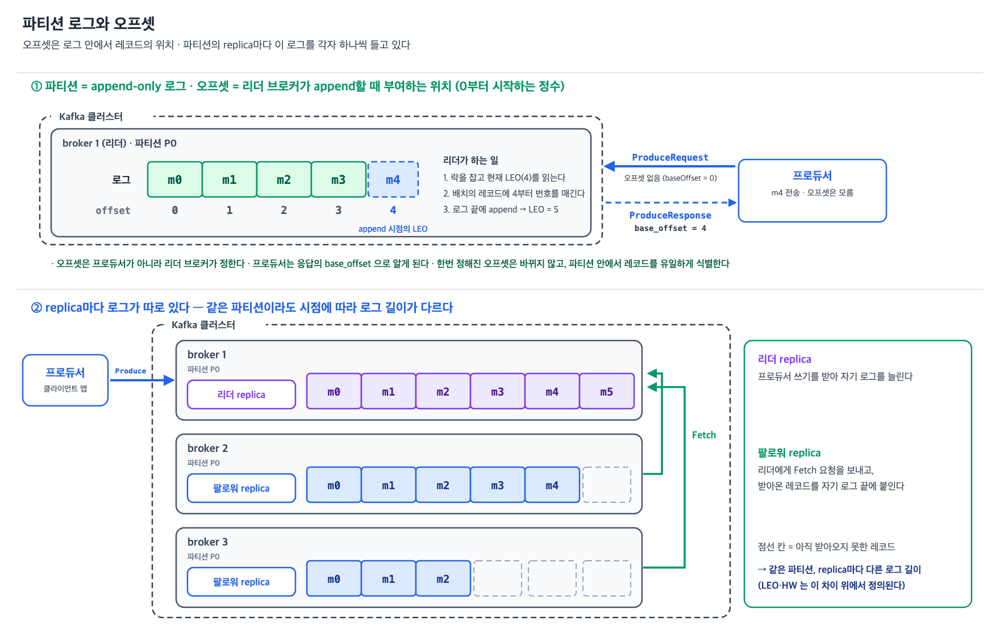
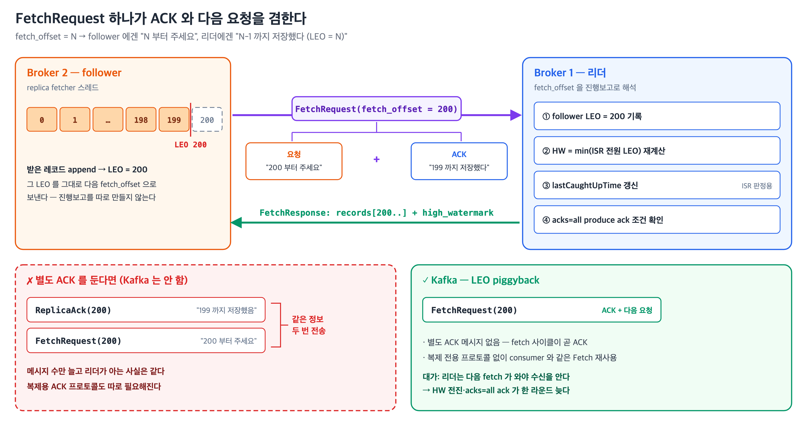
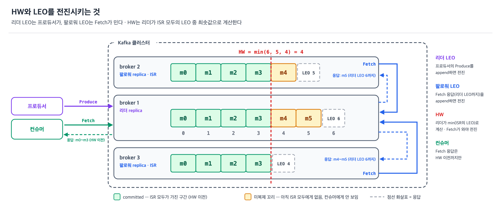
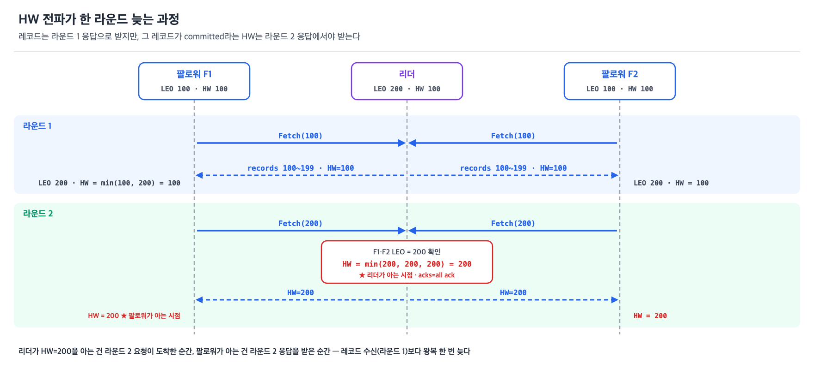
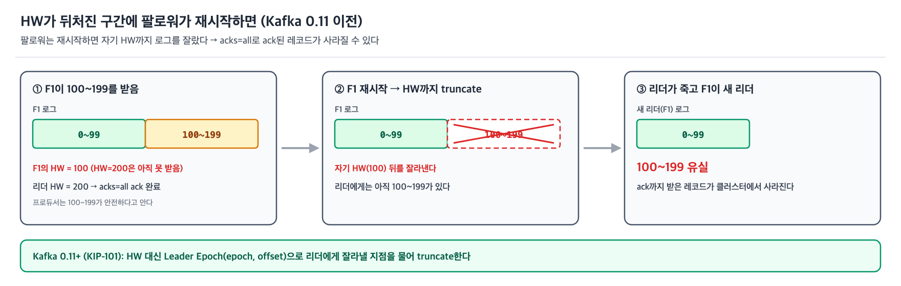
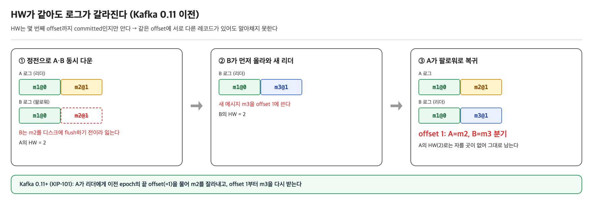

카프카를 쓰면서 만나는 "오프셋"은 하나가 아니다. 컨슈머 그룹이 "여기까지 처리했다"고 커밋하는 오프셋이 있고, 브로커가 파티션 로그 자체의 상태를 나타내려고 매기는 오프셋이 따로 있다. <br> 커밋된 오프셋도 브로커(`__consumer_offsets`)에 저장되지만, 값을 정하는 쪽은 컨슈머다. <br> ISR·복제·리더 선출을 다루면서 나오는 오프셋은 전부 후자 쪽이고, 이걸 모르면 "팔로워가 리더의 LEO까지 따라잡았는지" 같은 문장에서 막힌다.

이 글은 파티션 로그 위에 존재하는 네 개의 오프셋 — **log start offset, LSO, HW, LEO** — 이 각각 무엇이고 무엇이 그것을 전진시키는지 정리한다. <br>설정 기본값과 동작은 **Apache Kafka 4.2** 문서 기준이다.

## 파티션 로그와 오프셋

---

> 파티션은 append-only 로그이고, 오프셋은 그 **로그에서 레코드의 위치**를 가리키는 0부터 시작하는 정수다.



- 프로듀서는 `ProduceRequest`로 레코드 배치를 파티션의 **리더 브로커**에 보낸다.
  - 배치의 오프셋 자리에는 0이 들어 있을 뿐, 실제 오프셋은 정해져 있지 않다.
- 리더가 레코드를 로그 끝에 append하면서 **자기 LEO부터 번호를 매기고**, 그 번호가 오프셋이 된다.
  - 프로듀서는 `ProduceResponse`의 `base_offset`을 받고 나서야 오프셋을 안다.
- 한번 정해지면 바뀌지 않고, 파티션 안에서 레코드를 유일하게 식별한다.
- 여기서 중요한 건 **파티션의 복제본(replica)마다 이 로그를 각자 하나씩 들고 있다는 점**이다.
  - 리더 replica는 프로듀서 쓰기를 받아 로그를 늘리고, 팔로워 replica는 리더에게 fetch 요청을 보내 받아온 레코드를 자기 로그에 붙인다.
  - 그래서 같은 파티션이라도 시점에 따라 replica들의 로그 길이가 다르다.

## 왜 "로그"인가

---

> 여기서 로그는 애플리케이션 로그(텍스트 로그)가 아니라 **DB·분산 시스템에서 쓰는 자료구조로서의 로그**다.

**로그 = 시간순으로 append만 하는 레코드 시퀀스**
- 끝에만 추가하고, 이미 쓴 항목은 고치지 않는다.
- 항목마다 순번이 붙고, 그 순번이 곧 시간 순서다. → 카프카의 오프셋
- 같은 개념을 WAL(write-ahead log), commit log, transaction log라고도 부른다.

**카프카 = DB 내부의 로그 개념을 메시징 시스템으로 꺼낸 것**
- 초기 문서는 카프카를 "분산·파티션·복제되는 commit log 서비스"라고 소개했다.

**"파티션" 로그인 이유: 로그의 단위가 토픽이 아니라 파티션이다**
- 오프셋도, 순서 보장도, 복제도 파티션 로그 하나 단위로 성립한다.

Jay Kreps(카프카 공동 개발자)의 정의는 다음과 같다.

> 로그는 아마 가장 단순한 저장 추상화일 것이다. 시간순으로 정렬된, append만 가능한, 전순서(totally-ordered)가 있는 레코드 시퀀스다. (…) 각 항목에는 고유한 순차 번호가 부여된다.
>
> — Jay Kreps, *The Log: What every software engineer should know about real-time data's unifying abstraction* (2013)

애플리케이션 로그와의 차이도 같은 글에 있다.

> 애플리케이션 로그는 내가 말하는 로그 개념의 퇴화한 형태다. 가장 큰 차이는 텍스트 로그는 주로 사람이 읽기 위한 것이고, 내가 말하는 "저널"이나 "데이터 로그"는 프로그램이 접근하도록 만든 것이라는 점이다.

카프카 0.8 문서(2014)는 파티션을 이렇게 설명했다.

> 각 파티션은 계속 append되는, 순서가 있는 불변의 메시지 시퀀스, 즉 commit log다. 파티션의 메시지에는 각각 오프셋이라는 순차 id 번호가 부여된다.

## LEO (Log End Offset)

---

> LEO는 **각 replica가 자기 로그에 다음으로 쓸 오프셋**이다. <br> **마지막 레코드의 오프셋 + 1**이고, 로그가 비어 있으면 log start offset과 같다.

**LEO는 replica마다 값이 다르다.**
- 리더가 오프셋 0~199(200개)를 받았는데 느린 팔로워는 아직 0~99(100개)만 받았다면, 리더 LEO는 200이고 그 팔로워의 LEO는 100이다.
- 이 차이가 복제 lag다(컨슈머 lag인 `HW - committed offset`과는 다른 값이다).


### 빈 로그라고 오프셋이 0인 건 아니다

- 새로 만든 파티션만 log start offset = LEO = 0이다.
- 레코드가 retention으로 전부 지워지면 log start offset이 LEO까지 따라와 둘이 같아진다. 오프셋은 재사용하지 않는다.

```
0~99를 쓴 뒤 전부 삭제:  [0, 100) → [100, 100)   ← 비었지만 LEO = 100, 다음 레코드는 100
```

### 리더는 팔로워의 LEO를 어떻게 아는가

> 팔로워가 별도로 보고하지 않는다. <br>
> 팔로워가 보내는 `FetchRequest`의 `fetch_offset` 필드가 곧 그 팔로워의 LEO다.

이 방식을 **LEO piggyback**이라 부른다.
- piggyback은 별도 메시지를 보내지 않고 *어차피 보내는* 메시지에 정보를 얹어 보내는 것이다.
- 팔로워는 LEO를 별도 ACK로 보내지 않고, 다음 `FetchRequest`의 `fetch_offset`에 실어 보낸다.
  - `fetch_offset = N`은 팔로워 입장에선 *"N부터 달라"*는 요청이고, 리더 입장에선 **"N-1까지는 이미 다 받았다"** 는 진행보고다.
  - 그래서 fetch 요청 하나가 **직전 데이터의 ACK와 다음 데이터 요청**을 겸한다.



- 리더는 `HW = min(ISR 전원 LEO)`를 계산해야 하므로 각 팔로워의 LEO를 알아야 하고, 그 값을 이 `fetch_offset`에서 얻는다.
- 컨슈머도 같은 `FetchRequest`의 `fetch_offset`을 보내지만, `replica_id=-1`(컨슈머) 요청이면 리더는 이 값을 LEO로 쓰지 않는다.
- LEO 추적과 HW 재계산은 팔로워(`replica_id ≥ 0`) 요청일 때만 한다.

이 설계 때문에 HW가 한 라운드 늦게 움직이고, 쓰기가 없어도 ISR이 유지된다.

| 결과 | 내용 |
|---|---|
| HW가 구조적으로 한 라운드 늦음 | 리더는 팔로워의 수신 여부를 직접 확인하지 못하고 **다음 요청의 `fetch_offset`으로 추론**한다. 마지막 배치의 확인은 항상 다음 요청에 실려 온다. 그래서 `acks=all`의 ack도 "팔로워가 받은 순간"이 아니라 "팔로워가 다음 fetch를 보낸 순간"에 나간다 (→ [§팔로워는 HW를 한 라운드 늦게 안다](#팔로워는-hw를-한-라운드-늦게-안다)) |
| 쓰기가 없어도 LEO 보고가 끊기지 않음 | 쓸 데이터가 없어도 fetch는 long polling이라 `replica.fetch.wait.max.ms`(500ms)마다 빈 응답이 가고 다음 요청이 올라온다. 그때마다 `lastCaughtUpTime`이 갱신돼 ISR이 유지된다 (→ [ISR 글 §Fetch 요청 주기](/posts/kafka-isr-1/#fetch-요청-주기-long-polling)) |

> 위 그림의 `fetch_offset=200`은 **정상 사이클** 예시이고 최초 요청이 아니다. 최초 요청의 `fetch_offset`은 truncation 후의 LEO(신규 replica면 0)다 → [ISR 글 부록 B §최초 fetch 시점](/posts/kafka-isr-1/#부록-b--최초-fetch-시점).

## HW (High Watermark)

---

> HW는 **ISR에 속한 모든 replica가 복제를 마친 지점**이다. `HW = min(리더 LEO, ISR 팔로워들의 LEO)`로 계산되고, **컨슈머가 읽을 수 있는 경계**가 된다.



- 오프셋이 HW보다 작은 레코드는 ISR 모두의 로그에 들어가 있다.
- 그래서 리더가 죽어도 ISR의 다른 replica가 새 리더가 되어 그 레코드를 계속 내준다.
- ISR 중 하나만 살아 있으면 유실되지 않는다는 뜻이다.
- 이 상태를 카프카는 **committed**라고 부르고, 컨슈머에게는 committed된 레코드만 보여준다.
- 반면 팔로워의 fetch 요청(`replica_id ≥ 0`)에는 리더 LEO까지 다 준다
  - 팔로워가 그 꼬리를 가져가야 HW가 전진하기 때문이다.
  - 같은 Fetch API인데 요청자에 따라 응답 상한이 다르다.

## 팔로워는 HW를 한 라운드 늦게 안다

---

> 리더는 HW가 오른 순간 바로 알지만, 팔로워는 **Fetch 왕복 한 번(한 라운드) 뒤에야** 안다.

### 라운드 = Fetch 왕복 1회

한 라운드는 팔로워가 `FetchRequest`를 보내고 리더가 `FetchResponse`를 돌려주는 **왕복 1회**다. 이 왕복 하나에 두 방향의 정보가 실린다.

| 방향 | 실리는 값 | 받는 쪽이 하는 일 |
|---|---|---|
| 팔로워 → 리더 (`FetchRequest`) | `fetch_offset` = 팔로워 LEO | 리더가 팔로워 LEO를 기록하고 HW를 다시 계산 |
| 리더 → 팔로워 (`FetchResponse`) | `records` + `high_watermark` | 팔로워가 레코드를 append하고 `자기 HW = min(응답의 리더 HW, 자기 LEO)`로 갱신 |


### 한 라운드 늦는 과정



- 라운드 1 응답이 나갈 때 팔로워는 아직 레코드를 받기 전이라, 실을 수 있는 HW는 100뿐이다.
- 팔로워가 받았다는 사실은 라운드 2 요청의 `fetch_offset`으로 도착하고, 새 HW는 라운드 2 응답에 실린다.
- 리더가 HW 변화를 따로 알리는 경로가 없어서(pull 모델) 왕복 하나가 밀린다.

### 얼마나 늦고, 무엇이 문제인가

- **시간**: 대략 브로커 간 RTT 한 번, 보통 밀리초 단위다. HW가 밀려 있다는 건 리더에 아직 복제되지 않은 데이터가 있다는 뜻이라 `replica.fetch.min.bytes`(기본 1)가 바로 충족되고, 응답은 long polling 대기(`replica.fetch.wait.max.ms`, 기본 500ms) 없이 즉시 나간다.
- **문제**: 늦는 시간이 아니라, 이 구간에 재시작한 팔로워가 뒤처진 HW로 로그를 자른다(truncation)는 점이다.
  - ack가 너무 일찍 나가서 생기는 문제는 아니다. `acks=all`의 ack는 레코드가 ISR 모두의 로그에 들어간 뒤에 나간다. 아래 그림에서 100~199가 ack될 때 F1도 그 레코드를 갖고 있었다.
  - 잘못은 재시작한 F1이 늦게 받은 자기 HW(100)를 믿고, 갖고 있던 100~199를 버린 데 있다.
- **해결 방법**: KIP-101(Kafka Improvement Proposal, 카프카의 설계 변경 제안 문서. 이 문제를 다룬 것이 101번이고 0.11.0(2017년)에 반영됐다)이 검토한 방법은 두 가지다.
  - **리더 HW를 늦게 올린다** — 팔로워들이 자기 HW를 올린 뒤에야 리더도 HW를 올린다. 그러면 팔로워 HW가 리더 HW보다 뒤처지는 구간이 없어져 HW 기준으로 잘라도 안전하다. 대신 `acks=all`의 ack는 리더 HW가 그 레코드를 넘어설 때 나가므로, 모든 쓰기의 ack가 Fetch 왕복 한 번만큼 늦어진다. KIP-101은 "RPC 지연이 한 라운드 더 붙어 바람직하지 않다"며 이 방법을 택하지 않았다.
  - **잘라낼 지점을 리더에게 묻는다** — HW 전파와 ack 시점은 그대로 두고, 재시작한 팔로워가 어디부터 자를지를 리더에게 묻는다. 카프카가 택한 방법이고, 이것이 Leader Epoch이다(→ [아래 §Leader Epoch으로 분기점을 리더에게 묻는다](#leader-epoch으로-분기점을-리더에게-묻는다)).



> KIP-101: *"팔로워는 high watermark를 갱신하는 데 RPC 한 라운드가 더 든다. 이 틈 때문에 리더가 빠르게 바뀌면 데이터가 유실될 수 있다."*

HW 기준 truncation은 반대 방향으로도 틀린다. 위 그림은 너무 많이 잘라 유실이 나는 경우이고, 아래는 잘라야 할 꼬리를 알아보지 못해 로그가 갈라지는(분기) 경우다. 카프카는 로그를 디스크에 비동기로 flush하므로, 정전처럼 모든 replica가 한꺼번에 죽으면 replica마다 잃는 레코드 수가 다를 수 있다.



HW는 "몇 번째 offset까지 committed인가"만 담고, "그 offset의 레코드가 리더와 같은 레코드인가"는 담지 않는다. 그래서 이 분기는 HW로 감지할 수 없다.

> Kafka 4.x에서 ELR(Eligible Leader Replicas, KIP-966)을 활성화하면 여기에 조건이 하나 붙는다. ISR 크기가 `min.insync.replicas` 이상일 때만 HW가 전진한다. 이렇게 해야 "HW까지의 데이터는 최소 그만큼의 replica에 있다"가 보장된다. Kafka 4.0은 기본 비활성, 4.1부터 신규 클러스터 기본 활성이다.

## Leader Epoch으로 분기점을 리더에게 묻는다

---

> Kafka 0.11부터는 truncation 지점을 HW 대신 `(epoch, offset)` 쌍으로 정한다.


위 그림은 Kafka 4.1.0 브로커 3대(KRaft)로 RF=3 토픽을 만들고, 리더를 두 번 내려 가며 각 브로커의 파티션 디렉터리에 있는 `leader-epoch-checkpoint`와 `kafka-dump-log.sh` 출력을 확인한 결과다.

<details markdown="1">
<summary>실측 출력</summary>

```
## 리더 B2(epoch 0)에서 3건 produce
  B1 checkpoint: 0|1|0 0|
  B2 checkpoint: 0|1|0 0|
  B3 checkpoint: 0|1|0 0|
## B2 중지 → B3 리더 (아직 produce 전)
  B1 checkpoint: 0|1|0 0|          ← 팔로워는 아직 epoch 1 batch를 받지 않음
  B3 checkpoint: 0|2|0 0|1 3|      ← 새 리더는 선출 즉시 기록
## 3건 produce
  B1 checkpoint: 0|2|0 0|1 3|
  B3 checkpoint: 0|2|0 0|1 3|
## B2 재기동 → B3 중지 → B2 리더 → 3건 produce
  B1 checkpoint: 0|3|0 0|1 3|2 6|
  B2 checkpoint: 0|3|0 0|1 3|2 6|

$ kafka-dump-log.sh --files .../ep2-0/00000000000000000000.log
  offset 0~2 (count 3) partitionLeaderEpoch=0
  offset 3~5 (count 3) partitionLeaderEpoch=1
  offset 6~8 (count 3) partitionLeaderEpoch=2
```

checkpoint는 파일의 줄바꿈을 `|`로 바꿔 한 줄로 찍은 것이다.

</details>

| 구성 요소 | 내용 |
|---|---|
| Leader Epoch | 리더가 바뀔 때마다 +1되는 번호. 모든 record batch에 기록된다 |
| `leader-epoch-checkpoint` | replica마다 `epoch → 그 epoch의 시작 offset`을 디스크에 저장한 파일. 현재 리더도 과거 epoch 기록을 갖고 있어 옛 리더가 죽어도 답할 수 있다 |
| `OffsetsForLeaderEpoch` | 재시작한 팔로워가 자기 마지막 epoch을 보내 그 epoch의 끝 offset을 현재 리더에게 묻는 요청 |

리더는 질의한 epoch이 자기 현재 epoch이면 LEO를, 지난 epoch이면 다음 epoch의 시작 offset을 돌려준다. 팔로워는 HW가 아니라 그 offset부터 자른다.


이 truncation은 팔로워가 첫 fetch를 보내기 전에 일어나고(→ [ISR 글 부록 B §최초 fetch 시점](/posts/kafka-isr-1/#부록-b--최초-fetch-시점)), 0.11부터 기본 동작이라 따로 켤 설정은 없다. rolling restart처럼 리더 교체가 연달아 일어나도 위 유실은 생기지 않는다. 다만 ISR 축소와 unclean election을 피하려면 브로커를 재시작한 뒤 `UnderReplicatedPartitions`가 0으로 돌아온 걸 확인하고 다음 브로커를 내린다.

### 팔로워가 min을 취해야 하는 이유

리더 HW는 `min(ISR 멤버들의 LEO)`이므로, ISR에 정상적으로 붙어 있는 팔로워라면 응답의 HW가 자기 LEO를 넘을 일이 없다. 위 그림에서도 min은 늘 응답 HW를 고른다. min이 실제로 값을 바꾸는 건 그 전제가 깨질 때다.

- **ISR 밖의 팔로워** — HW 계산에 들어가는 건 ISR 멤버뿐이다. `replica.lag.time.max.ms`를 넘겨 ISR에서 빠진 팔로워, 재시작 후 따라잡는 중인 replica, 파티션 재할당으로 log start offset부터 받기 시작한 replica는 전부 계산에서 빠져 있으므로 리더 HW가 이들의 LEO보다 한참 앞서 있다.
- **한 번의 fetch로 꼬리를 다 못 받는 경우** — 응답 크기는 `replica.fetch.max.bytes`(기본 1MB) 등으로 잘린다. 응답에 HW=200이 실려 와도 records는 `[100..150)`까지만 오고, append 후 자기 LEO는 150에 머문다.
- **로그를 잘라낸 직후** — 리더 교체 후 Leader Epoch 기준으로 자기 로그 꼬리를 truncate하면 LEO가 뒤로 내려간다.

이때 응답 HW를 그대로 받아 쓰면 자기 로그에 없는 오프셋이 committed로 표시된다. 그 replica가 리더로 승격되거나 `client.rack` 기반 follower fetch(KIP-392)로 컨슈머에게 응답하는 순간, 갖고 있지 않은 구간을 읽을 수 있다고 알려주는 셈이 된다.

실제 구현(`UnifiedLog#maybeUpdateHighWatermark`, Kafka 4.1)은 min 하나가 아니라 양쪽으로 자른다.

```
새 HW = max(log start offset, min(응답 HW, 자기 LEO))
```

`log start offset ≤ HW ≤ LEO`라는 불변식을 팔로워 쪽에서도 강제하는 것이고, 위쪽 경계가 곧 min이다.

## LSO (Last Stable Offset)

---

> LSO는 **트랜잭션이 확정된 경계**다. 진행 중인 트랜잭션이 없으면 HW와 같고, 있으면 그중 가장 이른 트랜잭션의 첫 오프셋에서 멈춘다.

트랜잭션 프로듀서가 쓴 레코드는 로그에 먼저 들어가고, commit 여부는 나중에 control marker로 기록된다. 그래서 로그에는 "복제는 끝났지만 commit인지 abort인지 아직 모르는" 구간이 생길 수 있다. 그 구간의 시작점이 LSO다.

`isolation.level=read_committed` 컨슈머는 LSO 미만까지만 읽는다. abort된 트랜잭션의 레코드를 보여주지 않기 위해서다. 기본값인 `read_uncommitted` 컨슈머는 HW까지 읽는다.

여기서 자주 나오는 오해가 하나 있다.

> `read_uncommitted`로 두면 리더 LEO까지 다 받는다 → **아니다.**

`isolation.level`이 조정하는 건 **트랜잭션 축**이지 **복제 축**이 아니다. 컨슈머 응답의 상한은 isolation level과 무관하게 **항상 HW**이고, `read_uncommitted`는 그 HW 안쪽에서 "commit 안 된 트랜잭션 레코드도 보여줘"라는 의미다. "복제 안 된 레코드도 보여줘"가 아니다.

| "committed"의 두 축 | 의미 | 경계 |
|---|---|---|
| 복제 관점 committed | ISR 전원에게 복제됨 (내구성) | **HW** |
| 트랜잭션 관점 committed | 프로듀서 트랜잭션이 commit됨 | **LSO** (≤ HW) |

HW와 LEO 사이의 미복제 꼬리는 어떤 컨슈머에게도 가지 않는다. 그 구간은 팔로워만 받아가고, 팔로워는 `isolation.level` 자체를 쓰지 않는다.

## 네 오프셋의 순서 관계

---

> 정상 상태에서 네 오프셋은 항상 `log start offset ≤ LSO ≤ HW ≤ LEO` 순서를 지킨다.

```
로그:  [ ...... 삭제됨 ...... ][ 확정 ][ 트랜잭션 미확정 ][ 미복제 꼬리 ]
                              ↑        ↑                  ↑              ↑
                    log start offset  LSO                HW            LEO

read_committed   컨슈머  →  LSO 까지
read_uncommitted 컨슈머  →  HW  까지
팔로워 replica          →  LEO 까지   (복제해야 HW가 전진하므로)
```

| 오프셋 | 무엇을 가리키나 | 무엇이 전진시키나 | 값이 replica마다 다른가 |
|---|---|---|---|
| log start offset | 남아 있는 가장 오래된 오프셋 | 보존 정책 만료, `DeleteRecords` | 대체로 같음 |
| LSO | 트랜잭션 확정 경계 | 트랜잭션 commit/abort marker 기록 | 리더가 계산 |
| HW | ISR 전원이 복제한 경계 (committed) | **팔로워의 fetch** | 리더가 계산해 전파 (한 라운드 지연) |
| LEO | 다음에 쓸 자리 | 리더는 **프로듀서 쓰기**, 팔로워는 **fetch 응답** | **다름** |

ISR 관련 설명에서 "팔로워가 리더의 LEO까지 따라잡았는가"를 따지는 이유가 이 표에 있다. 리더 LEO는 프로듀서가 계속 밀어 올리는 목표점이고, 팔로워 LEO는 그걸 쫓아가는 현재 위치다. 정해진 시간(`replica.lag.time.max.ms`, 기본 30초) 안에 한 번도 그 목표점에 닿지 못하면 그 팔로워는 ISR에서 빠진다.

## committed 메시지와 committed offset은 다른 것이다

---

> 이름이 같아서 섞이기 쉽지만, HW가 정하는 "committed 메시지"와 컨슈머가 커밋하는 "committed offset"은 영역도 주체도 다르다.

| | committed 메시지 (HW) | committed offset (컨슈머) |
|---|---|---|
| 영역 | 브로커 / 복제 | 컨슈머 / 진행 추적 |
| 의미 | ISR 전원에게 복제됨 → 내구성·가시성 확보 | 내가 여기까지 처리했다 |
| 값을 정하는 쪽 | 브로커 (리더가 ISR의 LEO로 계산) | 컨슈머 (브로커는 받은 값을 저장만 함) |
| 저장 | 메모리 + 로그 디렉터리의 `replication-offset-checkpoint` 파일에 주기적 체크포인트 | 그룹 코디네이터 브로커가 `__consumer_offsets` 토픽에 기록 |
| 전진 시점 | 팔로워 Fetch로 ISR의 LEO가 오를 때 | 컨슈머가 `commitSync()` / auto-commit 할 때 |
| 답하는 질문 | *데이터가 안전한가?* | *어디까지 읽었나?* |

HW 체크포인트는 `kafka.server.ReplicaManager#checkpointHighWatermarks`가 `replica.high.watermark.checkpoint.interval.ms`(기본 5000ms)마다 로그 디렉터리별로 쓴다(Kafka 4.2 기준). 브로커가 재시작하면 이 파일에서 HW를 읽어 복구한다.

여기에 컨슈머 쪽 오프셋이 하나 더 있다. **position**은 컨슈머가 다음에 fetch할 오프셋으로 메모리에만 있고, `poll()` 할 때마다 전진한다. committed offset은 그 position을 브로커에 기록해 둔 스냅샷이다. 둘이 벌어져 있는 동안 컨슈머가 죽으면 committed offset부터 다시 읽게 되고, 그 구간이 중복 처리된다.

컨슈머 오프셋 커밋의 흐름은 [카프카 프로듀서에서 컨슈머까지의 처리 흐름](/posts/kafka-producer-to-consumer-flow/)에서 다뤘다.

## 직접 확인하기

---

> CLI로 확인할 수 있는 건 log start offset과 HW까지다. 리더 LEO는 외부 클라이언트 API로 노출되지 않는다.

```bash
# latest offset — read_uncommitted 기준이므로 실제로는 HW
kafka-get-offsets.sh --bootstrap-server localhost:9092 --topic my-topic --time -1

# earliest offset — log start offset
kafka-get-offsets.sh --bootstrap-server localhost:9092 --topic my-topic --time -2
```

`--time -1`이 반환하는 값은 리더 LEO가 아니라 **HW**다. `KafkaConsumer.endOffsets()`도 마찬가지다 — `read_uncommitted`에서는 HW를, `read_committed`에서는 LSO를 돌려준다. 즉 일반 클라이언트에게 HW와 LEO 사이의 미복제 꼬리는 존재 자체가 보이지 않는다.

replica별 LEO를 보려면 각 브로커의 JMX 지표를 봐야 한다. 복제 지연 정도만 알면 되는 경우라면 `kafka-log-dirs.sh --describe` 출력의 replica별 `offsetLag`으로도 충분하다.

> 이 절의 명령은 동작 방식 설명이고, 실제 클러스터를 띄워 얻은 출력값은 아직 싣지 않았다. 값의 정확한 형태는 직접 실행해 확인하는 편이 좋다.

## 참고 자료

---

- [Jay Kreps — The Log: What every software engineer should know about real-time data's unifying abstraction (engineering.linkedin.com, 2013, Wayback 아카이브)](https://web.archive.org/web/20240105095933/https://engineering.linkedin.com/distributed-systems/log-what-every-software-engineer-should-know-about-real-time-datas-unifying) — 로그의 정의, 애플리케이션 로그와의 차이 (원본 URL은 현재 404)
- [Apache Kafka 0.8 Documentation: Introduction (kafka.apache.org/documentation, 2014, Wayback 아카이브)](https://web.archive.org/web/2014/http://kafka.apache.org/documentation.html) — "distributed, partitioned, replicated commit log service", 파티션 = commit log
- [Apache Kafka — Design: Replication (kafka.apache.org/42/design)](https://kafka.apache.org/42/design/design/#replication) — committed 메시지의 정의와 ISR
- [Apache Kafka — Design: Consumer Position (kafka.apache.org/42/design)](https://kafka.apache.org/42/design/design/#consumer-position) — 컨슈머가 오프셋을 관리하는 이유
- [KafkaConsumer javadoc — endOffsets (kafka.apache.org/42/javadoc)](https://kafka.apache.org/42/javadoc/org/apache/kafka/clients/consumer/KafkaConsumer.html) — isolation level에 따라 HW / LSO가 반환된다는 설명
- [Apache Kafka — A Guide To The Kafka Protocol: Fetch API (kafka.apache.org/protocol)](https://kafka.apache.org/protocol.html) — `fetch_offset`, `high_watermark`, `log_start_offset` 필드
- [Apache Kafka — A Guide To The Kafka Protocol: Produce API (kafka.apache.org/protocol)](https://kafka.apache.org/protocol.html#The_Messages_Produce) — `ProduceRequest`의 레코드 배치와 `ProduceResponse`의 `base_offset`
- [`UnifiedLog#append` · `appendAsLeader` · `appendAsFollower` (github.com/apache/kafka, 4.2)](https://github.com/apache/kafka/blob/4.2/storage/src/main/java/org/apache/kafka/storage/internals/log/UnifiedLog.java) — 리더 append 시 LEO부터 오프셋 부여, 팔로워는 부여하지 않음
- [`LogValidator#assignOffsetsNonCompressed` (github.com/apache/kafka, 4.2)](https://github.com/apache/kafka/blob/4.2/storage/src/main/java/org/apache/kafka/storage/internals/log/LogValidator.java) — 레코드마다 오프셋을 매기는 코드
- [`RecordAccumulator` (github.com/apache/kafka, 4.2)](https://github.com/apache/kafka/blob/4.2/clients/src/main/java/org/apache/kafka/clients/producer/internals/RecordAccumulator.java) — 프로듀서가 `baseOffset = 0`으로 배치를 만드는 코드
- [KIP-101: Reduce log complexity with Leader Epoch (cwiki.apache.org)](https://cwiki.apache.org/confluence/display/KAFKA/KIP-101+-+Alter+Replication+Protocol+to+use+Leader+Epoch+rather+than+High+Watermark+for+Truncation) — HW 전파 지연이 만드는 유실·분기 시나리오, `OffsetsForLeaderEpoch`, leader-epoch-checkpoint
- [KIP-392: Allow consumers to fetch from closest replica (cwiki.apache.org)](https://cwiki.apache.org/confluence/display/KAFKA/KIP-392%3A+Allow+consumers+to+fetch+from+closest+replica) — 팔로워가 컨슈머에게 응답할 때의 상한
- [`ReplicaManager#checkpointHighWatermarks` (github.com/apache/kafka, 4.2)](https://github.com/apache/kafka/blob/4.2/core/src/main/scala/kafka/server/ReplicaManager.scala) — HW를 `replication-offset-checkpoint` 파일에 주기적으로 기록
- [`UnifiedLog#maybeUpdateHighWatermark` (github.com/apache/kafka, 4.1)](https://github.com/apache/kafka/blob/4.1/storage/src/main/java/org/apache/kafka/storage/internals/log/UnifiedLog.java) — 팔로워 HW를 log start offset과 LEO 사이로 clamp하는 코드
- [KIP-966: Eligible Leader Replicas (cwiki.apache.org)](https://cwiki.apache.org/confluence/display/KAFKA/KIP-966:+Eligible+Leader+Replicas) — ISR 크기에 따른 HW 전진 조건
