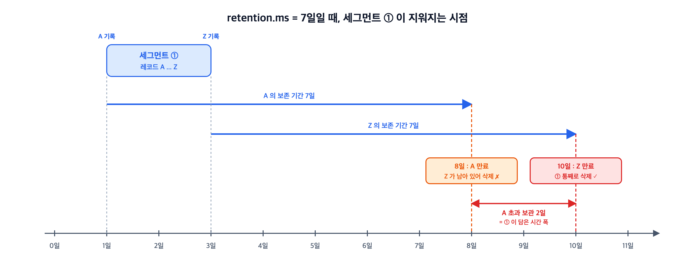

파티션 로그는 파일 하나가 아니라 세그먼트라는 파일 묶음 여러 개로 나뉘어 디스크에 놓인다. <br>
이 글은 세그먼트가 언제 새로 생기는지, retention이 세그먼트를 어떻게 지우는지, `.index`로 오프셋의 위치를 어떻게 찾는지를 정리한다. 파티션 디렉터리 구조 자체는 [Kafka - 토픽과 파티션](/posts/kafka-topic-partition/)에서 다뤘다.

본문의 명령 출력과 파일 목록은 모두 **Apache Kafka 4.3.1**(`apache/kafka:latest`, KRaft 단일 노드) 컨테이너를 띄워 직접 실행해 얻은 결과다.

## 세그먼트 — 파티션 로그를 쪼갠 파일 단위

---

> 파티션 로그는 논리적으로는 끝없이 append되는 하나의 로그지만, 물리적으로는 **일정 크기·기간마다 새 파일로 끊어서 저장**한다. 그 조각 하나가 세그먼트(segment)다.

> "Each log file is **named with the offset of the first message it contains.**"

- `segment.bytes`를 1MiB로 낮추고 1KB 레코드 4,000건(약 4MB)을 넣으면 파티션 디렉터리가 이렇게 된다.

```bash
$ kafka-producer-perf-test.sh --topic seg-demo --num-records 4000 --record-size 1024 ...
4000 records sent, 3633.060854 records/sec (3.55 MB/sec) ...

$ ls -la /tmp/kraft-combined-logs/seg-demo-0/
     528  00000000000000000000.index      ┐
 1044700  00000000000000000000.log        ├ 세그먼트 ①   offset 0 ~ 1027
     780  00000000000000000000.timeindex  ┘
     528  00000000000000001028.index      ┐
 1042252  00000000000000001028.log        │ 세그먼트 ②   offset 1028 ~ 2032
     608  00000000000000001028.snapshot   │
     756  00000000000000001028.timeindex  ┘
     528  00000000000000002033.index      ┐
 1042252  00000000000000002033.log        ├ 세그먼트 ③   offset 2033 ~ 3037
     ...                                  ┘
10485760  00000000000000003038.index      ┐
 1021531  00000000000000003038.log        ├ 세그먼트 ④   offset 3038 ~  (쓰는 중)
10485756  00000000000000003038.timeindex  ┘
```

- **세그먼트** : 같은 숫자를 이름으로 공유하는 `.log` / `.index` / `.timeindex` 묶음.
  - 그 숫자는 세그먼트의 첫 레코드 오프셋(base offset)이다.

- **파티션** : 세그먼트 여러 개.
  - 즉, `.log`는 파티션당 하나가 아니라 위처럼 세그먼트 수만큼 있고, **프로듀서가 보낸 레코드는 그중 마지막 세그먼트의 `.log`에만 붙는다.**
  - ①~③의 `.log`는 이미 닫혀서 읽기 전용이고, 새 레코드는 전부 ④로 간다.

- 활성 세그먼트(active segment) :지금 쓰기를 받고 있는 마지막 세그먼트
  - 롤링이 일어나면 새로 생긴 세그먼트가 그 자리를 넘겨받는다.
  - 파티션마다 항상 정확히 하나씩 있다.

- `ls` 출력만으로 어느 게 활성인지 구분된다.
  - 인덱스가 10MB면 활성, ①~③처럼 528바이트로 잘려 있으면 닫힌 세그먼트다.
  - 인덱스 파일은 미리 10MB(`log.index.size.max.bytes`)로 할당해 두고 세그먼트가 닫힐 때 실제 크기로 잘라내기 때문이다.

## 세그먼트가 넘어가는 조건

---

> 새 세그먼트로 넘어가는(rolling) 조건은 두 가지다.
> 둘 중 먼저 걸리는 쪽이 적용된다.

| 설정 | 기본값 | 롤링 조건 |
| --- | --- | --- |
| `segment.bytes` | 1GiB | 활성 세그먼트의 `.log`에 다음 배치를 붙이면 이 크기를 넘을 때 |
| `segment.ms` | 7일 | 활성 세그먼트가 만들어진 지 이 시간이 지나면 |

- `segment.bytes`는 `.log` 파일 하나의 크기만 본다.
  - `.index`·`.timeindex`는 합산하지 않는다.
- 브로커는 프로듀서가 묶어 보낸 레코드 배치(record batch)를 쪼개지 않고 통째로 붙이므로, 다음 배치가 남은 공간에 안 들어가면 그 배치를 붙이기 전에 새 세그먼트로 넘어간다.
  - 그래서 위 1MiB 실험의 세그먼트 ①도 1,048,576바이트보다 작은 1,044,700바이트에서 닫혔다.

> `segment.ms=10000`으로 두면 크기와 무관하게 시간만으로 닫힌다.

```bash
$ ls -la /tmp/kraft-combined-logs/segms-0/
       0  00000000000000000000.index
     147  00000000000000000000.log      ← 147바이트인데 이미 닫혔다
      12  00000000000000000000.timeindex
10485760  00000000000000000002.index
      74  00000000000000000002.log      ← 활성 세그먼트
10485756  00000000000000000002.timeindex
```

`segment.bytes`의 최솟값은 4.3 기준 1MiB다. 더 작게 넣으면 거부된다.

```
InvalidConfigurationException: Invalid value 300 for configuration segment.bytes:
Value must be at least 1048576
```

## 세그먼트로 쪼개는 이유는 삭제 때문이다

---

> "Deleting is done one log segment at a time."

retention이 만료돼도 카프카는 레코드를 하나씩 지우지 않는다. **세그먼트 파일을 통째로 지운다.** 레코드 단위로 지우려면 `.log` 파일 안의 바이트를 들어내고 파일을 다시 써야 하지만, 파일째 지우면 남은 파일은 한 바이트도 바뀌지 않는다. 삭제 비용도 파일 unlink 한 번으로 끝난다. 즉 세그먼트는 **retention이 작동하는 최소 단위**다.

retention은 세그먼트 단위로만 걸리므로, 레코드 하나가 `retention.ms`를 넘었다고 바로 사라지지는 않는다. 세그먼트 안의 **가장 마지막 레코드**까지 보존 기간을 넘겨야 그 세그먼트 전체가 삭제 대상이 된다. 그래서 세그먼트에서 가장 오래된 레코드는 `retention.ms`에 그 세그먼트가 담고 있는 시간 폭만큼 더 남는다. 트래픽이 적고 `segment.bytes`가 1GiB면 세그먼트 하나가 며칠 치를 담으므로, 그 며칠이 그대로 초과 보관 기간이 된다.



`retention.ms=10000`(10초)을 걸고 실제로 관찰한 순서는 이렇다. 세그먼트 4개(약 4MB)가 쌓인 토픽에 더 이상 produce하지 않고 40초를 기다렸다.

```bash
# ① 만료 판정 직후 — 파일명에 .deleted 가 붙는다
    1042252  00000000000000000000.log.deleted
    1042252  00000000000000001005.log.deleted
    1042252  00000000000000002010.log.deleted
    1021531  00000000000000003015.log.deleted   ← 활성 세그먼트였던 것
          0  00000000000000004000.log           ← 새로 만들어진 빈 활성 세그먼트

# ② file.delete.delay.ms(기본 60초) 뒤 — 물리적으로 사라진다
          0  00000000000000004000.log
         56  00000000000000004000.snapshot
   10485756  00000000000000004000.timeindex
```

두 가지가 드러난다.

- **활성 세그먼트도 결국 삭제된다.** 다만 바로 지우는 게 아니라, 빈 세그먼트(`...4000`)를 새로 롤링해 활성 자리를 넘긴 뒤 원래 것을 삭제한다. 쓰기 대상이 없는 순간이 생기지 않게 하려는 순서다.
- **삭제는 2단계다.** 먼저 `.deleted`로 이름만 바꿔 로그에서 떼어 내고, `file.delete.delay.ms`(기본 60초) 뒤에 실제로 파일을 지운다. 그 사이에 진행 중이던 읽기가 파일을 붙잡고 있어도 안전하다.

삭제 후 오프셋을 보면 이렇다.

```bash
$ kafka-get-offsets.sh --bootstrap-server localhost:9092 --topic seg --time -2   # earliest
seg:0:4000
$ kafka-get-offsets.sh --bootstrap-server localhost:9092 --topic seg --time -1   # latest
seg:0:4000
```

레코드는 전부 사라졌지만 오프셋은 0으로 돌아가지 않고 4000에서 이어진다. 삭제된 오프셋 번호는 재사용되지 않는다.

## 인덱스 — 오프셋으로 파일 안의 위치를 찾는다

---

> 세그먼트마다 붙어 있는 `.index`는 오프셋을 `.log` 파일 안의 바이트 위치로 바꿔 주는 표다.

### `.index` — 오프셋을 파일 안의 위치로 바꾸는 표

컨슈머는 "오프셋 3,500번부터 달라"고 요청한다. 브로커는 이걸 **파일 읽기**로 바꿔야 하는데, 파일에서 데이터를 읽으려면 "몇 번째 바이트부터"를 알아야 한다. 이 파일 안에서의 바이트 위치가 **byte position**이다.

레코드는 길이가 제각각이라 `오프셋 × 레코드 크기`로 계산할 수 없다. 그래서 **오프셋 → byte position** 대응표를 따로 파일로 들고 있고, 그게 `.index`다.

```bash
$ kafka-dump-log.sh --files .../seg-demo-0/00000000000000000000.index
offset: 52   position: 18004
offset: 67   position: 33560
offset: 82   position: 49116
offset: 97   position: 64672
offset: 112  position: 80228
```

두 번째 줄은 "오프셋 67번 레코드는 이 세그먼트 `.log` 파일의 33,560번째 바이트부터 시작한다"는 뜻이다. 이 값이 있으면 브로커는 파일을 처음부터 훑지 않고 곧장 그 위치로 `seek`할 수 있다.

### 희소(sparse) 인덱스 — 전부 적지 않는다

위 출력에서 오프셋이 52, 67, 82, 97로 **15씩 건너뛴다.** 0~51번, 53~66번 레코드의 위치는 표에 아예 없다. 이렇게 **일부 레코드에 대해서만 엔트리를 두는 인덱스를 희소(sparse) 인덱스**라고 한다. 반대로 모든 레코드에 엔트리가 있으면 조밀(dense) 인덱스다.

그러면 표에 없는 오프셋 60번은 어떻게 찾는가.

```
① .index 에서 60 이하의 가장 큰 엔트리를 이진 탐색   →  offset 52, position 18004
② .log 파일의 18004 바이트로 seek
③ 거기서부터 레코드를 순차로 읽으며 60번이 나올 때까지 전진
```

정확한 위치는 인덱스가 알려주지 않는다. **"이 근처"까지만 점프시켜 주고 나머지는 스캔**한다. 공식 문서의 설명도 같은 순서다.

> "locating the log segment file in which the data is stored, calculating the file-specific offset from the global offset value, and then reading from that file offset"

엔트리 간격은 `index.interval.bytes`(기본 4096)로 정해진다. 로그에 4KB를 쓸 때마다 엔트리를 하나 추가하되, 레코드 배치 경계에서만 기록하므로 배치가 크면 위처럼 간격이 더 벌어진다. 그래서 스캔 구간은 대체로 수 KB 수준이다.

### 왜 조밀하게 만들지 않는가

인덱스 엔트리는 **8바이트**다 (relative offset 4바이트 + position 4바이트). 파일 크기로 확인된다.

| 파일 | 크기 | ÷ 8 | ÷ 12 |
| --- | --- | --- | --- |
| `.index` (닫힘) | 528 | **66** | 44 |
| `.index` (활성, 미리 할당) | 10485760 | **1310720** | 873813.33 |
| `.timeindex` (닫힘) | 780 | 97.5 | **65** |
| `.timeindex` (활성) | 10485756 | 1310719.5 | **873813** |

활성 `.index`(10485760)는 8로 떨어지지만 12로는 안 떨어지고, 닫힌 `.timeindex`(780)는 12로 떨어지지만 8로는 안 떨어진다. 두 파일의 엔트리 크기가 다르다는 뜻이다 — `.timeindex` 엔트리는 timestamp 8바이트 + relative offset 4바이트 = 12바이트다. 활성 `.timeindex`가 10MB가 아니라 10485756인 것도 10MB 이하 12의 배수 중 최댓값이라서다.

파일명이 base offset인 이유도 여기 있다. 엔트리에 절대 오프셋 대신 **base offset으로부터의 상대 오프셋**을 저장하면 4바이트로 충분해진다. 세그먼트 이름이 곧 기준점 역할을 한다.

1,044,700바이트짜리 세그먼트의 인덱스가 528바이트, 즉 엔트리 66개다. 레코드 1,028건에 엔트리 66개니까 대략 **1/16 수준**만 적어 둔 셈이다. 모든 레코드에 엔트리를 달면 인덱스가 8KB를 넘는다.

인덱스 파일은 mmap으로 메모리에 올라가므로 엔트리 수가 곧 페이지 캐시 압박이 된다. 파티션이 수천 개면 이 차이가 그대로 브로커 메모리 사용량이 된다. 어차피 순차 읽기는 빠르니 대략의 위치만 잡고 나머지를 스캔하는 쪽이 이득이다.

## 정리

---

> 세그먼트는 파티션 로그를 나눈 파일 단위이고, 롤링·삭제·인덱스가 전부 세그먼트 단위로 돈다.

- 세그먼트는 같은 base offset을 이름으로 공유하는 `.log` / `.index` / `.timeindex` 묶음이고, 쓰기는 마지막(활성) 세그먼트에만 일어난다.
- `segment.bytes`(`.log` 크기)나 `segment.ms`(경과 시간) 중 먼저 걸리는 쪽에서 새 세그먼트로 넘어간다.
- retention은 세그먼트를 통째로 지우므로, 세그먼트 안의 마지막 레코드까지 만료돼야 삭제된다. 삭제는 `.deleted` 이름 변경 후 `file.delete.delay.ms` 뒤 실제 삭제의 2단계다.
- `.index`는 4KB 간격의 희소 인덱스라, 근처까지 점프한 뒤 순차로 스캔한다.

## 참고 자료

---

- [Apache Kafka — Implementation: Log (kafka.apache.org/43/implementation)](https://kafka.apache.org/43/implementation/log/) — 세그먼트 파일명, 읽기·삭제 동작
- [Apache Kafka — Topic Configs (kafka.apache.org/43/configuration)](https://kafka.apache.org/43/configuration/topic-configs/) — `segment.bytes`, `segment.ms`, `retention.ms`, `file.delete.delay.ms`, `index.interval.bytes` 기본값
