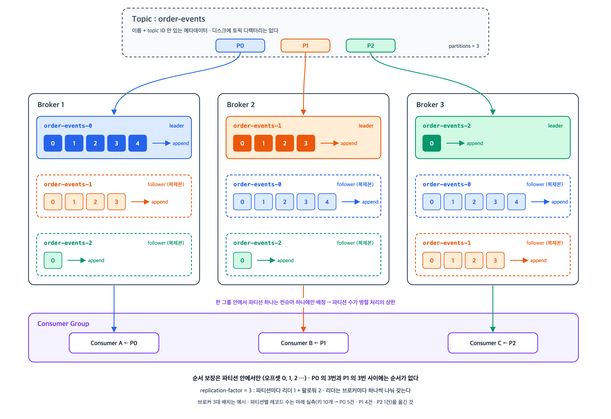
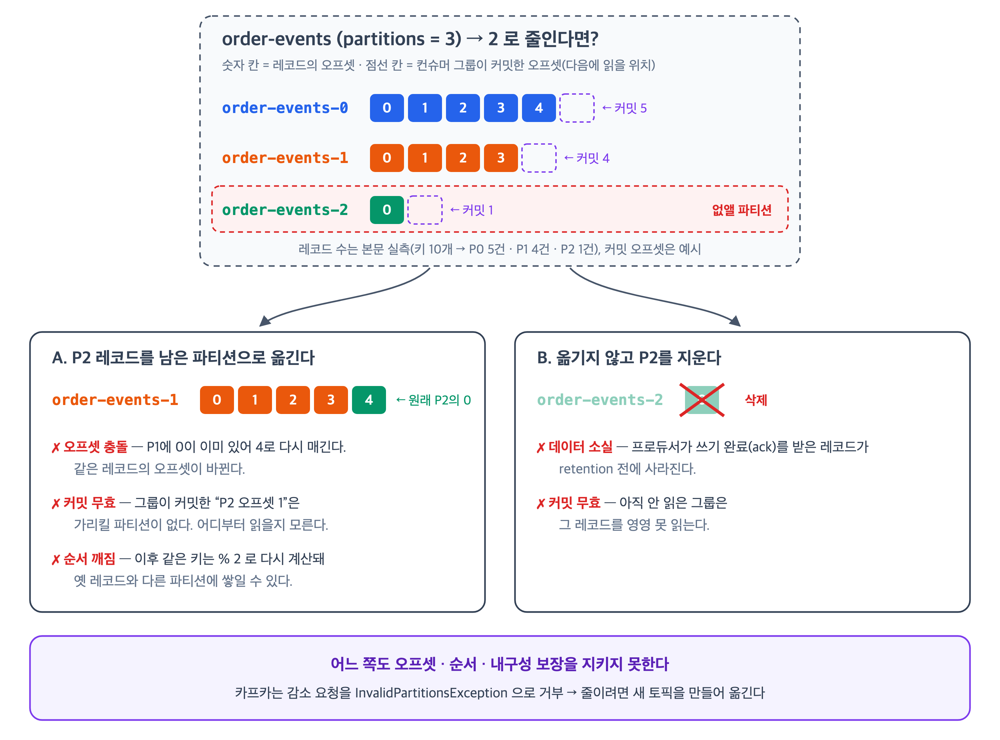
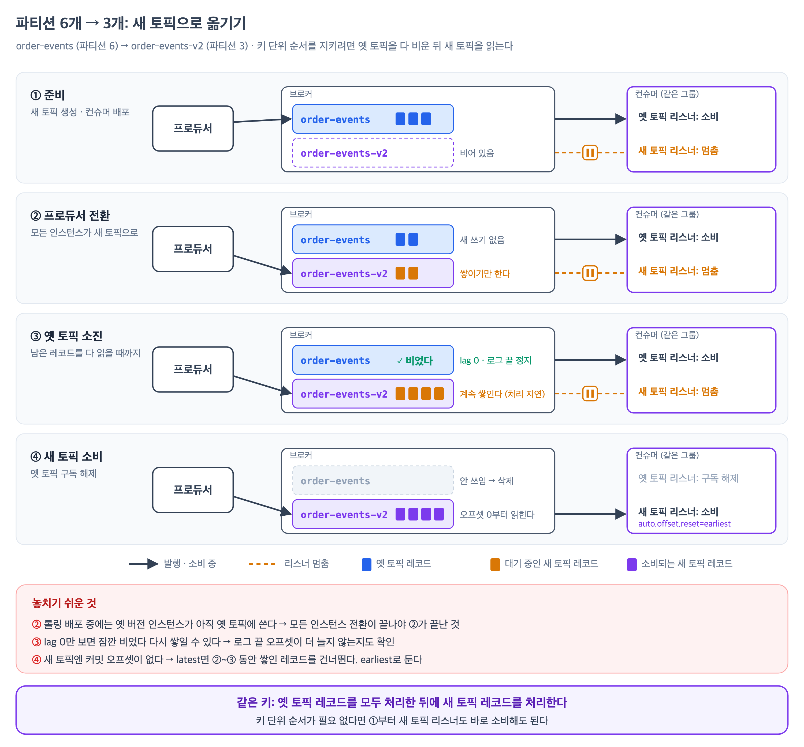
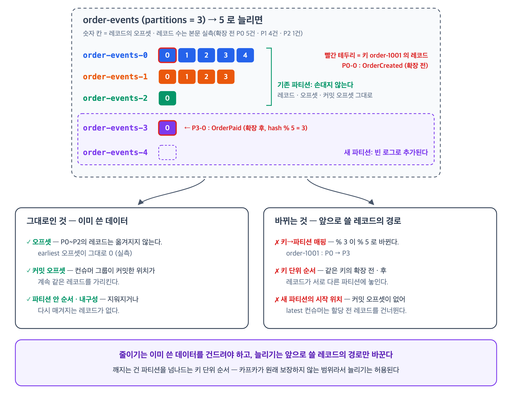
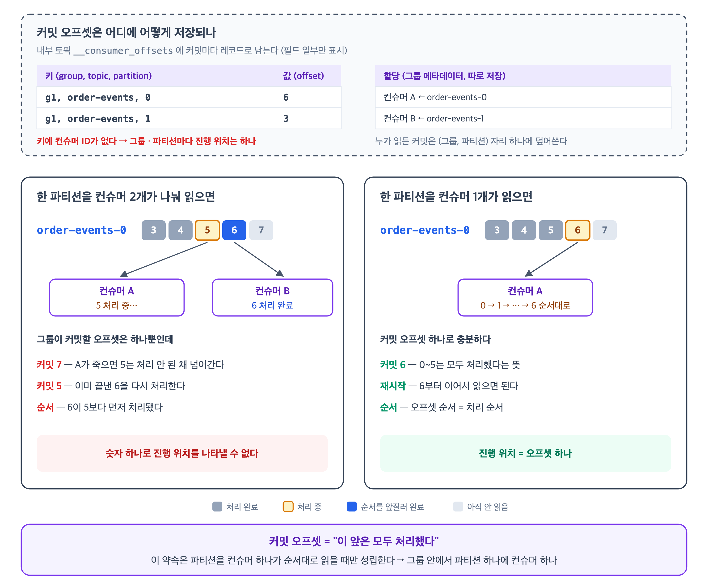

토픽과 파티션은 카프카에서 보통 가장 먼저 접하는 개념이지만, "토픽은 폴더고 파티션은 그 안의 파일"이라는 비유 수준에서 멈추기 쉽다. <br>
실제 디스크를 열어 보면 그 비유는 맞지 않고, 그 차이를 모르면 "파티션은 왜 줄일 수 없는가", "파티션을 늘렸더니 왜 순서가 깨지는가" 같은 질문에서 막힌다.

이 글은 토픽과 파티션의 정의부터 디스크에 실제로 어떻게 놓이는지, 그리고 운영에서 걸리는 지점들을 정리한다. <br>
본문의 명령 출력과 파일 목록은 모두 **Apache Kafka 4.3.1**(`apache/kafka:latest`, KRaft 단일 노드) 컨테이너를 띄워 직접 실행해 얻은 결과다.

## 정의

---

> 토픽은 이벤트를 분류하는 **이름**이고, 파티션은 그 토픽을 **실제로 나눠 담는** 단위다.

공식 문서는 토픽을 이렇게 설명한다.

> 이벤트는 토픽 단위로 정리되어 영속적으로 저장된다. 아주 단순화하면, 토픽은 파일 시스템의 폴더와 비슷하고 이벤트는 그 폴더 안의 파일이다.

"아주 단순화하면"이라는 단서가 붙어 있다. 실제 구현은 폴더 구조가 아니고, 그 얘기는 아래 [실제로 디스크에 어떻게 저장되나](#실제로-디스크에-어떻게-저장되나) 절에서 다룬다.

파티션은 다음과 같이 정의된다.

> 토픽은 파티션으로 나뉜다. 즉 토픽 하나가 서로 다른 카프카 브로커에 놓인 여러 개의 '버킷'에 나뉘어 퍼져 있다.

- **토픽 하나가 여러 브로커에 흩어진 파티션 N개로 쪼개진다.**
- 이 구조에서 나오는 성질이 카프카의 거의 모든 동작을 결정한다.



| | 토픽 | 파티션 |
| --- | --- | --- |
| 역할 | 이벤트의 **분류** | 이벤트의 **저장·분산 단위** |
| 실체 | 메타데이터상의 이름 + ID | append-only 로그 (디스크의 파일들) |
| 순서 보장 | **없음** | **있음** (오프셋 순) |
| 복제 단위 | 아님 | **맞음** (leader 1 + follower N) |
| 병렬 처리 단위 | 아님 | **맞음** (컨슈머 그룹 내 분배) |
| 개수 변경 | 생성/삭제 | 증가만 가능, **감소 불가** |

> 카프카는 특정 토픽-파티션의 컨슈머가 **그 파티션의 이벤트를 쓰인 순서와 정확히 같은 순서로** 읽는 것을 보장한다.

- 순서 보장은 **topic-partition** 단위라고 명시돼 있다.
- 토픽 전체의 순서를 보장하지 않는다.

### replication factor는 복제본을 할당할 브로커 수다

`--replication-factor`는 파티션 하나의 복제본을 몇 개의 브로커에 둘지 정하고, 리더도 이 수에 포함된다. 3이면 리더 1 + 팔로워 2다. 위 그림처럼 브로커 3대에 replication factor 3이면 모든 브로커가 모든 파티션을 갖고, 리더만 브로커마다 나뉜다.

이 값은 **할당**이다. 할당된 수만큼 최신 데이터가 복제되는 건 정상 상황에서의 얘기다. 브로커 3대(Kafka 4.3.1, KRaft)에 replication factor 3, `min.insync.replicas=2`인 토픽을 만들고 브로커 2를 내리면 이렇게 된다.

```bash
Partition: 0	Leader: 3	Replicas: 2,3,1	Isr: 3,1    ← 내리기 전: Leader 2, Isr 2,3,1
```

- `Replicas`(할당)는 그대로 3개이고, `Isr`(리더를 따라잡고 있는 복제본)만 2개로 준다. 빠진 복제본을 다른 브로커에 새로 만들지 않는다.
- 브로커가 돌아오면 따라잡은 뒤 ISR에 복귀하고, 리더도 몇 분 뒤 원래 브로커(`Replicas`의 첫 번째)로 돌아간다.
- 토픽 생성 시 replication factor는 살아 있는 브로커가 아니라 **등록된** 브로커 수와 비교한다. 브로커 하나가 내려가 있어도 replication factor 3 토픽은 만들어진다.

운영 중에 "최소 몇 벌"을 강제하는 건 replication factor가 아니라 `min.insync.replicas`다.

| 설정 | 정하는 것 | 강제되는 시점 |
| --- | --- | --- |
| replication factor | 복제본을 몇 개의 브로커에 **할당**할지 (`Replicas`) | 토픽 생성·재할당 때 |
| `min.insync.replicas` | `acks=all` 쓰기가 성공하려면 최소 몇 개가 **in-sync**여야 하는지 (`Isr`) | 매 쓰기마다 |

위 상태에서 브로커를 하나 더 내려 ISR이 1이 되면 `acks=all` 쓰기는 `NotEnoughReplicasException`으로 거부된다. 브로커 3대에 replication factor 3 + `min.insync.replicas=2`가 흔한 조합인 이유가 이것이다. 한 대가 죽어도 쓰기가 멈추지 않고, 데이터는 항상 2벌 이상 남는다.

## 실제로 디스크에 어떻게 저장되나

---

> 파티션 3개짜리 토픽(order-events)을 만들고 브로커의 로그 디렉터리를 열어 보면 이렇다.

`log.dirs`는 브로커가 파티션 데이터를 저장할 디렉터리를 지정하는 설정이다. 여기서 "log"는 애플리케이션 로그가 아니라 파티션 로그(레코드가 append되는 파일)를 뜻한다. 쉼표로 여러 디렉터리를 지정할 수 있고, `apache/kafka` 이미지의 기본 설정(`config/server.properties`)은 `log.dirs=/tmp/kraft-combined-logs`다. 아래 `ls` 대상이 바로 이 디렉터리다.

```bash
$ kafka-topics.sh --bootstrap-server localhost:9092 \
    --create --topic order-events --partitions 3 --replication-factor 1
Created topic order-events.

$ ls /tmp/kraft-combined-logs/
.lock
__cluster_metadata-0/
bootstrap.checkpoint
cleaner-offset-checkpoint
log-start-offset-checkpoint
meta.properties
order-events-0/          ← 파티션 0 디렉터리
order-events-1/          ← 파티션 1 디렉터리
order-events-2/          ← 파티션 2 디렉터리
recovery-point-offset-checkpoint
replication-offset-checkpoint
```

- `log.dirs`(`/tmp/kraft-combined-logs`) 아래에 토픽 디렉터리는 없다.
- `<토픽명>-<파티션번호>` 디렉터리가 파티션 개수만큼 평평하게 놓인다.
- `order-events/` 라는 디렉터리는 없다.
  - 즉, 토픽 이름은 파티션 디렉터리 이름의 **접두어로만** 존재한다.

> 파티션 디렉터리 이름은 토픽 이름 뒤에 대시(-)와 파티션 ID를 붙인 형태다.

## 파티션 디렉터리 살펴보기

---

> 파티션 디렉터리 하나를 열면 다음과 같다.

```bash
$ ls -la /tmp/kraft-combined-logs/order-events-0/
-rw-r--r-- 10485760  00000000000000000000.index
-rw-r--r--        0  00000000000000000000.log
-rw-r--r-- 10485756  00000000000000000000.timeindex
-rw-r--r--        8  leader-epoch-checkpoint
-rw-r--r--       43  partition.metadata
```

| 파일 | 역할 |
| --- | --- |
| `.index` | 오프셋 → 파일 내 byte position 매핑 (희소 인덱스) |
| `.log` | 실제 레코드가 append되는 세그먼트 파일 |
| `.timeindex` | 타임스탬프 → 오프셋 매핑 (`offsetsForTimes`, 시간 기반 retention에 사용) |
| `.snapshot` | producer id 상태 스냅샷 (멱등/트랜잭션 프로듀서 복구용) |
| `leader-epoch-checkpoint` | leader epoch → 시작 오프셋. 로그 truncation 판단에 사용 |
| `partition.metadata` | 이 파티션이 속한 `topic_id` |

`.log` 파일이 0바이트인데 `.index`는 10MB다. 활성 세그먼트의 인덱스 파일은 `log.index.size.max.bytes`(기본 10MB)만큼 미리 할당되고, 세그먼트가 닫힐 때 실제 크기로 잘린다.

- `order-1001` ~ `order-10010` 키로 메시지 10건을 넣으면 `.log`에 데이터가 들어간다.
- 파티션이 3개이므로 키 해시에 따라 셋으로 갈라지고, **아래는 그중 파티션 0의 `.log` 하나만 덤프한 것**이다.

```bash
$ kafka-dump-log.sh --files .../order-events-0/00000000000000000000.log --print-data-log
Log starting offset: 0
baseOffset: 0 lastOffset: 4 count: 5 ... isTransactional: false isControl: false
  position: 0 CreateTime: 1787577612696 size: 336 magic: 2 compresscodec: none crc: 871884934
| offset: 0 CreateTime: 1787577612677 keySize: 10 valueSize: 38 sequence: 0 headerKeys: []
    key: order-1001 payload: {"orderId":"order-1001","amount":1000}
| offset: 1 ... key: order-1002 payload: {"orderId":"order-1002","amount":2000}
| offset: 2 ... key: order-1004 payload: {"orderId":"order-1004","amount":4000}
| offset: 3 ... key: order-1005 payload: {"orderId":"order-1005","amount":5000}
| offset: 4 ... key: order-1007 payload: {"orderId":"order-1007","amount":7000}
```

- 파티션 0에 5건이 들어갔다.
  - 나머지는 파티션 1에 4건(`order-1003`, `1006`, `1008`, `10010`), 파티션 2에 1건(`order-1009`)으로 갈렸다.
- 저장 형태를 보면 레코드가 하나씩 쌓이는 게 아니라 **레코드 배치(record batch)** 단위로 묶여 있다.
- 위 출력에서 `baseOffset: 0 lastOffset: 4 count: 5`가 배치 하나이고, 그 안에 개별 레코드 5건이 들어 있다.
- 압축·CRC·트랜잭션 여부는 전부 배치 헤더에 달린다.

## 세그먼트 — 파티션 로그를 쪼갠 파일 단위

---

> 파티션 로그는 논리적으로는 끝없이 append되는 하나의 로그지만, 물리적으로는 **일정 크기·기간마다 새 파일로 끊어서 저장**한다. 그 조각 하나가 세그먼트(segment)다.

- `segment.bytes`를 1MiB로 낮추고 1KB 레코드 4,000건(약 4MB)을 넣으면 파티션 디렉터리가 이렇게 된다.

```bash
$ kafka-producer-perf-test.sh --topic seg-demo --num-records 4000 --record-size 1024 ...
4000 records sent, 3633.060854 records/sec (3.55 MB/sec) ...

$ ls -la /tmp/kraft-combined-logs/seg-demo-0/
     528  00000000000000000000.index      ┐
 1044700  00000000000000000000.log        ├ 세그먼트 ①   offset 0 ~ 1027
     780  00000000000000000000.timeindex  ┘
     528  00000000000000001028.index      ┐
 1042252  00000000000000001028.log        │ 세그먼트 ②   offset 1028 ~ 2032
     608  00000000000000001028.snapshot   │
     756  00000000000000001028.timeindex  ┘
     528  00000000000000002033.index      ┐
 1042252  00000000000000002033.log        ├ 세그먼트 ③   offset 2033 ~ 3037
     ...                                  ┘
10485760  00000000000000003038.index      ┐
 1021531  00000000000000003038.log        ├ 세그먼트 ④   offset 3038 ~  (쓰는 중)
10485756  00000000000000003038.timeindex  ┘
```

- **세그먼트** : 같은 숫자를 이름으로 공유하는 `.log` / `.index` / `.timeindex` 묶음.
  - 그 숫자는 세그먼트의 첫 레코드 오프셋(base offset)이다.

- **파티션** : 세그먼트 여러 개.
  - 즉, `.log`는 파티션당 하나가 아니라 위처럼 세그먼트 수만큼 있고, **프로듀서가 보낸 레코드는 그중 마지막 세그먼트의 `.log`에만 붙는다.**
  - ①~③의 `.log`는 이미 닫혀서 읽기 전용이고, 새 레코드는 전부 ④로 간다.

- 활성 세그먼트(active segment) :지금 쓰기를 받고 있는 마지막 세그먼트
  - 롤링이 일어나면 새로 생긴 세그먼트가 그 자리를 넘겨받는다.
  - 파티션마다 항상 정확히 하나씩 있다.

- `ls` 출력만으로 어느 게 활성인지 구분된다.
  - 인덱스가 10MB면 활성, ①~③처럼 528바이트로 잘려 있으면 닫힌 세그먼트다.
  - 인덱스 파일은 미리 10MB(`log.index.size.max.bytes`)로 할당해 두고 세그먼트가 닫힐 때 실제 크기로 잘라내기 때문이다.

세그먼트가 언제 새로 생기는지, retention이 세그먼트를 어떻게 지우는지, `.index`로 오프셋의 위치를 어떻게 찾는지는 [Kafka - 세그먼트 (롤링, 삭제, 인덱스)](/posts/kafka-segment/)에서 다룬다.

## 토픽은 어디에 있는가

---

> 토픽의 실체는 디스크의 데이터가 아니라 **KRaft 메타데이터 로그의 레코드**다.

`__cluster_metadata-0`을 디코딩해 보면 토픽과 파티션이 별도 레코드로 남아 있다.

```bash
$ kafka-dump-log.sh --cluster-metadata-decoder --files .../__cluster_metadata-0/00000000000000000000.log

{"type":"TOPIC_RECORD","version":0,
 "data":{"name":"order-events","topicId":"arvK229bSmSz_lBQJbIuhg"}}

{"type":"PARTITION_RECORD","version":2,
 "data":{"partitionId":0,"topicId":"O9tTOuh6TLaWS7nww1ejbg",
         "replicas":[1],"isr":[1],"removingReplicas":[],"addingReplicas":[],
         "leader":1,"leaderEpoch":0,"partitionEpoch":0,
         "directories":["g0NiE87GanF13iNX2t0zCQ"]}}
```

`TOPIC_RECORD`가 들고 있는 건 이름과 ID뿐이다. 어느 브로커에 있는지, 누가 리더인지, 어느 디스크에 놓였는지는 전부 `PARTITION_RECORD` 쪽에 있다.

> 토픽은 파티션들을 묶는 **이름표**이고, 데이터와 배치 정보는 전부 파티션에 달려 있다.

앞의 "토픽은 폴더"라는 비유를 정정하면 이렇게 된다.

| | 흔한 비유 | 실제 |
| --- | --- | --- |
| 토픽 | 폴더 | 메타데이터 레코드 (이름 + `topic_id`) |
| 파티션 | 폴더 안의 로그 파일 | **디렉터리** (`<topic>-<id>`) |
| 세그먼트 | — | 그 디렉터리 안의 `.log` / `.index` / `.timeindex` 파일 묶음 |

## 레코드는 어느 파티션으로 가는가

---

> 파티션 선택은 브로커가 아니라 프로듀서가 한다. <br>
> 키가 있으면 **키 해시**, 없으면 **배치 단위**로 한 파티션에 몰아 보낸다.

- 프로듀서가 보내는 레코드(`org.apache.kafka.clients.producer.ProducerRecord`)는 토픽과 값(value) 외에 키(key)와 파티션 번호를 선택적으로 담는다.
- 키는 필수가 아니어서 `new ProducerRecord<>("order-events", value)`처럼 값만으로도 발행된다. 이때 키는 `null`이다.

```java
new ProducerRecord<>(topic, value);                 // 키 없음 (key = null)
new ProducerRecord<>(topic, key, value);            // 키 지정
new ProducerRecord<>(topic, partition, key, value); // 파티션 직접 지정
```

> `org.apache.kafka.clients.producer.KafkaProducer#partition`은 레코드마다 다음 순서로 파티션을 고른다.

| 순서 | 조건 | 결정 방식 |
| --- | --- | --- |
| 1 | 레코드에 파티션 번호를 직접 넣었다 | 그 번호를 그대로 쓴다 |
| 2 | `partitioner.class` 설정으로 커스텀 파티셔너를 등록했다 | 그 파티셔너가 정한다 |
| 3 | 키가 있다 (`partitioner.ignore.keys=false`, 기본값) | 키 해시로 정한다 |
| 4 | 키가 없다 | sticky 방식으로 정한다 |

- `partitioner.class`는 파티션 결정 로직을 직접 구현한 클래스(`org.apache.kafka.clients.producer.Partitioner` 인터페이스 구현체)를 지정하는 프로듀서 설정이다.
- 기본값은 비어 있고, 대부분은 지정하지 않으므로 실제로는 3·4번 규칙이 쓰인다.

### 키가 있으면: 키 해시

> 3번 규칙은 카프카 클라이언트 내부 클래스 `org.apache.kafka.clients.producer.internals.BuiltInPartitioner`의 `partitionForKey` 메서드가 처리한다.

```java
// org.apache.kafka.clients.producer.internals.BuiltInPartitioner
public static int partitionForKey(final byte[] serializedKey, final int numPartitions) {
    return Utils.toPositive(Utils.murmur2(serializedKey)) % numPartitions;
}
```

`murmur2` (`org.apache.kafka.common.utils.Utils#murmur2`)
- 직렬화된 키 바이트를 32비트 정수로 바꾸는 해시 함수다. 암호용이 아니라 빠르고 값이 고르게 퍼지는 것이 목적인 비암호 해시다.
- **같은 키 바이트면 항상 같은 값이 나온다.**

`toPositive` (`org.apache.kafka.common.utils.Utils#toPositive`)
- 해시값의 부호 비트를 지워(`& 0x7fffffff`) 음수가 나오지 않게 한다.

`% numPartitions`
- 그 값을 토픽의 파티션 수로 나눈 나머지가 파티션 번호다.

같은 키는 항상 같은 파티션으로 가므로, 한 주문의 이벤트들이 한 파티션에 순서대로 쌓인다.
- 대신 **파티션 수(`numPartitions`)가 식에 직접 들어가 있어서 파티션 수가 바뀌면 같은 키라도 다른 파티션으로 간다.**
- 이 결과는 아래 [파티션을 늘리면 키의 순서 보장이 깨진다](#파티션을-늘리면-키의-순서-보장이-깨진다)에서 실측한다.

키를 `order-1001` ~ `order-10010`으로 주고 파티션 3개짜리 토픽에 넣으면 이렇게 흩어진다.

```
Partition:0  order-1001, order-1002, order-1004, order-1005, order-1007
Partition:1  order-1003, order-1006, order-1008, order-10010
Partition:2  order-1009
```

- 해시 분포는 키가 많아질수록 고르게 수렴하지만, 키 종류가 적거나 특정 키에 트래픽이 몰리면 파티션 간 불균형이 그대로 남는다.

### 키가 없으면: sticky

> 키가 없으면 라운드로빈이 아니라 **sticky** 방식이다. <br>
> `batch.size`가 찰 때까지 한 파티션에 몰아 보내고 그 다음에 파티션을 바꾼다. <br>
> 요청 수를 줄여 처리량을 높이려는 설계이고, 관련 설정이 두 개 있다.

| 설정 | 기본값 | 의미 |
| --- | --- | --- |
| `partitioner.ignore.keys` | `false` | `true`면 키가 있어도 무시하고 sticky로 분배 |
| `partitioner.adaptive.partitioning.enable` | `true` | 빠른 브로커의 파티션으로 더 많이 보냄 |

- `partitioner.ignore.keys=true`로 두면 **키 기반 순서 보장이 사라진다.**
- 키를 로그 압축(`cleanup.policy=compact`)의 식별자로만 쓰고 순서는 신경 쓰지 않는 경우에만 쓸 수 있다.

## 반드시 알아야 할 파티션 규칙

---

> 파티션은 늘릴 수만 있고, 늘리는 순간 키→파티션 매핑이 바뀐다. 그리고 컨슈머 병렬성의 상한은 파티션 수다.

### 파티션은 줄일 수 없다

파티션 3개짜리 `order-events` 토픽의 파티션 수를 `kafka-topics.sh --alter`로 2개로 바꾸려 하면 브로커가 거부한다.

```bash
$ kafka-topics.sh --bootstrap-server localhost:9092 --alter --topic order-events --partitions 2
Error while executing topic command : The topic order-events currently has 3 partition(s);
2 would not be an increase.
ERROR org.apache.kafka.common.errors.InvalidPartitionsException:
  The topic order-events currently has 3 partition(s); 2 would not be an increase.
```

공식 문서도 명시한다.

> 카프카는 현재 토픽의 파티션 수를 줄이는 기능을 지원하지 않는다.

앞의 [토픽은 어디에 있는가](#토픽은-어디에-있는가)에서 본 것처럼 파티션 하나는 KRaft 메타데이터 로그의 `PARTITION_RECORD` 하나로 정의된다. 파티션을 늘릴 때도 `PARTITION_RECORD`가 추가될 뿐이므로, 메타데이터만 보면 줄일 때는 그 레코드를 지우기만 하면 될 것처럼 보인다.

문제는 그 파티션에 이미 쌓인 데이터다. 파티션에는 오프셋이 매겨진 레코드가 있고, 컨슈머 그룹은 "이 파티션의 몇 번 오프셋까지 읽었다"를 커밋해 둔다. 이 데이터를 처리하는 방법은 두 가지뿐이고, 둘 다 카프카가 보장하는 성질을 깬다.



- **옮긴다**: 남은 파티션에는 같은 오프셋이 이미 있으므로 오프셋을 다시 매겨야 한다. 컨슈머 그룹이 커밋한 오프셋은 가리킬 곳을 잃고, 키→파티션 매핑(`% numPartitions`)도 바뀌어 같은 키의 순서가 끊긴다.
- **지운다**: 프로듀서가 쓰기 완료를 받은 레코드가 retention 기간 전에 사라진다.

#### 그래도 줄여야 한다면

파티션을 줄이고 싶어지는 경우는 대개 이렇다.

- 트래픽을 과하게 예상해 파티션을 많이 잡았고, [파티션이 많을 때의 비용](#파티션이-많을-때의-비용)(파일 핸들, 리더 선출 시간, 프로듀서 메모리)만 남았다.
- 키 종류보다 파티션이 많아 빈 파티션이 생긴다.
- 서비스 규모가 줄어 컨슈머 수를 줄였더니 컨슈머 하나가 너무 많은 파티션을 맡는다.

토픽의 파티션 수는 줄일 수 없으므로 **원하는 파티션 수로 새 토픽을 만들고 트래픽을 옮긴다.** 키 단위 순서가 중요하다면 같은 키의 옛 토픽 레코드를 새 토픽 레코드보다 먼저 처리해야 한다. 그래서 옛 토픽을 다 비운 뒤에 새 토픽 소비를 시작한다.



- **②는 모든 프로듀서 인스턴스가 전환해야 끝난다.** 롤링 배포 중에는 옛 버전 인스턴스가 아직 옛 토픽에 쓰고 있다. lag 0만 보면 잠깐 비었다가 다시 쌓일 수 있으므로, 옛 토픽의 로그 끝 오프셋(`kafka-get-offsets.sh --time -1`)이 더 이상 늘지 않는 것까지 확인한다.
- **새 토픽 컨슈머는 `auto.offset.reset=earliest`로 둔다.** 그룹이 새 토픽에 커밋한 오프셋이 없는 상태에서 시작하므로, `latest`면 ②~③ 동안 쌓인 레코드를 [건너뛴다](#새-파티션의-레코드를-컨슈머가-건너뛸-수-있다).
- **③ 동안에는 새 레코드 처리가 지연된다.** 옛 토픽을 비울 때까지 새 토픽 레코드는 기다린다. 옛 토픽의 lag이 작을 때 전환할수록 지연이 짧다.
- **키 단위 순서가 필요 없다면** ①부터 새 토픽 소비를 바로 시작해도 된다. 두 토픽을 동시에 소비하는 구간에서 같은 키의 레코드가 섞여 처리될 뿐이다.
- 멈춰 둔 리스너는 스프링 카프카라면 `@KafkaListener(autoStartup = "false")`로 등록해 두고, ③ 확인 후 `org.springframework.kafka.config.KafkaListenerEndpointRegistry`로 시작할 수 있다. 새 토픽 컨슈머를 ③ 이후에 따로 배포해도 결과는 같다.

이 절차는 옛 토픽에 쌓인 과거 레코드를 새 토픽으로 복사하지 않는다. 과거 레코드를 새 토픽에서 다시 읽어야 한다면(예: 상태 복구용 compact 토픽) 별도 복사 작업(MirrorMaker 2, 재발행 배치 등)이 필요하다.

### 파티션을 늘리면 키의 순서 보장이 깨진다

파티셔닝 식이 `hash(key) % numPartitions`이므로 `numPartitions`가 바뀌면 결과가 바뀐다.

> 데이터가 `hash(key) % number_of_partitions`로 파티셔닝된다면, 파티션 수가 늘어날 때 기본 파티셔너의 매핑 로직이 바뀐다.

파티션을 3 → 5로 늘린 뒤 **같은 키들을 다시 발행**해 봤다.

| 키 | 확장 전 | 확장 후 | |
| --- | --- | --- | --- |
| `order-1001` | 0 | **3** | 이동 |
| `order-1002` | 0 | 0 | 유지 |
| `order-1003` | 1 | **3** | 이동 |
| `order-1004` | 0 | **1** | 이동 |
| `order-1005` | 0 | **4** | 이동 |
| `order-1006` | 1 | **2** | 이동 |
| `order-1007` | 0 | 0 | 유지 |
| `order-1008` | 1 | **3** | 이동 |
| `order-1009` | 2 | **3** | 이동 |

9개 중 7개가 다른 파티션으로 갔다. `order-1001` 키는 확장 전에 쓴 레코드가 파티션 0에, 확장 후에 쓴 레코드가 파티션 3에 남는다.

이 주문의 `OrderCreated`가 확장 전에, `OrderPaid`가 확장 후에 발행됐다면 두 이벤트는 서로 다른 파티션에 흩어진다. **파티션이 다르면 카프카는 두 레코드의 상대 순서를 보장하지 않는다.**

기존 데이터가 재배치되지도 않는다.

```bash
$ kafka-get-offsets.sh --bootstrap-server localhost:9092 --topic order-events --time -2  # earliest
order-events:0:0   order-events:1:0   order-events:2:0   order-events:3:0   order-events:4:0

$ kafka-get-offsets.sh --bootstrap-server localhost:9092 --topic order-events --time -1  # latest
order-events:0:7   order-events:1:5   order-events:2:2   order-events:3:4   order-events:4:1
```

파티션 0~2의 earliest 오프셋이 그대로 0이다. 확장 전에 쌓인 레코드가 새 파티션으로 빠져나간 흔적이 없다는 뜻이다. 파티션 3·4에 들어 있는 4건과 1건은 전부 확장 후에 발행한 레코드다.

메타데이터도 마찬가지다. 기존 `TOPIC_RECORD`는 그대로 두고 `PARTITION_RECORD`만 3, 4번이 추가된다.

늘리기도 키의 순서를 깨는데 허용되는 이유가 여기 있다. 줄이기는 이미 쓴 레코드를 옮기거나 지워야 하지만, 늘리기는 빈 파티션을 붙이고 **앞으로 쓸 레코드의 경로만** 바꾼다. 기존 파티션의 오프셋, 커밋된 오프셋, 파티션 안 순서는 하나도 바뀌지 않는다. 끊기는 건 서로 다른 파티션에 걸친 같은 키의 순서이고, 이건 카프카가 처음부터 보장하지 않는 범위다. 키 단위 순서는 프로듀서의 `hash(key) % numPartitions` 매핑에서 따라 나오는 성질일 뿐이다.



#### 새 파티션의 레코드를 컨슈머가 건너뛸 수 있다

`auto.offset.reset`은 컨슈머 그룹에 그 파티션의 **커밋된 오프셋이 없을 때** 어디서부터 읽을지 정한다. `latest`면 그 시점의 로그 끝부터, `earliest`면 맨 처음부터다. 새로 생긴 파티션은 커밋 기록이 없으므로 처음 할당될 때 이 설정을 따른다.

문제는 프로듀서와 컨슈머가 새 파티션을 알아채는 시점이 다르다는 것이다. 둘 다 `metadata.max.age.ms`(기본 5분)마다 메타데이터를 따로 갱신하므로, 프로듀서가 먼저 새 파티션에 쓰기 시작하면 컨슈머가 할당받기 전까지 레코드가 쌓인다. `latest` 컨슈머는 할당 시점의 로그 끝부터 읽으므로 그 사이 레코드를 건너뛴다.

```
t0  파티션 3 → 5 확장
t1  프로듀서가 새 파티션 3·4에 쓰기 시작
    ... 레코드 쌓임 (그룹의 커밋 오프셋 없음) ...
t2  컨슈머가 메타데이터 갱신 → 리밸런스 → 파티션 3·4 할당
    → latest: t2 시점의 로그 끝부터 읽음 → t1 ~ t2 레코드는 건너뜀
```

Kafka 4.3.1에서 `latest` 그룹과 `earliest` 그룹을 붙여 둔 채 파티션을 3 → 5로 늘리고 곧바로 새 파티션에 5건을 발행했더니, 컨슈머가 새 파티션을 할당받기까지 약 4분이 걸렸다. 그동안 쌓인 5건을 `earliest` 그룹은 모두 받았고, `latest` 그룹은 하나도 받지 못했다.

이 누락은 lag으로도 드러나지 않는다. 할당 시점에 읽을 위치가 로그 끝으로 잡히므로, 건너뛴 레코드는 처음부터 lag에 들어가지 않는다. `latest` 그룹의 새 파티션 LAG는 0으로 나온다.

- 건너뛴 레코드는 삭제된 게 아니다. retention 기간 안이면 `kafka-consumer-groups.sh --reset-offsets`로 오프셋을 되돌려 다시 읽을 수 있다.
- `earliest`면 누락은 없다. 대신 이 설정은 커밋 기록이 없는 모든 경우에 적용되므로, 처음 붙는 그룹도 토픽의 맨 처음부터 읽는다.

### 파티션 수가 컨슈머 병렬성의 상한이다

한 컨슈머 그룹 안에서 파티션 하나는 컨슈머 하나에만 할당된다. 파티션 2개짜리 토픽 `parallel-demo`에 같은 그룹(`g1`)으로 콘솔 컨슈머 3개를 붙이면 하나는 파티션을 할당받지 못한다.

```bash
$ kafka-consumer-groups.sh --bootstrap-server localhost:9092 --describe --group g1 --members --verbose
GROUP  CONSUMER-ID                    #PARTITIONS  CURRENT-ASSIGNMENT
g1     console-consumer-1d0d43d6-...  1            parallel-demo:0
g1     console-consumer-b8da11f5-...  0            -                  ← 할당된 파티션 없음
g1     console-consumer-a76daf10-...  1            parallel-demo:1
```

`#PARTITIONS`는 파티션 번호가 아니라 그 컨슈머가 할당받은 파티션 **개수**다. 어느 파티션인지는 `--verbose`를 붙이면 나오는 `CURRENT-ASSIGNMENT`에 `<토픽>:<파티션 번호>` 형태로 찍힌다.

컨슈머를 아무리 늘려도 처리량이 오르지 않는 상황은 대개 여기다. 스케일 아웃 여력을 남기려면 파티션 수를 예상 컨슈머 수보다 넉넉히 잡아야 하는데, 그 "넉넉히"에는 아래 [파티션이 많을 때의 비용](#파티션이-많을-때의-비용)이 따라온다.

### 파티션 하나에 컨슈머 하나인 이유

컨슈머 그룹은 파티션마다 **오프셋 하나**만 커밋한다. 이 값은 "이 앞의 레코드는 모두 처리했다"는 뜻이다. 커밋은 내부 토픽 `__consumer_offsets`에 `(그룹, 토픽, 파티션)`을 키로, 오프셋을 값으로 하는 레코드로 저장된다. 키에 컨슈머 ID는 없다. 어느 컨슈머가 어느 파티션을 맡는지(할당)는 그룹 메타데이터에 따로 기록된다.



- 한 파티션을 두 컨슈머가 나눠 읽으면 한쪽이 오프셋 5를 처리하는 동안 다른 쪽이 6을 먼저 끝낼 수 있다. 그러면 숫자 하나로는 어디까지 처리했는지 나타낼 수 없다.
- 처리 순서도 오프셋 순서와 어긋나서, 파티션 안 순서 보장이 컨슈머 쪽에서 깨진다.

파티션을 컨슈머 하나에만 맡기면 그 컨슈머가 오프셋 순서대로 처리하고, 오프셋 하나로 진행 위치를 기록할 수 있다. 순서 보장과 오프셋 기반 진행 관리가 둘 다 이 규칙에 기대고 있다.

> 4.x에는 한 파티션을 여러 컨슈머가 나눠 읽는 share group(KIP-932)이 별도로 있다. 레코드 단위로 전달·확인하는 큐 방식이라 파티션 안 순서를 보장하지 않는다. 이 글에서 말하는 컨슈머 그룹은 기존 방식이다.

### 스프링 카프카의 `concurrency`

`@KafkaListener(concurrency = "3")`나 `spring.kafka.listener.concurrency`는 **애플리케이션 인스턴스 하나 안에서 띄울 컨슈머 수**다. `org.springframework.kafka.listener.ConcurrentMessageListenerContainer`가 `concurrency` 개수만큼 `org.springframework.kafka.listener.KafkaMessageListenerContainer`를 만들고, 각 컨테이너가 자기 `KafkaConsumer`와 스레드를 가진 채 같은 그룹에 합류한다. 한 파티션을 여러 스레드가 나눠 처리하는 설정이 아니다.

그래서 그룹의 컨슈머 수는 `인스턴스 수 × concurrency`이고, 이 값이 파티션 수를 넘으면 넘는 만큼 위 출력처럼 논다. 파티션 6개 토픽에 인스턴스 3대를 `concurrency=3`으로 띄우면 컨슈머 9개 중 3개는 할당받는 파티션이 없다.

## 실무에서 고려할 것

---

> 파티션 수는 한 번 정하면 늘릴 수만 있다. 그래서 "얼마나 잡을 것인가"가 토픽 설계에서 사실상 되돌릴 수 없는 유일한 결정이다.

### 파티션 수 정하기

[Confluent가 제시한 계산식](https://www.confluent.io/blog/how-choose-number-topics-partitions-kafka-cluster/)은 목표 처리량 기반이다. 목표 처리량 `t`, 파티션 하나가 감당하는 프로듀서 처리량 `p`, 컨슈머 처리량 `c`라 할 때 최소 `max(t/p, t/c)` 개가 필요하다. 하지만 오픈 전에는 `t`를 모르는 경우가 많다.

그럴 때 기준은 **나중에 늘려도 괜찮은 토픽인가**다. 파티션을 늘릴 때 깨지는 건 같은 키의 순서이므로, 키 단위 순서가 필요한지에 따라 처음 잡는 방법이 갈린다.

| | 키 단위 순서가 필요 없다 | 키 단위 순서가 필요하다 |
| --- | --- | --- |
| 예 | 로그 수집, 알림 발송, 키 없이 발행하는 이벤트 | 주문 상태 변경, 잔액 변동, CDC |
| 늘릴 때 대가 | 거의 없다. `latest` 컨슈머가 새 파티션 레코드를 건너뛰는 것만 주의 | 확장 전·후의 같은 키 레코드가 다른 파티션에 흩어진다 |
| 처음 잡는 법 | 지금 필요한 만큼 작게 시작하고, 부족하면 늘린다 | 1~2년 뒤 예상 처리량·컨슈머 수를 기준으로 처음부터 넉넉히 잡는다 |

순서가 필요한 토픽을 넉넉히 잡는 건 [위 Confluent 글](https://www.confluent.io/blog/how-choose-number-topics-partitions-kafka-cluster/)이 권하는 방식이기도 하다.

> 이런 상황을 피하려고 흔히 파티션을 조금 넉넉하게 잡는다. 기본적으로 1~2년 뒤 같은 미래의 목표 처리량을 기준으로 파티션 수를 정한다.

처음에는 지금 트래픽에 맞는 작은 클러스터로 시작하고, 트래픽이 늘면 브로커를 추가해 기존 파티션 일부를 옮긴다. 파티션 수가 그대로이므로 키→파티션 매핑도 그대로다.

넉넉히 잡는 정도는 다음을 기준으로 한다.

- **컨슈머 확장 여력**: 지금 컨슈머가 3개라도 앞으로 6개까지 늘릴 계획이면 파티션은 6개 이상. 컨슈머가 파티션보다 많으면 남는 컨슈머는 논다.
- **나눠 떨어지는 수**: 6, 12처럼 약수가 많은 수로 잡으면 컨슈머가 2·3·4·6개 어느 쪽이든 파티션이 고르게 나뉜다. 파티션 10개를 컨슈머 4개가 나누면 3·3·2·2개씩 맡아 부하가 고르지 않다.
- **키 카디널리티**: 파티션 수가 키 종류보다 많으면 빈 파티션이 생긴다.

아래 비용 표의 항목은 모두 파티션 수에 비례하므로, 토픽 하나를 3개 대신 12개로 잡는 정도는 차이가 작다. 비용이 문제가 되는 건 토픽마다 넉넉히 잡은 결과 클러스터 전체 파티션이 수천~수만 개로 불어날 때다.

#### 순서가 중요한 토픽을 늘려야 한다면

순서가 깨지는 건 같은 키의 레코드가 기존 파티션에 **아직 처리되지 않은 채 남아 있는데** 새 파티션의 레코드가 먼저 처리될 때다. 그래서 방법은 셋 중 하나다.

| 방법 | 절차 | 대가 |
| --- | --- | --- |
| 발행을 멈추고 늘린다 | ① 프로듀서 발행 중단 ② 컨슈머가 기존 파티션을 lag 0까지 소비 ③ 파티션 늘리기 ④ 프로듀서를 재시작해 새 파티션 수를 받은 상태로 발행 재개 | 기존 lag을 소진하는 동안 발행이 멈춘다 |
| 새 토픽으로 옮긴다 | 파티션을 줄일 때와 같은 절차(새 토픽 생성 → 프로듀서 전환 → 옛 토픽 소진 → 새 토픽 소비)를 파티션이 더 많은 새 토픽으로 진행 | 옛 토픽을 비우는 동안 새 레코드 처리가 지연된다 |
| 컨슈머가 순서 뒤바뀜을 견디게 한다 | 레코드에 키별 버전(상태 버전, 시퀀스 번호)을 싣고, 컨슈머는 이미 처리한 버전보다 낮은 레코드를 버린다 | 애플리케이션 설계가 필요하다. 대신 이후 파티션 변경에 자유로워진다 |

- 첫 번째 방법의 ④에서 프로듀서를 재시작하는 이유는 실행 중인 프로듀서가 `metadata.max.age.ms`(기본 5분)가 지나야 새 파티션 수를 알기 때문이다. 재시작 없이 발행을 재개하면 한동안 옛 매핑(`% 옛 파티션 수`)으로 쓰다가 도중에 새 매핑으로 바뀐다.
- 첫 번째·두 번째 방법 모두 새 파티션(새 토픽)에는 그룹의 커밋 오프셋이 없으므로 컨슈머를 `auto.offset.reset=earliest`로 둔다.

### 파티션이 많을 때의 비용

파티션은 공짜가 아니다. 대표적인 비용은 다음과 같다.

| 비용 | 내용 |
| --- | --- |
| 파일 핸들 | 파티션마다 세그먼트별로 `.log` / `.index` / `.timeindex` 세 개. 파티션이 많으면 브로커의 open file 수가 수만 단위로 올라간다 |
| 프로듀서 메모리 | 프로듀서는 파티션마다 배치 버퍼를 잡는다. [Confluent 기준](https://www.confluent.io/blog/how-choose-number-topics-partitions-kafka-cluster/)으로 파티션당 최소 수십 KB |
| 복제 지연 | 파티션 수만큼 복제 fetch가 늘어난다. 1,000개 파티션 복제에 약 20ms 지연이 붙는다는 [측정치](https://www.confluent.io/blog/how-choose-number-topics-partitions-kafka-cluster/)가 있다 |
| 리더 선출 시간 | 브로커가 죽으면 그 브로커가 리더였던 파티션 전부에 대해 선출이 돈다 |
| 디스크 상한 | `retention.bytes`가 파티션마다 적용돼, 토픽이 차지할 수 있는 최대 크기가 파티션 수에 비례한다 |

> 위 수치는 [2015년 ZooKeeper 시절](https://www.confluent.io/blog/how-choose-number-topics-partitions-kafka-cluster/) 측정 기준이다. KRaft로 넘어오면서 컨트롤러 페일오버 비용 구조가 바뀌었으므로, "브로커당 2~4천 개, 클러스터당 수만 개"라는 당시 권고를 그대로 적용할 수는 없다. [Confluent 랩 환경에서 KRaft 클러스터가 200만 파티션까지 검증됐다는 보고](https://docs.confluent.io/platform/current/kafka-metadata/kraft.html)가 있지만, 파일 핸들·메모리·복제 비용은 KRaft와 무관하게 그대로 남는다. 실제 상한은 사용하는 버전과 하드웨어에서 직접 측정하는 편이 맞다.

`retention.bytes`는 토픽 전체 크기가 아니라 파티션 하나의 상한이다.

> 이 설정은 공간 확보를 위해 오래된 로그 세그먼트를 버리기 전까지 파티션(로그 세그먼트들로 구성된다)이 커질 수 있는 최대 크기를 정한다.

파티션이 10개면 토픽이 실제로 차지할 수 있는 최대 크기는 `retention.bytes × 10`이고, 복제 팩터 3이면 클러스터 전체로는 `× 30`이다. 파티션을 늘리면 디스크 상한도 같이 늘어난다. 이렇게 파티션 단위로 적용되는 토픽 설정이 많고, 주요 설정의 기본값은 다음과 같다 (4.3 기준).

| 설정 | 기본값 | 적용 범위 |
| --- | --- | --- |
| `cleanup.policy` | `delete` | 토픽 |
| `retention.ms` | `604800000` (7일) | 파티션 |
| `retention.bytes` | `-1` (무제한) | **파티션** |
| `segment.bytes` | `1073741824` (1GiB) | 파티션 |
| `segment.ms` | `604800000` (7일) | 파티션 |
| `min.insync.replicas` | `1` | 파티션 |
| `max.message.bytes` | `1048588` | 레코드 배치 |

### 브로커를 추가해도 파티션은 옮겨가지 않는다

> 새로 추가한 서버에는 데이터 파티션이 자동으로 할당되지 않는다. 따라서 파티션을 그쪽으로 옮기지 않으면 새 서버는 아무 일도 하지 않는다.

브로커를 늘렸는데 부하가 그대로인 이유가 이것이다. `kafka-reassign-partitions.sh`로 직접 옮겨야 한다.

```bash
# 1. 재배치 계획 생성
kafka-reassign-partitions.sh --bootstrap-server localhost:9092 \
  --topics-to-move-json-file topics.json --broker-list "1,2,3,4" --generate

# 2. 실행
kafka-reassign-partitions.sh --bootstrap-server localhost:9092 \
  --reassignment-json-file plan.json --execute

# 3. 진행 확인
kafka-reassign-partitions.sh --bootstrap-server localhost:9092 \
  --reassignment-json-file plan.json --verify
```

재배치는 파티션 데이터를 네트워크로 통째로 복사하는 작업이다. 운영 중이라면 `--throttle`로 대역폭을 제한하지 않으면 정상 트래픽까지 영향을 받는다.

### 데이터 스큐

키 해시가 균등해도 **키별 트래픽 양이 균등하지는 않다.** 특정 사용자나 특정 상품에 이벤트가 몰리면 그 키가 매핑된 파티션 하나만 커진다. 파티션은 브로커 하나가 담당하므로 그 브로커가 병목이 된다.

증상은 컨슈머 그룹의 파티션별 lag으로 드러난다.

```bash
kafka-consumer-groups.sh --bootstrap-server localhost:9092 --describe --group my-group
# 특정 PARTITION 행의 LAG만 계속 커진다면 스큐를 의심
```

대응은 키 설계를 바꾸는 쪽이다. 순서 보장이 `orderId` 단위로만 필요한데 키를 `userId`로 잡았다면 `orderId`로 낮추고, 그마저 몰린다면 `userId#0` ~ `userId#N` 같은 salt를 붙여 쪼갠다. 단, salt를 붙이면 원래 키 기준의 순서 보장은 포기하게 된다.

### 내부 토픽은 건드리지 않는다

`__consumer_offsets`, `__transaction_state`, `__share_group_state`, `__cluster_metadata`의 파티션 수는 수동으로 바꾸면 안 된다. 공식 문서가 **never**로 경고한다. 코디네이터가 `hash(group.id) % 파티션 수`로 담당 파티션을 정하기 때문에, 파티션 수가 바뀌면 기존 그룹의 오프셋을 찾지 못한다.

```bash
$ kafka-topics.sh --bootstrap-server localhost:9092 --describe --topic __consumer_offsets
Topic: __consumer_offsets  PartitionCount: 50  ReplicationFactor: 1
  Configs: compression.type=producer, cleanup.policy=compact, segment.bytes=104857600
```

기본 50개이고, 바꾸려면 클러스터 최초 구성 시 `offsets.topic.num.partitions`로 정해야 한다.

### 토픽을 삭제하고 같은 이름으로 다시 만들면 다른 토픽이다

```bash
$ cat .../parallel-demo-0/partition.metadata     # 삭제 전
version: 0
topic_id: zvtYTgbUSOWL8GQLFewUSQ

$ kafka-topics.sh --delete --topic parallel-demo ...
$ kafka-topics.sh --create --topic parallel-demo --partitions 2 ...

$ cat .../parallel-demo-0/partition.metadata     # 재생성 후
version: 0
topic_id: O9tTOuh6TLaWS7nww1ejbg
```

이름은 같아도 `topic_id`가 다르다. 오프셋은 0부터 다시 시작하고, 기존 컨슈머 그룹이 커밋해 둔 오프셋은 새 토픽의 오프셋 범위와 아무 관계가 없다. 삭제 직후 재생성은 브로커 간 메타데이터 전파 타이밍에 따라 클라이언트가 `UNKNOWN_TOPIC_ID`를 만날 수도 있다. 운영 환경에서 토픽을 갈아엎어야 한다면 같은 이름을 재사용하기보다 새 이름을 쓰고 컨슈머를 옮기는 편이 안전하다.

## 정리

---

> 토픽은 이름이고, 실체는 전부 파티션에 있다.

- 디스크에 있는 건 `<토픽명>-<파티션번호>` 디렉터리와 그 안의 세그먼트 파일들이다. 토픽 디렉터리는 존재하지 않는다.
- 토픽은 KRaft 메타데이터의 `TOPIC_RECORD`(이름 + ID)일 뿐이고, 리더·복제본·디스크 위치는 전부 `PARTITION_RECORD`에 달려 있다.
- 순서 보장, 복제, 병렬 처리, retention 크기 제한이 모두 파티션 단위다.
- 파티션은 늘릴 수만 있고, 늘리면 `hash(key) % numPartitions`가 바뀌어 키의 순서 보장이 끊긴다. 기존 데이터는 재배치되지 않는다.
- 컨슈머 병렬성의 상한이 파티션 수다. 키 단위 순서가 필요한 토픽은 미래 처리량 기준으로 처음부터 넉넉히 잡고, 그렇지 않은 토픽은 작게 시작해 늘린다.

## 참고 자료

---

- [Apache Kafka — Introduction: Main Concepts and Terminology (kafka.apache.org/43/getting-started)](https://kafka.apache.org/43/getting-started/introduction/) — 토픽·파티션 정의, 파티션 단위 순서 보장, 파티션 단위 복제
- [Apache Kafka — Implementation: Log (kafka.apache.org/43/implementation)](https://kafka.apache.org/43/implementation/log/) — 파티션 디렉터리 명명 규칙, 세그먼트 파일명
- [Apache Kafka — Operations: Basic Kafka Operations (kafka.apache.org/43/operations)](https://kafka.apache.org/43/operations/basic-kafka-operations/) — 파티션 증가 시 주의사항, 파티션 감소 미지원, 브로커 추가 후 재배치, 내부 토픽 경고
- [Apache Kafka — Producer Configs (kafka.apache.org/43/configuration)](https://kafka.apache.org/43/configuration/producer-configs/) — `partitioner.class` 기본 동작, `partitioner.ignore.keys`, `partitioner.adaptive.partitioning.enable`
- [Apache Kafka — Topic Configs (kafka.apache.org/43/configuration)](https://kafka.apache.org/43/configuration/topic-configs/) — `retention.bytes`가 파티션 단위라는 설명, 각 설정 기본값
- [How to Choose the Number of Topics/Partitions in a Kafka Cluster? (confluent.io)](https://www.confluent.io/blog/how-choose-number-topics-partitions-kafka-cluster/) — Jun Rao, 2015. `max(t/p, t/c)` 기준, 키가 있는 토픽은 1~2년 뒤 처리량 기준으로 넉넉히 잡으라는 권고, 파티션 증가 비용 (ZooKeeper 시절 기준)
- [KRaft Overview (docs.confluent.io)](https://docs.confluent.io/platform/current/kafka-metadata/kraft.html) — KRaft에서의 파티션 규모 관련 설명
- [KIP-932: Queues for Kafka (cwiki.apache.org)](https://cwiki.apache.org/confluence/display/KAFKA/KIP-932%3A+Queues+for+Kafka) — 한 파티션을 여러 컨슈머가 나눠 읽는 share group
