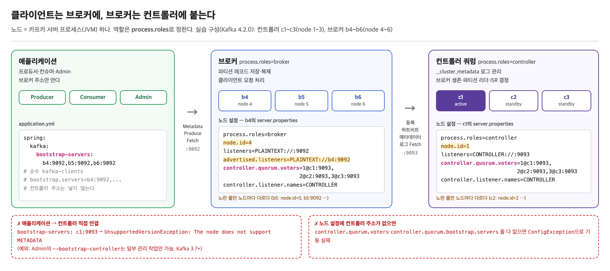
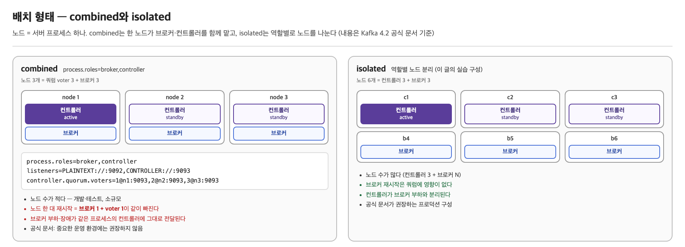

브로커 여러 대가 "하나의 카프카"처럼 동작하려면 **누군가는 어떤 브로커가 살아 있는지, 각 파티션의 리더가 누구인지를 정해야 한다.** <br>
카프카에서 그 역할을 맡는 게 **컨트롤러**다. <br>

이 글은 클러스터가 무엇으로 묶이는지, 컨트롤러가 무엇을 하는지, 컨트롤러 여러 대가 **쿼럼**으로 메타데이터를 지키는 방식, 그리고 ZooKeeper 시절과 무엇이 달라졌는지를 다룬다.

본문의 명령 출력과 로그는 모두 **Apache Kafka 4.2.0 KRaft 모드**를 Docker로 띄워 직접 얻은 결과다. <br>
ZooKeeper 모드는 4.0에서 제거돼, 해당 절은 문서 기준으로 적었다.

## 실습 환경

---

> 컨트롤러 3대(node 1~3)와 브로커 3대(node 4~6)를 서로 다른 컨테이너로 띄웠다. 컨테이너 하나가 노드 하나다.

| 컨테이너 | `node.id` | `process.roles` |
|---|---|---|
| c1, c2, c3 | 1, 2, 3 | `controller` |
| b4, b5, b6 | 4, 5, 6 | `broker` |

```yaml
# docker-compose.yml (요지) — c2·c3, b5·b6 도 node id 만 다르다
x-env: &env
  CLUSTER_ID: "MkU3OEVBNTcwNTJENDM2Qk"
  KAFKA_CONTROLLER_QUORUM_VOTERS: "1@c1:9093,2@c2:9093,3@c3:9093"
  KAFKA_CONTROLLER_LISTENER_NAMES: CONTROLLER
  KAFKA_LISTENER_SECURITY_PROTOCOL_MAP: "CONTROLLER:PLAINTEXT,PLAINTEXT:PLAINTEXT"
  KAFKA_INTER_BROKER_LISTENER_NAME: PLAINTEXT
  KAFKA_HEAP_OPTS: "-Xmx256m -Xms256m"
services:
  c1:
    image: apache/kafka:4.2.0
    environment: { <<: *env, KAFKA_NODE_ID: 1, KAFKA_PROCESS_ROLES: controller,
                   KAFKA_LISTENERS: "CONTROLLER://:9093" }
  b4:
    image: apache/kafka:4.2.0
    environment: { <<: *env, KAFKA_NODE_ID: 4, KAFKA_PROCESS_ROLES: broker,
                   KAFKA_LISTENERS: "PLAINTEXT://:9092", KAFKA_ADVERTISED_LISTENERS: "PLAINTEXT://b4:9092" }
```

## 컨트롤러와 브로커

---

> 카프카의 **노드**는 서버 프로세스(JVM) 하나다. <br> 노드는 `process.roles` 설정에 따라 브로커, 컨트롤러, 또는 둘 다의 역할을 맡는다.

- 노드마다 클러스터 안에서 고유한 `node.id`가 붙는다.
  - 브로커와 컨트롤러가 같은 번호 공간을 쓴다.
- 노드는 머신 단위가 아니다. 머신 한 대에 노드를 여러 개 띄울 수도 있다.
- `process.roles=broker,controller`로 한 프로세스가 두 역할을 함께 맡는 형태를 combined 모드라 한다.

| | 브로커 (`broker`) | 컨트롤러 (`controller`) |
|---|---|---|
| 저장하는 것 | 토픽 파티션의 레코드 | 클러스터 메타데이터 로그(`__cluster_metadata`) |
| 하는 일 | Produce·Fetch 처리, 파티션 복제 | 브로커 등록·생존 관리, 파티션 리더·ISR 결정 |
| 누가 붙나 | 프로듀서·컨슈머·Admin, 다른 브로커 | 브로커, 다른 컨트롤러, 일부 Admin 요청 |
| 리스너 (실습) | `PLAINTEXT://:9092` | `CONTROLLER://:9093` |
| 대수 | 데이터량·처리량에 맞춰 N대 | 쿼럼 과반수를 위해 보통 3대 또는 5대 |
| 한 대가 죽으면 | 그 브로커가 리더였던 파티션의 리더가 바뀐다 | active controller였다면 다른 컨트롤러가 새로 선출된다 |

- **Admin**: 토픽 생성·설정 변경 같은 관리 작업을 하는 클라이언트(`org.apache.kafka.clients.admin.Admin`)다.
  - `kafka-topics.sh` 같은 CLI 도구도 내부에서 이걸 쓴다.
- **리스너**: 노드가 연결을 받는 이름·주소·포트다.
  - `listeners=PLAINTEXT://:9092`처럼 `이름://호스트:포트`로 적는다.
  - 이름은 라벨일 뿐이고, 실제 보안 프로토콜은 `listener.security.protocol.map`이 정한다.
  - `advertised.listeners`는 클라이언트에게 알려 주는 접속 주소다.



### 배치 형태

> 컨트롤러를 브로커와 같은 프로세스에 둘 수도(combined), 따로 둘 수도(isolated) 있다.



[공식 문서(KRaft 운영)](https://kafka.apache.org/42/operations/kraft/)는 combined 모드를 이렇게 설명한다.

> combined 서버는 개발 환경 같은 작은 용도에서 운영하기 더 간단하다. 핵심 단점은 컨트롤러가 시스템의 나머지 부분과 덜 격리된다는 것이다. 예를 들어 combined 모드에서는 컨트롤러를 브로커와 따로 롤링 재시작하거나 확장할 수 없다. combined 모드는 중요한 운영 환경에서는 권장하지 않는다.

이 블로그의 [토픽과 파티션](/posts/kafka-topic-partition/)·[세그먼트](/posts/kafka-segment/) 글은 단일 노드 combined 모드로 실습했다(로그 디렉터리 이름 `kraft-combined-logs`가 그 흔적이다).

**노드(브로커·컨트롤러) 설정**에 컨트롤러 주소를 넣는 방법은 두 가지다. 애플리케이션 설정에는 브로커 주소만 넣는다.

- `controller.quorum.voters`: voter(쿼럼에서 투표하는 컨트롤러) 목록을 `id@host:port`로 고정한다. 이 글의 실습이 이 방식이다.
- `controller.quorum.bootstrap.servers`: 접속할 주소만 주고, voter 구성은 쿼럼이 메타데이터로 관리한다(KIP-853, Kafka 3.9+). 이 방식에서는 `kafka-metadata-quorum.sh add-controller`·`remove-controller`로 voter를 바꿀 수 있다. 이 글에서는 실측하지 않았다.

둘 다 없으면 노드가 뜨지 않는다. 4.2.0 브로커를 두 설정 없이 띄우면 저장소 포맷 단계(`StorageTool`)에서 설정 검증에 걸려 종료된다.

```
org.apache.kafka.common.config.ConfigException: If using process.roles, either controller.quorum.bootstrap.servers must contain the set of bootstrap controllers or controller.quorum.voters must contain a parseable set of controllers.
	at kafka.server.KafkaConfig.validateQuorumVotersAndQuorumBootstrapServerForKRaft$1(KafkaConfig.scala:528)
	at kafka.tools.StorageTool$.execute(StorageTool.scala:79)
```

"`process.roles`를 쓰려면 `controller.quorum.bootstrap.servers`에 컨트롤러 주소를 넣거나 `controller.quorum.voters`에 컨트롤러 목록을 넣어야 한다"는 뜻이다.

## 클러스터 메타데이터

---

> 클러스터 메타데이터는 "이 클러스터가 지금 어떤 모양인가"를 적은 정보다. <br> 브로커는 요청을 처리할 때, 그리고 클라이언트의 `Metadata` 요청에 파티션별 리더를 답할 때 이 정보를 본다.

| 담는 것 | 예 |
|---|---|
| 노드 | 브로커·컨트롤러의 `node.id`, 리스너 주소, fenced 여부 |
| 토픽·파티션 | 토픽 이름과 ID, 파티션별 replica 목록 |
| 파티션 상태 | 리더, ISR, leader epoch |
| 설정 | 토픽·브로커·클러스터 단위 동적 설정 |
| feature | `metadata.version` 같은 클러스터 기능 버전 |

- 브로커도 자기 파티션의 리더·ISR·leader epoch을 메모리에 들고 있지만, 이 **메타데이터를 받아 반영한 사본**이다.
- 디스크의 `leader-epoch-checkpoint`는 epoch별 시작 offset 이력이고, 현재 값을 정하는 건 컨트롤러다.

- 이 정보는 `__cluster_metadata`라는 내부 토픽의 파티션 하나(`__cluster_metadata-0`)에 **레코드로 쌓인다.**
- 브로커 등록, 토픽 생성, 리더 변경이 모두 레코드 한 줄이다.
  - 토픽이 이 로그의 `TOPIC_RECORD`·`PARTITION_RECORD`라는 점은 [Kafka - 토픽과 파티션](/posts/kafka-topic-partition/) 글에서도 확인했다.

>   실습 클러스터를 새로 띄운 뒤 토픽 `orders`(파티션 2개, RF 3)를 만들고 `retention.ms`를 바꾼 다음, b5를 정상 종료했다. c1의 로그를 `kafka-dump-log.sh --cluster-metadata-decoder`로 덤프한 결과다(`NO_OP_RECORD`는 빼고, 필드 일부 생략).

```
offset 0    LeaderChange               leaderId=3, voters=[1,2,3], grantingVoters=[3,2]   ← 컨트롤러 3이 리더로 선출
offset 1    BEGIN_TRANSACTION_RECORD   name="Bootstrap records"                        ← 클러스터 초기값 묶음 시작
offset 2    FEATURE_LEVEL_RECORD       metadata.version=29
offset 3~7  FEATURE_LEVEL_RECORD       eligible.leader.replicas.version=1, group.version=1, ...
offset 8    CONFIG_RECORD              (클러스터 기본값) min.insync.replicas=1
offset 9    END_TRANSACTION_RECORD
offset 10   REGISTER_CONTROLLER_RECORD controllerId=2, endPoints=[CONTROLLER c2:9093]

# fenced: 등록은 됐지만 일을 맡길 수 없는 상태. 리더가 될 수 없고 ISR에도 못 든다
offset 11   REGISTER_BROKER_RECORD     brokerId=5, brokerEpoch=11, endPoints=[PLAINTEXT b5:9092], fenced=true   ← 등록은 fenced로 시작
offset 16   BROKER_REGISTRATION_CHANGE_RECORD brokerId=5, fenced=-1   ← 메타데이터 로그를 따라 읽어 unfence
...         (c1·c3, b4·b6 등록과 unfence)

offset 64   TOPIC_RECORD               name=orders, topicId=osRGsIgz...
offset 65   PARTITION_RECORD           partitionId=0, replicas=[4,5,6], isr=[4,5,6], leader=4, leaderEpoch=0
offset 66   PARTITION_RECORD           partitionId=1, replicas=[5,6,4], isr=[5,6,4], leader=5, leaderEpoch=0
offset 74   CONFIG_RECORD              resourceName=orders, retention.ms=86400000   ← 토픽 설정 변경

offset 119  BROKER_REGISTRATION_CHANGE_RECORD brokerId=5, inControlledShutdown=1   ← b5 정상 종료 시작
offset 120  PARTITION_CHANGE_RECORD    partitionId=0, isr=[4,6]             ← 바뀐 필드만 담는다 (ISR에서 5 제외)
offset 121  PARTITION_CHANGE_RECORD    partitionId=1, isr=[6,4], leader=6   ← 리더였던 5가 빠져 6으로 교체
offset 126  BROKER_REGISTRATION_CHANGE_RECORD brokerId=5, fenced=1   ← 종료 완료로 다시 fenced
                                                                      (하트비트가 broker.session.timeout.ms 동안 끊겨도 fenced)

# 위에서 뺀 NO_OP_RECORD는 덤프 175줄 중 70줄이었다.
# active controller가 metadata.max.idle.interval.ms(기본 500ms)마다 쓰는 빈 레코드다.
```

**메타데이터 이미지**는 이 로그를 처음부터 반영해 메모리에 만든 현재 상태다. 브로커는 로그 자체가 아니라 이 이미지를 보고 요청을 처리한다. `kafka-metadata-shell.sh`로 같은 로그를 읽으면 이미지를 트리로 볼 수 있다(로그 파일을 복사해서 읽었다).

```
$ kafka-metadata-shell.sh --snapshot /tmp/md/00000000000000000000.log ls /image
acls  clientQuotas  cluster  configs  delegationToken  features  producerIds  provenance  scram  topics

$ ... cat /image/topics/byName/orders/1
PartitionRegistration(replicas=[5, 6, 4], ..., isr=[6, 4], ..., elr=[], lastKnownElr=[], leader=6,
  leaderRecoveryState=RECOVERED, leaderEpoch=1, partitionEpoch=1)

$ ... cat /image/cluster/brokers/4
BrokerRegistration(id=4, epoch=18, ..., listeners=[Endpoint(listenerName='PLAINTEXT', securityProtocol=PLAINTEXT,
  host='b4', port=9092)], ..., fenced=false, inControlledShutdown=false, ...)
```

파티션 1은 `PARTITION_RECORD`(offset 66)와 `PARTITION_CHANGE_RECORD`(offset 121)가 합쳐져 leader=6, isr=[6, 4], leaderEpoch=1이 됐다. 레코드에 없던 leaderEpoch 1은 리더가 바뀐 변경을 반영하면서 올라간 값이다.

### 컨트롤러가 쓰고, 모두가 복제한다

메타데이터 로그에 레코드를 쓰는 건 active controller 한 대뿐이다. 변경이 시작되는 경로는 세 가지다.

| 경로 | 예 | 요청 |
|---|---|---|
| 컨트롤러가 정한다 | 리더 교체(fencing, 정상 종료, preferred 선출), fence·unfence | 없음 |
| 브로커가 요청한다 | ISR 축소·확장, 브로커 등록, 하트비트·종료 요청 | `AlterPartition`, `BrokerRegistration`, `BrokerHeartbeat` |
| 클라이언트가 브로커를 거쳐 요청한다 | 토픽 생성·삭제, 파티션 추가, 설정 변경 | `CreateTopics`, `DeleteTopics`, `CreatePartitions`, `IncrementalAlterConfigs` |


- ISR을 요청한 리더는 `AlterPartition` 응답으로 결과를 먼저 반영한다. 나머지 브로커는 로그로 안다(`kafka.cluster.Partition#makeLeader` 주석, Kafka 4.2.0).
- 메시지 offset·LEO·HW와 컨슈머 offset(`__consumer_offsets`)은 이 로그에 없다.
- 브로커 쪽 전환은 `kafka.server.metadata.BrokerMetadataPublisher`가 새 이미지를 받을 때마다 `kafka.server.ReplicaManager#applyDelta`를 불러, 이 브로커(`node.id`)에 해당하는 변경만 골라 리더·팔로워로 바꾸는 것이다.

브로커도 이 로그를 복제한다(위 덤프와는 다른 기동에서 측정).

```
$ kafka-metadata-quorum.sh --bootstrap-controller c1:9093 describe --replication   # 일부 열 생략
NodeId  LogEndOffset  Lag  Status
3       45            0    Leader
1       45            0    Follower
2       45            0    Follower
5       45            0    Observer
6       45            0    Observer
4       45            0    Observer
```

- **Leader / Follower**: 쿼럼 투표권(voter)이 있는 컨트롤러 3대
- **Observer**: 투표권 없이 로그만 받아 가는 브로커 3대
- 여섯 노드 모두 LEO 45로 같은 메타데이터를 갖고 있다.

## 클러스터는 어떻게 묶이나

---

> 브로커와 컨트롤러 모두 `controller.quorum.voters`에 적힌 주소로 컨트롤러를 찾아가고, `cluster.id`로 같은 클러스터인지 확인받는다. <br> 브로커끼리는 서로를 직접 등록하지 않는다.

- 브로커: 컨트롤러에 등록하고 메타데이터 로그를 받아 가려고 접속한다.
- 컨트롤러: 다른 컨트롤러와 리더를 뽑고(`Vote`) 메타데이터 로그를 복제하려고 접속한다.

| | 무엇으로 | 역할 |
|---|---|---|
| 찾아가기 | `controller.quorum.voters` (또는 `controller.quorum.bootstrap.servers`) | 컨트롤러 주소로 접속한다 |
| 확인하기 | `meta.properties`의 `cluster.id` | 요청에 자기 `cluster.id`를 실어 보내고, 받는 쪽이 자기 값과 비교한다 |

### 컨트롤러 주소만 안다

> 브로커 설정에는 다른 브로커 목록이 없다. 브로커가 아는 건 컨트롤러 주소뿐이다. 기동하면 이런 순서로 클러스터에 들어간다(`kafka.server.BrokerServer#startup`, 4.2.0).

1. 컨트롤러 쿼럼에서 메타데이터 로그를 받아 오기 시작한다(`sharedServer.startForBroker()`).
2. 컨트롤러에 `BrokerRegistration` 요청을 보내 자기 `node.id`와 리스너 주소를 등록한다(`lifecycleManager.start`).
3. 컨트롤러가 그 등록을 `REGISTER_BROKER_RECORD`로 메타데이터 로그에 쓴다.
4. 브로커는 받아 오는 로그에서 다른 브로커들의 등록 레코드를 읽는다. 그렇게 해서 다른 브로커의 주소를 안다.
5. 이후 `broker.heartbeat.interval.ms`(기본 2초)마다 컨트롤러에 하트비트를 보낸다.
    - 하트비트가 끊기면 fencing된다. 이 과정은 [카프카 브로커 장애와 리더 선출](/posts/kafka-broker-failure-leader-election/)에서 다룬다.

### cluster.id로 같은 클러스터인지 확인한다

`cluster.id`는 노드끼리 연결해 주는 값이 아니라, 연결된 상대가 같은 클러스터인지 검사하는 값이다.

- 저장소를 포맷할 때(`kafka-storage.sh format`) 각 노드 디스크의 `meta.properties`에 기록된다. 실습 클러스터의 컨트롤러 c1과 브로커 b4의 파일이다.

```
# c1: /tmp/kafka-logs/meta.properties
cluster.id=MkU3OEVBNTcwNTJENDM2Qk
directory.id=JW6cZqr3Zx9-16SFkadOIw
node.id=1
version=1

# b4: /tmp/kafka-logs/meta.properties
cluster.id=MkU3OEVBNTcwNTJENDM2Qk
directory.id=kpAOTAIGKCFY-WpKL12pOA
node.id=4
version=1
```

- `apache/kafka` 이미지는 `CLUSTER_ID` 환경 변수로 포맷을 대신 해 준다.
- 직접 설치한 경우에는 `kafka-storage.sh random-uuid`로 ID를 하나 만들고, 모든 노드를 그 ID로 `format`한다.

노드는 이 값을 요청에 실어 보낸다. 4.2.0 메시지 정의에서 `ClusterId` 필드가 있는 요청은 메타데이터 로그 `Fetch`·`FetchSnapshot`, `BrokerRegistration`, 그리고 컨트롤러끼리 주고받는 `Vote`·`BeginQuorumEpoch`·`EndQuorumEpoch`와 voter 추가·삭제 요청이다. `FetchRequest.json`의 필드 설명은 "알고 있다면 clusterId. 브로커 등록 전의 메타데이터 fetch를 검증하는 데 쓴다"이다.

받는 쪽은 자기 값과 비교한다. 브로커 등록은 `org.apache.kafka.controller.ClusterControlManager#registerBroker`에서 검사한다.

```java
if (!clusterId.equals(request.clusterId())) {
    throw new InconsistentClusterIdException("Expected cluster ID " + clusterId +
        ", but got cluster ID " + request.clusterId());
}
```

### 다른 `cluster.id`로는 붙지 않는다

같은 컨트롤러 주소를 바라보되 `CLUSTER_ID`만 다른 브로커(node 7)를 하나 더 띄웠다. 컨트롤러 세 대 모두 등록 전 단계인 메타데이터 로그 `Fetch`부터 거부했다.

```
ERROR [RaftManager id=7] Unexpected error INCONSISTENT_CLUSTER_ID in FETCH response:
  InboundResponse(..., data=FetchResponseData(throttleTimeMs=0, errorCode=104, ...),
  source=c1:9093 (id: 1 rack: null isFenced: false))
ERROR [RaftManager id=7] Unexpected error INCONSISTENT_CLUSTER_ID in FETCH response: ... source=c2:9093 ...
ERROR [RaftManager id=7] Unexpected error INCONSISTENT_CLUSTER_ID in FETCH response: ... source=c3:9093 ...
```

`cluster.id`는 노드를 실수로 다른 클러스터에 붙이는 일을 막는 안전장치다. 디스크를 다른 ID로 포맷한 노드는 컨트롤러 주소를 맞게 넣어도 이 클러스터에 들어오지 못한다.

## 클라이언트는 어디에 붙나

---

> 애플리케이션은 브로커에만 붙는다. bootstrap 주소는 첫 연결용이고, 이후에는 메타데이터로 알아낸 리더에게 요청을 보낸다.

### 아무 브로커 하나만 알면 된다

클라이언트의 `bootstrap.servers`에 브로커 하나만 넣어도, 그 브로커가 메타데이터 이미지에서 전체 브로커 목록을 돌려준다. b4 한 대에만 연결했을 때다.

```
$ kafka-broker-api-versions.sh --bootstrap-server b4:9092 | grep '^b'
b5:9092 (id: 5 rack: null isFenced: false) -> (
b4:9092 (id: 4 rack: null isFenced: false) -> (
b6:9092 (id: 6 rack: null isFenced: false) -> (
```

`bootstrap.servers`는 첫 연결용 주소일 뿐이다. 여러 개를 넣는 이유는 그중 하나가 죽어 있어도 첫 연결을 하기 위해서다.

### 프로듀서·컨슈머는 컨트롤러에 붙지 않는다

프로듀서와 컨슈머는 연결하자마자 `Metadata` 요청으로 파티션 리더가 어느 브로커인지 알아낸다. 컨트롤러는 이 API를 지원하지 않는다. 같은 클러스터(컨트롤러 c1~c3, 브로커 b4)에서 접속 대상을 바꿔 가며 붙여 봤다.

| 시도 | 결과 |
|---|---|
| 프로듀서 → 브로커 `b4:9092` | 전송 성공 |
| 프로듀서 → 컨트롤러 `c1:9093` | `UnsupportedVersionException: The node does not support METADATA` |
| `kafka-topics.sh --bootstrap-server c1:9093` (Admin) | 같은 예외. "원격 노드가 METADATA API를 지원하는 BROKER가 아니다"라는 경고 |
| `kafka-cluster.sh cluster-id --bootstrap-controller c1:9093` (Admin) | `Cluster ID: MkU3OEVBNTcwNTJENDM2Qk` |
| `kafka-topics.sh --bootstrap-controller c1:9093` | 옵션 없음 (`bootstrap-controller is not a recognized option`) |

Admin 클라이언트는 예외다. Kafka 3.7부터 `bootstrap.controllers`(CLI에서는 `--bootstrap-controller`)로 컨트롤러에 직접 붙을 수 있다(KIP-919). 다만 이 경로로는 클러스터 ID 조회나 쿼럼 조회 같은 일부 관리 작업만 된다. 위의 `kafka-metadata-quorum.sh --bootstrap-controller`도 이 경로다. 토픽 생성 같은 요청은 브로커가 받아서 active controller로 넘긴다.

### 애플리케이션 설정

애플리케이션 설정에도 브로커 주소만 넣는다. 순수 `kafka-clients`라면 `bootstrap.servers` 키에 넣는다.

```properties
# producer.properties / consumer.properties
bootstrap.servers=b4:9092,b5:9092,b6:9092
```

Spring Boot에서는 `spring.kafka.bootstrap-servers`에 넣는다. 이 값이 프로듀서·컨슈머·Admin의 `bootstrap.servers`로 전달된다.

```yaml
# application.yml
spring:
  kafka:
    bootstrap-servers: b4:9092,b5:9092,b6:9092
    producer:
      acks: all
    consumer:
      group-id: app-group
      auto-offset-reset: earliest
```

`application.properties`라면 같은 키를 `spring.kafka.bootstrap-servers=b4:9092,b5:9092,b6:9092`처럼 쓴다. 클라이언트별로 다른 주소를 주려면 `spring.kafka.producer.bootstrap-servers`, `spring.kafka.consumer.bootstrap-servers`를 쓴다. 이 값이 공통 값보다 우선한다.

Spring Boot 3.5.4(spring-kafka 3.3.8, kafka-clients 3.9.1) 앱을 같은 Docker 네트워크에서 띄워 확인했다. 앱은 기동하면서 `app-test` 토픽에 `hello`를 보내고, `@KafkaListener`로 받는다. 표의 `bootstrap.servers`는 kafka-clients가 기동 시 출력하는 `ProducerConfig`·`ConsumerConfig` 로그 값이다. `app-test`의 리더는 브로커 5다.

| 설정 | 로그의 `bootstrap.servers` | 결과 |
|---|---|---|
| `bootstrap-servers: b4:9092,b5:9092,b6:9092` | 프로듀서·컨슈머 모두 `[b4:9092, b5:9092, b6:9092]` | 전송(`app-test-0@0`), 수신 성공 |
| `bootstrap-servers: c1:9093` (컨트롤러) | `[c1:9093]` | `KafkaException: Send failed`. 원인 `UnsupportedVersionException: The node does not support METADATA` |
| `bootstrap-servers: b4:9092` + `producer.bootstrap-servers: b6:9092` | 컨슈머 `[b4:9092]`, 프로듀서 `[b6:9092]` | 전송(`app-test-0@2`), 수신 성공 |

마지막 줄의 프로듀서는 b6만 알지만 리더인 b5로 보냈다. 컨슈머도 b4만 알지만 b5에서 읽었다. bootstrap 주소는 첫 연결에만 쓰이고, 실제 요청은 메타데이터로 알아낸 리더에게 간다.

`spring.kafka.*` 한 벌은 클러스터 하나를 가리킨다. `org.springframework.boot.autoconfigure.kafka.KafkaProperties`에는 공통 `bootstrapServers` 하나와 클라이언트별 `bootstrapServers`만 있고, 클러스터 목록을 받는 항목은 없다. 클러스터 둘에 붙으려면 두 번째 클러스터용 `ProducerFactory`·`ConsumerFactory`를 직접 빈으로 만들어야 한다. 이 구성은 이 글에서 실측하지 않았다.

## 쿼럼

---

> 컨트롤러 여러 대는 Raft 합의(KRaft)로 메타데이터 로그를 복제한다. 레코드는 투표권 있는 컨트롤러(voter)의 **과반수**가 받아야 커밋된다.

### voter, 리더, observer

| 역할 | 누가 | 하는 일 |
|---|---|---|
| leader | voter 중 한 대 = active controller | 메타데이터 레코드를 쓰고, 과반수가 받으면 커밋 |
| follower | 나머지 voter | 리더에게서 로그를 fetch해 복제. 리더가 죽으면 선거에 참여 |
| observer | 브로커 | 투표권 없이 로그만 fetch |

Raft 리더(= active controller)를 바꿀 때마다 **epoch**이 1 오른다. 위 `describe --status` 출력의 `LeaderEpoch`가 그 값이다. 파티션 리더의 leader epoch과는 별개인 쿼럼 단위 번호다.

### 과반수 규칙

voter가 N대면 레코드를 커밋하고 리더를 뽑는 데 `N/2 + 1`대(정수 나눗셈)가 필요하다.

| voter 수 | 필요한 과반수 | 견딜 수 있는 장애 |
|---|---|---|
| 1 | 1 | 0 |
| 3 | 2 | 1 |
| 4 | 3 | 1 |
| 5 | 3 | 2 |

4대는 3대보다 장애 내성이 늘지 않고 과반수만 커진다. 그래서 컨트롤러는 3대나 5대처럼 홀수로 둔다.

### active controller가 죽으면

active controller인 c3를 SIGKILL로 죽였다. c3 종료 시각을 0으로 두고 나머지 노드의 로그를 놓으면 다음과 같다.

```
+0.000s  c3 프로세스 종료 (SIGKILL)
+0.000s  c1, c2: Node 3 disconnected.
+1.774s  c2: Transitioning to Prospective state due to fetch timeout
+1.775s  c1: Transitioning to Prospective state due to fetch timeout
+1.824s  c2: Attempting durable transition to CandidateState(localId=2, epoch=2, ...)
+1.924s  c2: Completed transition to Leader(... id=2 ...)
+1.996s  c2: [QuorumController id=2] Becoming the active controller at epoch 2, next write offset 171.
+2.067s  b4: Recorded new KRaft controller, from now on will use node c2:9093
```

1. **장애 감지**: follower는 리더에게서 `controller.quorum.fetch.timeout.ms`(기본 2000ms) 동안 응답을 못 받으면 리더가 죽었다고 본다. 마지막 fetch가 kill 0.22초 전에 나갔으므로 kill 후 1.77초에 타임아웃이 났다.
2. **Prospective (pre-vote)**: 바로 epoch을 올리지 않고, 먼저 다른 voter에게 "내가 후보로 나가면 뽑아 줄 것인가"를 묻는다. 네트워크가 잠깐 끊긴 노드 하나가 epoch만 올려 멀쩡한 리더를 끌어내리는 일을 막는 단계다(KIP-996).
3. **Candidate → Leader**: c2가 epoch 2로 투표를 요청했고, c1이 c2에게 표를 줬다. c2 자신의 표까지 2표로 과반수(3대 중 2대)를 넘어 c2가 리더가 됐다.
4. **active controller 전환**: c2가 Raft 리더가 된 뒤 72ms 만에 컨트롤러로서 쓰기를 시작했다. standby 시절에 이미 메타데이터 로그를 끝까지 갖고 있었으므로 따로 읽어 들일 것이 없다.
5. **브로커 전환**: 브로커 b4는 kill 2.07초 뒤 새 컨트롤러로 하트비트 대상을 옮겼다.

같은 실험을 `acks=all` 프로듀서(초당 100건)를 돌리면서 다시 했다.

```
501 records sent, 100.0 records/sec, 98.0 ms avg latency, 1120.0 ms max latency.   ← 기동 직후 구간
500 records sent, 100.0 records/sec, 15.6 ms avg latency,   95.0 ms max latency.   ← active controller kill 구간
501 records sent, 100.1 records/sec, 12.8 ms avg latency,   38.0 ms max latency.
```

active controller가 바뀌는 2초 동안에도 produce는 멈추지 않았다(최대 95ms). produce·fetch는 브로커끼리 처리하는 일이고, 그 사이 리더·ISR 변경이 필요 없었기 때문이다.

### 과반수를 잃으면

컨트롤러 3대 중 2대(c1, c2)를 죽여 c3 한 대만 남겼다. 과반수(2대)가 없으므로 리더를 뽑을 수도, 레코드를 커밋할 수도 없다. 브로커 3대는 모두 살아 있다.

| 동작 | 결과 |
|---|---|
| 토픽 생성 (`kafka-topics.sh --create`) | 60초 대기 후 `TimeoutException: Timed out waiting for a node assignment. Call: createTopics` |
| 토픽 조회 (`kafka-topics.sh --describe`) | 실패. 내부에서 컨트롤러에 묻는 `listPartitionReassignments` 호출이 타임아웃 |
| 기존 토픽에 `acks=all` produce | 1000건 모두 성공 (최대 634ms) |
| 파티션을 직접 지정한 consume (`--partition 0`) | 성공 |
| 컨슈머 그룹 consume, `__consumer_offsets`가 아직 없을 때 | 실패 (`TimeoutException`), 0건 |
| 컨슈머 그룹 consume, `__consumer_offsets`가 이미 있을 때 | 기존 그룹·새 그룹 모두 성공 |

메타데이터를 **바꾸는** 일은 막히고, 이미 있는 메타데이터로 하는 produce·consume은 계속된다. 컨슈머 그룹은 처음 쓰일 때 `__consumer_offsets` 토픽이 자동 생성되는데, 그것도 토픽 생성이라 쿼럼 없이는 안 된다.

**이 상태에서 브로커까지 죽으면 복구가 안 된다.** 쿼럼이 없는 채로 p0의 리더인 b4를 죽였다.

```
p0 (리더 b4)        리더가 바뀌지 않는다. 오프셋 조회도 실패:
                    Skip getting offsets for topic-partition t-0 due to error: ... TimeoutException
p1 (리더 b5, ISR에 b4 포함)
  b5 로그: Shrinking ISR from 6,4,5 to 5,6. Leader: (highWatermark: 817, endOffset: 824).
  acks=all produce 50건: 전부 Expiring ... for t-1: 20000 ms has passed since batch creation
  HW 조회: t:1:817   ← ISR 축소가 커밋되지 않아 HW가 멈춤
  acks=1 produce 50건: 성공
```

- p0은 새 리더를 뽑을 컨트롤러가 없다.
- p1은 리더가 살아 있다. 그런데 ISR에서 죽은 b4를 빼려는 `AlterPartition`을 커밋해 줄 컨트롤러가 없다. ISR이 `[5,6,4]`로 남아 있으니 HW가 b4의 LEO(817)에 묶이고, `acks=all` 쓰기가 전부 타임아웃난다.

> 쿼럼이 없는 클러스터는 장애가 없는 동안에만 정상처럼 보인다. 브로커 하나만 죽어도 리더 선출과 ISR 변경이 모두 멈춘다.

컨트롤러 c1, c3를 다시 띄우자 c2가 epoch 3의 active controller가 됐다(14:34:25.873). 그 9.01초 뒤(`broker.session.timeout.ms` 9초) 하트비트가 없는 b4를 fencing했고, p0의 리더는 5, 모든 파티션의 ISR은 `[5,6]`이 됐다. 새 active controller는 브로커 세션을 자기가 활성화된 시점부터 다시 센다.

## ZooKeeper vs KRaft

---

> ZooKeeper 모드에서는 메타데이터의 원본이 ZooKeeper에 있었고, 브로커 중 한 대가 컨트롤러를 겸하며 다른 브로커에 RPC로 변경을 밀어 넣었다. KRaft에서는 메타데이터 자체가 카프카 로그이고, 브로커가 그 로그를 당겨 간다.

이 절은 공식 문서와 KIP-500·KIP-631 기준이다. ZooKeeper 모드는 4.0에서 제거돼 직접 실행해 보지 못했다.

| | ZooKeeper 모드 (~3.x) | KRaft 모드 (2.8 프리뷰, 3.3 프로덕션, 4.0부터 유일) |
|---|---|---|
| 메타데이터 원본 | ZooKeeper (znode) | `__cluster_metadata` 로그 |
| 컨트롤러 | 브로커 중 하나. ZooKeeper의 `/controller` znode를 먼저 잡은 브로커 | 별도 컨트롤러 노드(또는 combined)로 이뤄진 Raft 쿼럼의 리더 |
| 브로커에 변경 전달 | 컨트롤러가 `LeaderAndIsr`·`UpdateMetadata`·`StopReplica` RPC를 **푸시** | 브로커가 메타데이터 로그를 fetch해 **당겨 감** |
| 브로커 생존 판단 | ZooKeeper 세션과 ephemeral znode | 컨트롤러로 보내는 하트비트 |
| 컨트롤러 페일오버 | 새 컨트롤러가 ZooKeeper에서 전체 메타데이터를 다시 읽어야 함 | standby가 이미 로그를 갖고 있어 바로 이어받음 (실측 약 2초) |
| 운영 대상 | 카프카 + ZooKeeper 두 시스템 | 카프카 하나 |

4.2.0 브로커가 광고하는 API 목록(`kafka-broker-api-versions.sh`)에도 `LeaderAndIsr`·`UpdateMetadata`·`StopReplica`는 없다.

### 왜 바꿨나

KIP-500이 꼽은 ZooKeeper 모드의 한계는 두 가지다.

- **페일오버 비용이 파티션 수에 비례한다.** 새 컨트롤러는 ZooKeeper에서 모든 토픽·파티션 상태를 읽어 들인 뒤에야 일할 수 있다. 파티션이 수십만 개면 이 로딩 동안 리더 선출이 멈춘다.
- **메타데이터가 두 곳에서 어긋날 수 있다.** 원본은 ZooKeeper에 있고, 브로커는 컨트롤러가 푸시한 사본을 들고 있다. 푸시가 늦거나 빠지면 브로커마다 다른 메타데이터를 보게 된다.

KRaft에서는 메타데이터가 오프셋이 매겨진 로그라서, 브로커는 "내가 오프셋 몇까지 반영했다"로 자기 상태를 정확히 알 수 있다. 뒤처진 브로커는 그 오프셋부터 마저 읽으면 된다. [카프카 브로커 장애와 리더 선출](/posts/kafka-broker-failure-leader-election/)에서 본 "등록 레코드 오프셋까지 따라 읽어야 unfence", "다른 브로커들이 오프셋 700까지 반영한 뒤 종료 허가" 같은 조건이 이 성질을 쓴다.

## 정리

---

> 클러스터는 `cluster.id`로 묶이고, 브로커는 서로가 아니라 컨트롤러에 등록하며, 모든 메타데이터 변경은 쿼럼 리더 한 대가 로그에 쓴다.

- 브로커는 다른 브로커를 직접 알지 못한다. 컨트롤러에 등록하고, `__cluster_metadata`를 observer로 복제해서 다른 브로커를 안다.
- 메타데이터를 바꾸는 주체는 active controller 하나다. 리더 선출과 ISR 변경도 컨트롤러가 커밋해야 확정된다.
- 컨트롤러 쿼럼은 과반수가 살아 있어야 동작한다. 3대면 1대 장애까지 견디고, active controller가 바뀌는 데 약 2초 걸렸다.
- 과반수를 잃어도 기존 토픽의 produce·consume은 계속된다. 다만 토픽 생성은 막히고, 그 상태에서 브로커가 죽으면 리더 선출도 ISR 축소도 일어나지 않는다.

## 참고 자료

---

- [Apache Kafka — KRaft (kafka.apache.org/42/operations)](https://kafka.apache.org/42/operations/kraft/) — `process.roles`, combined·isolated 배치, 컨트롤러 쿼럼 구성, `kafka-metadata-quorum.sh`
- [Apache Kafka — Broker Configs (kafka.apache.org/42/configuration)](https://kafka.apache.org/42/configuration/broker-configs) — `controller.quorum.voters`, `controller.quorum.bootstrap.servers`, `controller.quorum.fetch.timeout.ms`, `broker.heartbeat.interval.ms`
- [KIP-500: Replace ZooKeeper with a Self-Managed Metadata Quorum (cwiki.apache.org)](https://cwiki.apache.org/confluence/display/KAFKA/KIP-500%3A+Replace+ZooKeeper+with+a+Self-Managed+Metadata+Quorum) — ZooKeeper 모드의 한계, 메타데이터 로그로의 전환 배경
- [KIP-595: A Raft Protocol for the Metadata Quorum (cwiki.apache.org)](https://cwiki.apache.org/confluence/display/KAFKA/KIP-595%3A+A+Raft+Protocol+for+the+Metadata+Quorum) — voter·observer, fetch 기반 복제, 리더 선거
- [KIP-631: The Quorum-based Kafka Controller (cwiki.apache.org)](https://cwiki.apache.org/confluence/display/KAFKA/KIP-631%3A+The+Quorum-based+Kafka+Controller) — 브로커 등록·하트비트·fencing, 메타데이터 레코드 종류
- [KIP-853: KRaft Controller Membership Changes (cwiki.apache.org)](https://cwiki.apache.org/confluence/display/KAFKA/KIP-853%3A+KRaft+Controller+Membership+Changes) — 동적 쿼럼, `controller.quorum.bootstrap.servers`
- [KIP-996: Pre-Vote (cwiki.apache.org)](https://cwiki.apache.org/confluence/display/KAFKA/KIP-996%3A+Pre-Vote) — Prospective 상태, 불필요한 리더 교체 방지
- [KIP-919: Allow AdminClient to Talk Directly with the KRaft Controller Quorum (cwiki.apache.org)](https://cwiki.apache.org/confluence/display/KAFKA/KIP-919%3A+Allow+AdminClient+to+Talk+Directly+with+the+KRaft+Controller+Quorum+and+add+Controller+Registration) — `bootstrap.controllers`, `--bootstrap-controller`
- [Spring Boot — Messaging: Apache Kafka Support (docs.spring.io/spring-boot)](https://docs.spring.io/spring-boot/reference/messaging/kafka.html) — `spring.kafka.bootstrap-servers`, 클라이언트별 설정
