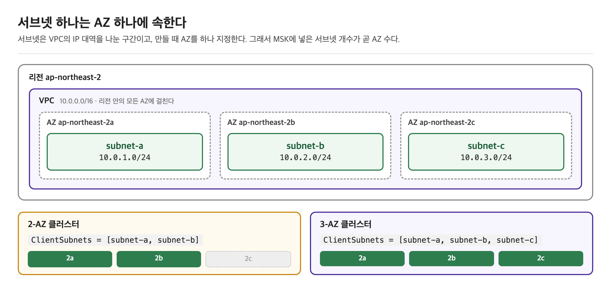
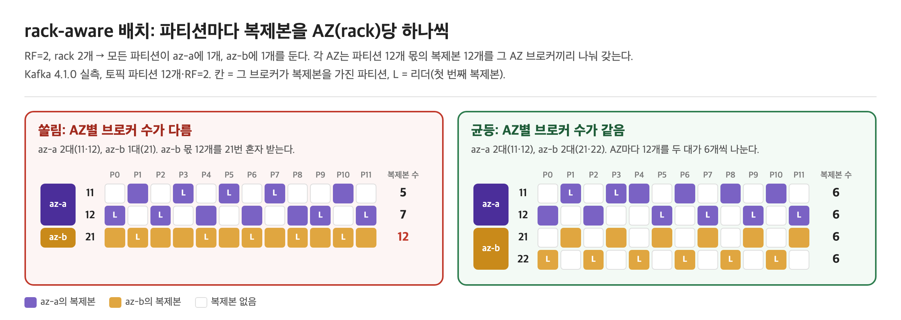

Amazon MSK(Managed Streaming for Apache Kafka)는 브로커 프로비저닝, 컨트롤러(또는 ZooKeeper) 운영, OS·보안 패치, 장애 브로커 교체를 AWS가 맡는 관리형 카프카다. <br>
그래도 **토픽의 복제 설정, 브로커를 몇 대·몇 개 AZ에 둘지, 클라이언트가 브로커 재시작을 견디는지**는 사용자가 정한다. <br>

이 글은 MSK Provisioned 클러스터를 운영할 때 알아야 할 제약과 기본값을 다룬다. 특히 AZ가 2개인 환경에서 브로커 수가 짝수여야 하는 이유와 그 구성에서 복제 설정이 어떻게 어긋나는지, 컨트롤러가 어떻게 제공되는지를 본다.

MSK 자체의 규칙·기본값·쿼터는 **2026년 11월 기준 AWS 공식 문서**에서 가져왔다. <br>
AZ 장애 시 쓰기 가능 여부처럼 카프카 동작에 해당하는 부분은 MSK Standard 브로커가 지원하는 최신 버전과 같은 **Apache Kafka 4.1.0**을 Docker로 띄우고, 브로커마다 `broker.rack`에 AZ 이름을 넣어 재현했다. <br>
MSK 클러스터를 직접 만들어 확인한 결과는 아니다.

## MSK가 맡는 것과 사용자가 맡는 것

---

> MSK는 카프카 프로세스와 그 아래 인프라를 맡고, 카프카 위에서 내리는 결정은 사용자에게 남긴다.

| 영역 | MSK가 맡는다 | 사용자가 정한다 |
|---|---|---|
| 노드 | 브로커용 EC2 인스턴스·EBS 볼륨 생성(프로비저닝), 장애 브로커 교체 | 브로커 타입(Standard·Express), 브로커 크기(`kafka.m7g.large` 같은 인스턴스 사양), 브로커 수, AZ 수, 브로커당 EBS 크기 |
| 메타데이터 | KRaft 컨트롤러(또는 ZooKeeper) 생성·운영 | — |
| 패치 | OS·보안 패치, 버전 업그레이드 실행(롤링) | 업그레이드 시점, 재시작을 견디는 클라이언트 설정 |
| 설정 | 기본 설정(MSK default configuration) 제공 | 커스텀 configuration, 토픽별 `replication.factor`·`min.insync.replicas` |
| 용량 | 스토리지 자동 확장 기능 제공 | 파티션 수, 보존 기간, 스토리지 크기 |
| 네트워크·인증 | VPC 안에 브로커 ENI 생성, 인증 리스너 제공 | 서브넷·보안 그룹, 인증 방식(IAM·SCRAM·mTLS) |

### 프로비저닝
> 자원을 정한 크기로 미리 만들어 두는 일

- 사용자가 사양과 수를 정하면 MSK가 브로커마다 EC2 인스턴스를 띄우고, 지정한 크기의 EBS 볼륨을 만들어 붙인다.
- 이 EC2·EBS는 AWS가 관리하는 계정에 생기므로 사용자의 EC2 콘솔에는 보이지 않는다.
- 사용자 VPC에는 브로커에 접속할 ENI만 생긴다.
  - ENI(Elastic Network Interface)는 VPC 서브넷에 붙는 가상 네트워크 카드다.
    - 서브넷의 사설 IP를 하나 받고, 보안 그룹은 이 ENI 단위로 적용된다.
  - 브로커마다 ENI가 하나씩 생긴다.
    - 클라이언트는 이 ENI의 사설 IP로 브로커에 접속하고, 클러스터에 지정한 보안 그룹이 이 ENI에 붙는다.
- 비용은 실제 사용량이 아니라 정한 크기로 나온다.
  - 1TiB EBS를 잡고 100GiB만 써도 1TiB 요금을 낸다.

> MSK의 배포 형태는 세 가지다.

| 형태 | 설명 |
|---|---|
| Provisioned — Standard 브로커 | 브로커 크기·수·EBS 스토리지를 직접 정한다. 2-AZ·3-AZ 모두 가능하다. |
| Provisioned — Express 브로커 | 스토리지를 사용한 만큼 과금하고 직접 관리하지 않는다. 3-AZ만 가능하다. |
| Serverless | 브로커 개념 없이 처리량·파티션 쿼터 안에서 쓴다. |

이 글은 주로 Provisioned Standard 브로커를 기준으로 한다.

## 컨트롤러는 MSK가 따로 제공한다

---

> KRaft 모드 MSK 클러스터의 컨트롤러는 브로커와 별도로 MSK가 만들고 운영하며, 비용이 따로 붙지 않는다.

MSK는 Apache Kafka 3.7.x부터 KRaft 모드 클러스터를 만들 수 있다. [메타데이터 관리 문서](https://docs.aws.amazon.com/msk/latest/developerguide/metadata-management.html)는 컨트롤러를 이렇게 설명한다.

> KRaft 컨트롤러는 추가 비용 없이 포함되며, 사용자가 따로 설정하거나 관리할 필요가 없다.

**사용자가 지정하는 건 브로커뿐이다.**
- 클러스터 생성 시 넣는 `NumberOfBrokerNodes`, 브로커 크기, 스토리지는 모두 브로커에 대한 값이다.
- 컨트롤러 수나 크기를 고르는 항목은 없다.
- 자체 운영 카프카의 isolated 배치(컨트롤러 전용 노드 + 브로커 전용 노드)와 같은 모양이다.

**컨트롤러에 직접 접근할 일이 없다.**
- [메타데이터 관리 문서](https://docs.aws.amazon.com/msk/latest/developerguide/metadata-management.html)는 관리·모니터링 목적으로 컨트롤러에 붙을 필요가 없고, 클러스터 상태를 보는 데 컨트롤러 메트릭도 필요 없다고 적는다.
  - Kafka 4.1 이상으로 만든 KRaft 클러스터와 ZooKeeper에서 이전한 클러스터에는 컨트롤러 DNS 엔드포인트가 아예 없다.
    - 4.1 이전에 만든 KRaft 클러스터에만 남아 있다.
  - 그래서 Prometheus open monitoring으로도 컨트롤러 JMX 메트릭은 못 긁는다.
  - 클러스터 수준 상태는 CloudWatch의 `ActiveControllerCount`로 본다.

**클라이언트·관리 도구는 브로커 부트스트랩 주소만 쓴다.**
- `--zookeeper` 연결 문자열은 KRaft에서 없고, ACL도 `--bootstrap-server`로 관리한다.

**브로커 상한이 다르다.**
- 클러스터당 브로커 수 기본 쿼터는 ZooKeeper 모드 30대, KRaft 모드 60대다.

### ZooKeeper 모드와 KRaft 이전

> ZooKeeper 모드 클러스터에서도 ZooKeeper 노드는 MSK가 무료로 만들고 관리한다. 차이는 버전 수명이다.

- Apache Kafka 3.9.x가 ZooKeeper와 KRaft를 모두 지원하는 마지막 버전이다.
  - MSK는 3.9.x를 출시일로부터 최소 2년 연장 지원한다.
- 4.0.x 이상은 KRaft만 있다.
- 기존 ZooKeeper 클러스터는 `UpdateClusterKafkaVersion`으로 제자리(in-place) 이전할 수 있다.
  - 데이터는 옮기지 않고, 이전 중에도 클러스터는 서비스한다.

> 조건과 성질은 다음과 같다.

| 항목 | 내용 |
|---|---|
| 시작 버전 | ZooKeeper 모드 3.9.x (그보다 낮으면 3.9.x로 먼저 업그레이드) |
| 대상 버전 | `3.9.x.kraft` |
| AZ | Standard 브로커는 **3-AZ 클러스터여야 한다** |
| 사전 작업 | ZooKeeper 클라이언트 접근 비활성화, 모든 클라이언트가 `--bootstrap-server` 사용 |
| 제외 조건 | `kafka.t3.small` 브로커, public access와 open monitoring 동시 사용, 동적으로 설정한 `advertised.listeners` |
| 소요 시간 | 클러스터 크기에 따라 수 시간 |
| 되돌리기 | 불가. 이전 후 ZooKeeper 모드로 돌아갈 수 없다 |

2-AZ ZooKeeper 클러스터는 이 경로로 KRaft에 갈 수 없다. 새 3-AZ 클러스터를 만들어 데이터를 옮겨야 한다.

## 브로커 수는 AZ 수의 배수다

---

> MSK는 브로커를 AZ마다 같은 수로 둔다. <br>
> AZ가 2개면 브로커 수는 짝수, 3개면 3의 배수다.

MSK 클러스터를 만들 때 AZ를 직접 고르는 항목은 없고, 브로커를 둘 **서브넷**(`ClientSubnets`)을 고른다.

- 서브넷은 VPC의 IP 대역을 나눈 구간이고, **서브넷 하나는 반드시 AZ 하나에 속한다.**
  - 따라서, 서브넷을 고르면 그 서브넷의 AZ도 함께 정해진다.



- 위 VPC에서 subnet-a, subnet-b를 넣으면 2-AZ 클러스터, subnet-a, subnet-b, subnet-c를 넣으면 3-AZ 클러스터가 된다.
  - 그래서 AZ 수는 **넣은 서브넷 개수**와 같다.
- 서브넷 목록은 **클러스터를 만들 때 한 번** 넣는다. 브로커를 한 대씩 만들면서 서브넷을 고르는 게 아니다.
  - 2개 또는 3개를 넣고, 서로 다른 AZ에 있어야 한다.
  - 같은 AZ의 서브넷 두 개를 넣는 식으로는 AZ 수를 늘릴 수 없다.
  - 미국 서부(캘리포니아 북부) 리전은 정확히 2개만 된다. 이 리전은 고객이 쓸 수 있는 AZ가 2개뿐이다.
- MSK는 브로커를 이 서브넷들에 고르게 나눠 둔다. 나중에 브로커를 늘릴 때도 같은 서브넷에 놓인다.
  - 콘솔은 아예 "AZ당 브로커 수"를 입력받는다.
- 브로커를 늘리는 `UpdateBrokerCount`의 목표 브로커 수는 **AZ 수의 배수여야 한다.**
  - 줄일 때도 같다.
  - [브로커 제거 문서](https://docs.aws.amazon.com/msk/latest/developerguide/msk-remove-broker.html)는 한 번의 제거 작업에서 AZ마다 한 대씩 빼라고 적는다.
    - 2-AZ에 AZ당 3대(총 6대)라면 2대를 빼서 AZ당 2대(총 4대)가 되고, 3-AZ라면 3대를 뺀다.
    - 그래야 남은 브로커도 AZ마다 같은 수로 맞는다.
  - 빼기 전에 제거할 브로커의 파티션을 남길 브로커로 먼저 옮겨야 한다.
    - MSK는 파티션이 없는 브로커(MSK 내부 canary 토픽 제외)를 골라 제거한다.

| AZ 수 | 가능한 브로커 수 |
|---|---|
| 2 | 2, 4, 6, 8, … |
| 3 | 3, 6, 9, 12, … |

- `UpdateBrokerCount`는 목표 브로커 수만 받고 서브넷을 받지 않는다.
  - 늘어난 브로커는 MSK가 생성 때 넣은 서브넷에 AZ마다 같은 수로 나눠 둔다.
  - 목표 수가 AZ 수의 배수여야 하는 것도 이 때문이다.
    - 예를 들어 3-AZ에 6대가 있고 목표를 9대로 정하면, 2a·2b·2c에 한 대씩 늘어난다.
    - 배수가 아니면 고르게 나눌 수 없어서 API가 요청을 거부한다.
- 새 브로커에는 기존 파티션이 옮겨 가지 않으므로, 데이터 배치(재배치)는 사용자 몫이다.
- 생성 후에 AZ 수를 바꾸는 API는 찾지 못했다.
  - 2-AZ로 만든 클러스터를 3-AZ로 바꾸려면 새 클러스터로 이전해야 한다고 보는 게 안전하다(문서에 이를 명시한 문장은 찾지 못했다).

## AZ가 곧 rack이다

---

> AZ별로 브로커 수를 맞추는 이유는 카프카의 rack-aware 복제본 배치에 있다.

### rack
> 데이터센터에서 서버를 꽂아 두는 선반(랙)이다.

- 같은 랙의 서버는 전원과 랙 상단 스위치를 함께 쓴다.
  - 그래서 랙 전원이 나가거나 스위치가 죽으면 그 랙의 서버가 한꺼번에 내려간다.
- 카프카는 이렇게 **함께 죽을 수 있는 브로커 묶음**을 rack이라 부른다.
  - 브로커 설정 `broker.rack`에 문자열로 적고, 값이 같은 브로커끼리 같은 rack으로 본다.
- 클라우드에는 물리 랙 대신 AZ가 그 역할을 한다.
  - AZ 하나가 장애로 통째로 빠질 수 있기 때문이다.
  - MSK는 각 브로커의 `broker.rack`을 그 브로커가 있는 AZ의 ID(예: `use1-az1`)로 설정한다.

### rack-aware 배치
> 한 파티션의 복제본을 서로 다른 rack에 흩어 두는 카프카의 복제본 배치 방식이다.

- 복제본이 한 rack에 모여 있으면 그 rack이 죽을 때 복제본이 전부 사라진다.
- 흩어 두면 rack 하나가 죽어도 다른 rack에 복제본이 남는다.
- `broker.rack`이 설정돼 있으면 토픽 생성, 파티션 추가, `kafka-reassign-partitions.sh`로 재배치안을 만들 때 이 방식이 적용된다.
- [카프카 운영 문서](https://kafka.apache.org/documentation/#basic_ops_racks)는 한 파티션이 `min(rack 수, RF)`개의 서로 다른 rack에 걸치도록 둔다고 얘기한다.
  - rack 3개·RF=3이면 rack마다 하나씩, rack 2개·RF=2면 rack마다 하나씩, rack 2개·RF=3이면 한 rack에 2개·다른 rack에 1개다.
- rack마다 브로커 수가 다르면 브로커가 **적은 rack이 복제본을 더 받아 저장 공간과 복제 자원을 더 쓰므로, rack마다 브로커 수를 같게 두라고 권한다.**

> MSK에서는 만들 수 없는 구성이지만, 브로커 3대를 az-a 2대(11, 12)·az-b 1대(21)로 띄우고 파티션 12개·RF=2 토픽을 만들어 확인했다.

```text
replicas per broker:            leaders per broker:
   5 11   (az-a)                   3 11
   7 12   (az-a)                   4 12
  12 21   (az-b)                   5 21
```

- az-b에는 브로커가 21번 하나뿐이다. 그래서 21번이 12개 파티션 전부의 복제본을 갖는다.
- 21번은 az-a 브로커보다 디스크·복제 트래픽을 두 배 가까이 더 받는다.

AZ마다 브로커 수가 같으면 이 쏠림이 생기지 않는다. 같은 토픽을 az-a 2대(11, 12)·az-b 2대(21, 22)에 만들면 네 브로커가 복제본을 6개씩 갖는다.



- 두 경우 모두 파티션마다 az-a에 하나, az-b에 하나씩 복제본이 있다. rack-aware 배치는 그대로 지켜진다.
- 차이는 AZ 안에서 몇 대가 나눠 갖느냐다. az-b 몫 12개를 왼쪽은 한 대가, 오른쪽은 두 대가 받는다.
- 리더(L) 수는 균등 구성에서도 토픽마다 달랐다.
  - 같은 구성에 같은 토픽을 4개 만들었을 때 복제본은 매번 6개씩이었지만, 브로커 11·12·21·22의 리더 수는 2·4·0·6, 4·2·4·2, 4·2·2·4, 2·4·0·6으로 바뀌었다.

## 2-AZ에서는 복제 설정이 어긋난다

---

> RF=3·`min.insync.replicas=2`는 AZ가 3개일 때 AZ 하나를 잃어도 쓰기가 이어지는 조합이다. <br>
> AZ가 2개면 같은 설정으로도 AZ 장애 시 일부 파티션의 `acks=all` 쓰기가 멈춘다.

MSK의 기본 설정은 AZ 수에 따라 값이 다르다.

| 설정 | 3-AZ 기본값 | 2-AZ 기본값 | Apache Kafka 기본값 |
|---|---|---|---|
| `default.replication.factor` | 3 | 2 | 1 |
| `min.insync.replicas` | 2 | 1 | 1 |

[MSK 모범 사례 문서](https://docs.aws.amazon.com/msk/latest/developerguide/bestpractices.html)의 고가용성 권장은 세 줄이다.

- 3-AZ 클러스터를 구성한다.
- RF를 3 이상으로 둔다. RF=1은 롤링 업데이트 중 파티션이 오프라인이 될 수 있고, RF=2는 데이터 유실로 이어질 수 있다.
- `min.insync.replicas`는 RF-1 이하로 둔다. RF와 같으면 롤링 업데이트 중 쓰기가 막힌다.

2-AZ에서 이 권장을 그대로 따르면 어떻게 되는지 재현했다. `acks`·`min.insync.replicas`의 동작은 [ISR 글](/posts/kafka-isr-1/)에 정리했다.

### 실습 환경

```yaml
# docker-compose.yml (요지) — 컨트롤러 1대 + 브로커 4대, AZ 2개를 rack 으로 흉내 낸다
x-env: &env
  CLUSTER_ID: "MkU3OEVBNTcwNTJENDM2Qk"
  KAFKA_CONTROLLER_QUORUM_VOTERS: "1@c1:9093"
  KAFKA_CONTROLLER_LISTENER_NAMES: CONTROLLER
  KAFKA_LISTENER_SECURITY_PROTOCOL_MAP: "CONTROLLER:PLAINTEXT,PLAINTEXT:PLAINTEXT"
  KAFKA_INTER_BROKER_LISTENER_NAME: PLAINTEXT
services:
  c1:  { image: apache/kafka:4.1.0, environment: { <<: *env, KAFKA_NODE_ID: 1, KAFKA_PROCESS_ROLES: controller } }
  b11: { image: apache/kafka:4.1.0, environment: { <<: *env, KAFKA_NODE_ID: 11, KAFKA_PROCESS_ROLES: broker, KAFKA_BROKER_RACK: az-a } }
  b12: { image: apache/kafka:4.1.0, environment: { <<: *env, KAFKA_NODE_ID: 12, KAFKA_PROCESS_ROLES: broker, KAFKA_BROKER_RACK: az-a } }
  b21: { image: apache/kafka:4.1.0, environment: { <<: *env, KAFKA_NODE_ID: 21, KAFKA_PROCESS_ROLES: broker, KAFKA_BROKER_RACK: az-b } }
  b22: { image: apache/kafka:4.1.0, environment: { <<: *env, KAFKA_NODE_ID: 22, KAFKA_PROCESS_ROLES: broker, KAFKA_BROKER_RACK: az-b } }
```

- 브로커 번호의 앞자리가 AZ다. 11·12는 az-a, 21·22는 az-b다.
- 컨트롤러는 어느 AZ 장애에도 같이 죽지 않는 위치에 있다고 가정했다. MSK가 2-AZ에서 컨트롤러를 어떻게 배치하는지는 앞에서 적었듯 공개돼 있지 않다.
- AZ 장애는 그 AZ 브로커 두 대를 `docker kill`(SIGKILL)로 동시에 죽여 흉내 냈다.
- 쓰기는 파티션을 지정해 레코드 한 건씩 보내는 Java 프로듀서(`org.apache.kafka.clients.producer.KafkaProducer`, `acks=all`, `delivery.timeout.ms=8000`)로 확인했다.

### RF=3, `min.insync.replicas=2`

토픽을 만든 직후의 배치다.

```text
$ kafka-topics.sh --create --topic rf3 --partitions 6 --replication-factor 3 --config min.insync.replicas=2
$ kafka-topics.sh --describe --topic rf3
	Topic: rf3	Partition: 0	Leader: 21	Replicas: 21,12,22	Isr: 21,12,22
	Topic: rf3	Partition: 1	Leader: 11	Replicas: 11,22,12	Isr: 11,22,12
	Topic: rf3	Partition: 2	Leader: 21	Replicas: 21,12,22	Isr: 21,12,22
	Topic: rf3	Partition: 3	Leader: 11	Replicas: 11,22,12	Isr: 11,22,12
	Topic: rf3	Partition: 4	Leader: 11	Replicas: 11,22,12	Isr: 11,22,12
	Topic: rf3	Partition: 5	Leader: 21	Replicas: 21,12,22	Isr: 21,12,22
```

복제본 3개를 AZ 2개에 나누면 한쪽 AZ에는 반드시 2개가 놓인다.

- 파티션 0·2·5는 az-b에 2개(21, 22), az-a에 1개(12)다.
- 파티션 1·3·4는 az-a에 2개(11, 12), az-b에 1개(22)다.

az-a의 11·12를 죽이고 15초 뒤의 상태다.

```text
	Topic: rf3	Partition: 0	Leader: 21	Replicas: 21,12,22	Isr: 21,22	Elr:
	Topic: rf3	Partition: 1	Leader: 22	Replicas: 11,22,12	Isr: 22	Elr: 12
	Topic: rf3	Partition: 2	Leader: 21	Replicas: 21,12,22	Isr: 21,22	Elr:
	Topic: rf3	Partition: 3	Leader: 22	Replicas: 11,22,12	Isr: 22	Elr: 12
	Topic: rf3	Partition: 4	Leader: 22	Replicas: 11,22,12	Isr: 22	Elr: 12
	Topic: rf3	Partition: 5	Leader: 21	Replicas: 21,12,22	Isr: 21,22	Elr:
```

```text
rf3-0: OK offset=0
rf3-1: FAIL TimeoutException: Expiring 1 record(s) for rf3-1:8002 ms has passed since batch creation
rf3-2: OK offset=0
rf3-3: FAIL TimeoutException: Expiring 1 record(s) for rf3-3:8001 ms has passed since batch creation
rf3-4: FAIL TimeoutException: Expiring 1 record(s) for rf3-4:8001 ms has passed since batch creation
rf3-5: OK offset=0
```

- az-a에 복제본 2개가 있던 파티션 1·3·4는 ISR이 22 하나로 줄었다. `min.insync.replicas=2`를 못 채워 `acks=all` 쓰기가 거부된다.
- 리더가 바로 거부하는 에러는 `NotEnoughReplicasException`이다. 재시도 가능한 에러라 프로듀서가 `delivery.timeout.ms`까지 재시도하다 `TimeoutException`으로 끝났다. `retries=0`으로 보내면 원래 에러가 그대로 보인다.

  ```text
  rf3-1: FAIL NotEnoughReplicasException: Messages are rejected since there are fewer in-sync replicas than required.
  ```

- `acks=1`로 보내면 파티션 1도 쓰기가 된다. 대신 복제본 하나에만 기록된 상태로 ack가 나간다.
- 브로커 **한 대**가 내려가는 경우(패치·교체)는 어느 파티션이든 ISR이 2개 남으므로 이 설정으로 쓰기가 이어진다. 막히는 건 AZ 전체가 내려갈 때다.

### RF=2, `min.insync.replicas=1` (MSK 2-AZ 기본값)

RF=2면 복제본이 AZ마다 하나씩 놓인다.

```text
	Topic: rf2	Partition: 0	Leader: 11	Replicas: 11,22	Isr: 11,22
	Topic: rf2	Partition: 1	Leader: 21	Replicas: 21,12	Isr: 21,12
	Topic: rf2	Partition: 2	Leader: 11	Replicas: 11,22	Isr: 11,22
	Topic: rf2	Partition: 3	Leader: 21	Replicas: 21,12	Isr: 21,12
```

az-a(11·12)를 죽여도 모든 파티션에 az-b 복제본이 남고, `min.insync.replicas=1`이라 `acks=all` 쓰기가 전부 성공했다. <br>
대신 이때 ack된 레코드는 **복제본 하나에만** 있다. 파티션 0의 레코드(offset 0)는 22번에만 기록됐고 11번은 이 레코드를 모른다.

MSK 기본값에서 `unclean.leader.election.enable`은 `true`다(티어드 스토리지를 켜지 않은 클러스터 기준, 아래 기본 설정 절 참고). 같은 값을 토픽에 넣고 이어서 진행했다.

1. 22번까지 죽인다. 파티션 0은 리더가 없어진다.

   ```text
	Topic: rf2	Partition: 0	Leader: none	Replicas: 11,22	Isr: 	Elr: 22	LastKnownElr: 22
   ```

2. 레코드를 모르는 11번을 다시 띄운다. ISR 밖의 11번이 unclean 선출로 리더가 된다.

   ```text
	Topic: rf2	Partition: 0	Leader: 11	Replicas: 11,22	Isr: 11
   ```

3. 파티션 0의 끝 오프셋이 1에서 0으로 돌아갔다. `acks=all`로 ack까지 받은 레코드가 사라졌다.

   ```text
   $ kafka-get-offsets.sh --topic rf2      # 22번을 죽이기 전
   rf2:0:1
   $ kafka-get-offsets.sh --topic rf2      # 11번이 리더가 된 뒤
   rf2:0:0
   ```

AZ 장애가 아니라 **패치로 브로커 한 대가 재시작되는 동안 다른 브로커가 죽는 경우**에도 같은 순서가 만들어진다. [모범 사례 문서](https://docs.aws.amazon.com/msk/latest/developerguide/bestpractices.html)가 RF=2를 "데이터 유실로 이어질 수 있다"고 적은 경우가 이것이다.

`unclean.leader.election.enable=false`를 토픽에 넣고 같은 순서를 밟았다(복제본 11·22, `min.insync.replicas=1`).

```text
# 11·12를 죽이고 acks=all로 1건 → 22번에만 기록
u-0: OK offset=0
u:0:1

# 22를 죽이고 11을 띄운다 → 11은 리더가 되지 못하고 파티션이 리더 없이 멈춘다
	Topic: u	Partition: 0	Leader: none	Replicas: 11,22	Isr: 	Elr: 22	LastKnownElr: 22
u-0: FAIL TimeoutException: Expiring 1 record(s) for u-0:8001 ms has passed since batch creation

# 22를 다시 띄운다 → 22가 리더로 돌아오고 레코드가 남아 있다
	Topic: u	Partition: 0	Leader: 22	Replicas: 11,22	Isr: 22,11
u:0:1
```

- 레코드를 모르는 11번이 리더가 되는 일은 막힌다. 22번이 돌아오면 ack된 레코드가 그대로 있다.
- 대신 22번이 돌아올 때까지 그 파티션은 **읽기·쓰기가 모두 멈춘다.** 유실을 가용성과 바꾼 것이다.
- 22번이 디스크까지 잃으면 레코드는 어디에도 없다. `min.insync.replicas=1`이면 ack 시점에 복사본이 하나뿐이라는 사실은 이 설정으로 바뀌지 않는다.
- 그래서 2-AZ에서 유실과 정지를 함께 줄이려면 RF=3·`min.insync.replicas=2`로 가야 하고, 그 대가가 앞 절의 "AZ 장애 시 일부 파티션 쓰기 정지"다.

### 3-AZ와 비교

같은 RF=3·`min.insync.replicas=2` 토픽을 브로커 3대(az-a, az-b, az-c 한 대씩)에 만들고 az-c를 죽이면, 모든 파티션의 ISR이 2개로 남아 6개 파티션 모두 쓰기가 성공했다.

```text
	Topic: rf3	Partition: 0	Leader: 12	Replicas: 12,21,11	Isr: 12,11
	Topic: rf3	Partition: 1	Leader: 11	Replicas: 21,11,12	Isr: 11,12
	...
rf3-0: OK offset=0
rf3-1: OK offset=0
rf3-2: OK offset=0
rf3-3: OK offset=0
rf3-4: OK offset=0
rf3-5: OK offset=0
```

| 구성 | 브로커 1대 재시작(패치) | AZ 하나 장애 | ack된 레코드의 최소 복제본 수 |
|---|---|---|---|
| 2-AZ, RF=3, minISR=2 | 쓰기 계속 | 파티션 일부(이번 실습은 6개 중 3개) `acks=all` 쓰기 거부 | 2 |
| 2-AZ, RF=2, minISR=1 (MSK 기본) | 쓰기 계속 | 쓰기 계속 | 1 — unclean 선출 시 유실 가능 |
| 3-AZ, RF=3, minISR=2 (MSK 기본) | 쓰기 계속 | 쓰기 계속 | 2 |

2-AZ에서는 "AZ 장애 중에도 쓰기 계속"과 "ack된 레코드는 두 곳 이상에 있다"를 동시에 얻을 수 없다. 둘 다 필요하면 3-AZ로 구성한다.

## 기본 설정에서 확인할 것

---

> MSK의 기본 설정 일부는 Apache Kafka 기본값과 다르다. 클러스터를 만들 때 커스텀 configuration을 붙이지 않으면 이 값으로 동작한다.

| 설정 | MSK 기본값 | Apache Kafka 기본값 | 의미 |
|---|---|---|---|
| `unclean.leader.election.enable` | `true` (티어드 스토리지 클러스터는 `false`) | `false` | ISR 밖 복제본이 리더가 될 수 있다. 위 실습처럼 ack된 레코드가 사라질 수 있다 |
| `allow.everyone.if.no.acl.found` | `true` | `false` | ACL이 하나도 없는 리소스는 모든 사용자가 접근할 수 있다 |
| `auto.create.topics.enable` | `false` | `true` | 없는 토픽에 produce하면 자동 생성되지 않는다 |
| `default.replication.factor` | 3-AZ 3, 2-AZ 2 | 1 | 자동 생성 토픽의 RF |
| `min.insync.replicas` | 3-AZ 2, 2-AZ 1 | 1 | `acks=all`에 필요한 ISR 수 |
| `num.partitions` | 1 | 1 | |
| `replica.lag.time.max.ms` | 30000 | 30000 | |

- 데이터 유실을 허용하지 않는 클러스터라면 커스텀 configuration에서 `unclean.leader.election.enable=false`로 바꾼다. 토픽 단위로도 덮어쓸 수 있다.
- `allow.everyone.if.no.acl.found=true`는 IAM 인증을 쓰면 IAM 정책이 접근을 통제하므로 영향이 작다. SCRAM·mTLS로 카프카 ACL을 쓸 때는 ACL을 안 건 토픽이 열려 있게 된다.
- 기본 설정에 없는 항목은 그 카프카 버전의 Apache Kafka 기본값을 따른다.

## 브로커는 주기적으로 재시작된다

---

> MSK는 보안 패치·버전 업그레이드·브로커 크기 변경 때 브로커를 한 대씩 재시작한다. 이 재시작을 견디는 것은 토픽 설정과 클라이언트 설정의 몫이다.

### 패치

| | Standard 브로커 | Express 브로커 |
|---|---|---|
| 방식 | 브로커를 한 대씩 재부팅하는 롤링 업데이트 | 한 달에 걸쳐 브로커를 한 대씩 수시로 재부팅 |
| 작업 유형 (`ListClusterOperations`) | `SECURITY_PATCHING` | `BROKER_UPDATE` |
| 유지보수 창 | 있음 | 없음 |

Standard 브로커의 패치 주기는 MSK 개발자 가이드와 FAQ에 나와 있지 않다. Express 브로커 쪽만 "한 달에 걸쳐 가끔, 한 대씩 재부팅된다"고 적혀 있다. <br>
AWS 지원 엔지니어가 re:Post에 남긴 답변과 글에는 다음 내용이 있다. 개발자 가이드에 있는 내용이 아니므로 바뀔 수 있다.

- Standard 브로커 패치는 **월 단위 주기**로 돈다.
- 패치 일정은 알림 메일로 오고, 메일에는 시각만 있다. RDS처럼 콘솔·API로 유지보수 창을 정하는 기능은 없다.
- AWS Support에 요청하면 창을 옮길 수 있다. "매월 n째 주 m요일 몇 시(UTC)" 형식이고, 주는 1~4주(1~28일)만 고를 수 있다. 정한 창은 다음 달부터 같은 규칙으로 반복된다.
- 보안 패치는 건너뛰거나 장기 연기할 수 없다. 인증서 갱신, 지원 종료 버전의 자동 업그레이드도 이 창 조정과는 별개라 미룰 수 없다.

[패치 문서](https://docs.aws.amazon.com/msk/latest/developerguide/patching-impact.html)가 밝힌 재시작 중의 영향은 다음과 같다.

- 클라이언트에 일시적인 연결 끊김 에러가 찍힌다.
- 최대 2분(보통 그보다 짧게) 동안 p99 읽기·쓰기 지연이 튄다. 높은 밀리초에서 약 2초까지다. 클라이언트가 새 리더에 다시 붙는 동안 생긴다.
- `UnderReplicatedPartitions`가 올라간다. 내려간 브로커의 복제본이 복제를 멈췄기 때문이다.
- 브로커가 돌아오면 밀린 레코드를 따라잡느라 볼륨 처리량과 CPU 사용량이 늘어난다.

이외에도 MSK는 클러스터 인증서를 13개월마다 갱신한다. 그동안 클러스터 상태가 `MAINTENANCE`가 되고, produce·consume은 되지만 클러스터 업데이트 작업은 할 수 없다.

### 재시작을 견디는 클라이언트 설정

> [MSK 클라이언트 모범 사례 문서](https://docs.aws.amazon.com/msk/latest/developerguide/bestpractices-kafka-client.html)의 권장값이다.

| 설정 | 권장 | 이유 |
|---|---|---|
| `retries` | 정수 최댓값 또는 큰 값 | 리더 교체 중 실패한 전송을 재시도한다 |
| `delivery.timeout.ms` | 60초 이상 | 재시도가 리더 교체를 넘길 만큼 길어야 한다 |
| `request.timeout.ms` | 10초 이상 | 요청 하나가 재전송 전까지 기다리는 시간 |
| `retry.backoff.ms` | 200ms 이상 | 재시도 폭주를 막는다 |
| `acks` | `all` | 서버의 RF=3, `min.insync.replicas=2`와 맞춘다 |
| `client.rack` (컨슈머) | 클라이언트가 있는 AZ ID | 가까운 복제본에서 읽는다(아래 네트워크 절) |
| `session.timeout.ms` (컨슈머) | 60초 | 애플리케이션 기동 시간보다 길게 |
| `heartbeat.interval.ms` (컨슈머) | 10초 | |
| `group.instance.id` (컨슈머) | 호스트명·pod ID 등 고유값 | 재시작 시 불필요한 리밸런스를 줄인다 |
| `partition.assignment.strategy` | `StickyAssignor` 또는 `CooperativeStickyAssignor` | |

- 부트스트랩 연결 문자열에는 **AZ마다 브로커를 하나 이상** 넣는다. 한 브로커가 업데이트로 내려가 있어도 다른 브로커로 접속을 시작할 수 있다.
- 프로듀서·컨슈머를 한꺼번에 재시작하지 않는다. 클라이언트를 만들기 전과 종료 전에 무작위 지연을 둬서 연결이 한 번에 몰리지 않게 한다. IAM 인증 리스너에는 브로커당 연결 생성 속도 상한(아래 쿼터 표)이 있다.

## 용량: 스토리지·파티션·CPU

---

> Standard 브로커의 EBS 스토리지는 늘릴 수만 있고 줄일 수 없으며, 한 번 늘리면 다음 확장까지 최소 6시간을 기다려야 한다.

### 스토리지

- 브로커당 EBS는 1 GiB ~ 16,384 GiB다.
- **줄일 수 없다.** 늘린 용량은 바로 쓸 수 있다.
- 확장 뒤에는 **쿨다운**이 있다. 스토리지 크기·사용률·트래픽에 따라 최소 6시간에서 24시간 넘게 걸리고, 그동안 다시 늘릴 수 없다. 자동 확장(auto scaling)도 같은 제약을 받는다.
  - 디스크가 빠르게 차는 상황에서 한 번 늘린 뒤 또 부족해지면 쿨다운이 끝날 때까지 보존 기간을 줄이거나 토픽을 지우는 수밖에 없다.
- [모범 사례 문서](https://docs.aws.amazon.com/msk/latest/developerguide/bestpractices.html)는 `KafkaDataLogsDiskUsed`가 85%에 닿으면 알람을 받아 확장·보존 기간 단축·미사용 토픽 삭제 중 하나를 하라고 권한다.
- 티어드 스토리지를 켜면 오래된 세그먼트를 저렴한 원격 저장소로 옮겨 로컬 디스크 부담을 줄일 수 있다.
- Express 브로커는 스토리지를 프로비저닝하지 않는다. 쓴 만큼 과금된다.

### 파티션 수

브로커 크기별 권장 파티션 수(리더·팔로워 복제본 합)다.

| 브로커 크기 | 권장 | 업데이트 작업이 가능한 최대 |
|---|---|---|
| `kafka.t3.small` | 300 | 300 |
| `kafka.m5.large`, `kafka.m5.xlarge`, `kafka.m7g.large`, `kafka.m7g.xlarge` | 1000 | 1500 |
| `kafka.m5.2xlarge`, `kafka.m7g.2xlarge` | 2000 | 3000 |
| `kafka.m5.4xlarge` 이상, `kafka.m7g.4xlarge` 이상 | 4000 | 6000 |

- 권장값은 강제되지 않는다.
- 최대값을 넘긴 상태에서 클러스터가 과부하되면 **클러스터 설정 변경, 더 작은 브로커 크기로 변경, SCRAM 시크릿 연결**이 막힌다. 설정 변경이나 버전 업그레이드를 하려면 먼저 파티션 수를 이 아래로 내려야 한다.
- 파티션이 많으면 CloudWatch·Prometheus 메트릭이 누락될 수 있다. 컨슈머 그룹 × 토픽 × 파티션마다 오프셋 항목이 생기므로 빈 컨슈머 그룹도 정리한다.

### CPU·메모리

- `CPU User + CPU System`을 60% 아래로 유지하라고 강하게 권한다. 브로커 한 대가 롤링으로 빠지면 그 리더 파티션이 나머지 브로커로 옮겨 가므로 여유가 필요하다.
- 넘으면 브로커 크기를 한 단계 올리는 것이 1순위 권장이다. 크기 변경도 롤링이고 브로커당 보통 10~15분 걸린다.
- 브로커를 추가하면 **기존 파티션은 새 브로커로 옮겨 가지 않는다.** `kafka-reassign-partitions.sh`나 Cruise Control로 직접 재배치해야 하고, [모범 사례 문서](https://docs.aws.amazon.com/msk/latest/developerguide/bestpractices.html)는 한 번에 10개 이하 파티션씩 옮기라고 권한다.
- `HeapMemoryAfterGC`가 60%를 넘으면 알람을 받는다.

### 브로커 줄이기

M5·M7g 기반 클러스터, Kafka 2.8.1 이상(KRaft 포함)에서 브로커를 뺄 수 있다.

1. 뺄 브로커에서 모든 파티션을 다른 브로커로 옮긴다. MSK 내부 토픽 `__amazon_msk_canary`, `__amazon_msk_canary_state`는 제외다.
2. 해당 브로커의 `UserPartitionExists` 메트릭이 5분간 0인지 확인한다.
3. `UpdateBrokerCount`로 AZ 수의 배수만큼 줄인다. MSK는 파티션이 없는 브로커를 골라 제거한다.

## 네트워크·인증·비용

---

> 클라이언트는 같은 VPC(또는 연결된 VPC)에서 브로커 ENI로 붙고, 인증 방식마다 포트가 다르다.

| 인증 | VPC 안에서 | public access |
|---|---|---|
| 평문(plaintext) | 9092 | — |
| TLS | 9094 | 9194 |
| SASL/SCRAM | 9096 | 9196 |
| IAM | 9098 | 9198 |

인증 방식마다 부트스트랩 문자열도 따로 나온다. 보안 그룹에 해당 포트를 열어야 한다.

### 쿼터

| 항목 | 값 |
|---|---|
| 계정당 브로커 | 90 |
| 클러스터당 브로커 | ZooKeeper 30, KRaft 60 |
| 브로커당 TCP 연결 (IAM 인증) | 3000 |
| 브로커당 연결 생성 속도 (IAM 인증) | 초당 100 (t3는 초당 4) |
| 계정당 configuration | 100 |

IAM 이외의 인증에는 연결 수 상한을 두지 않는다. 대신 CPU·메모리를 보고 판단하라고 한다.

### AZ 간 트래픽

- 브로커 간 복제 트래픽, 메타데이터 노드(컨트롤러)와 브로커 간 트래픽에는 **데이터 전송 요금이 붙지 않는다.**
- 클러스터로 들어오고 나가는 트래픽에는 표준 AWS 데이터 전송 요금이 붙는다.
- 컨슈머는 기본적으로 파티션 리더에서 읽으므로 리더가 다른 AZ에 있으면 AZ를 건넌다. 가까운 복제본에서 읽으려면 두 설정이 필요하다.
  - 브로커: `replica.selector.class=org.apache.kafka.common.replica.RackAwareReplicaSelector` (커스텀 configuration)
  - 컨슈머: `client.rack`에 컨슈머가 있는 AZ의 **ID**(예: `use1-az1`)를 넣는다. AZ 이름(`us-east-1a`)이 아니다. MSK의 `broker.rack`이 AZ ID이므로 값이 일치해야 한다.

## Standard vs Express 브로커

---

> Express 브로커는 스토리지 관리·유지보수 창·RF 설정 같은 운영 결정을 MSK가 대신 고정해 둔 브로커 타입이다.

| | Standard | Express |
|---|---|---|
| AZ | 2 또는 3 | 3만 |
| 스토리지 | EBS 직접 프로비저닝, 축소 불가 | 사용량 과금, 관리 불필요 |
| 복제 | 사용자가 RF 결정 | 항상 3-way 복제 |
| 패치 | 유지보수 창, `SECURITY_PATCHING` | 유지보수 창 없음, `BROKER_UPDATE` |
| 처리량 | 브로커 크기·EBS에 따름 | 브로커 크기별 처리량 쿼터(초과 시 스로틀) |
| 지원 버전 | 4.1.x까지 | 3.6, 3.8, 3.9, 4.2 (4.2는 Express 전용) |
| KRaft | 3.7.x부터 | 3.9부터 |
| 제약 | — | Kafka Streams API 일부 미지원, KIP-932(Queues) 미지원 |

Express는 2-AZ를 지원하지 않으므로, 2-AZ를 고집하면 Standard 브로커만 선택지다.

## 정리

---

> MSK는 컨트롤러와 노드를 대신 운영하지만, AZ 수·RF·`min.insync.replicas`·클라이언트 재시도 설정은 사용자가 정하고 그 결과도 사용자가 진다.

- KRaft 모드 MSK의 컨트롤러는 MSK가 별도로 만들고 운영한다. 비용이 없고, 수·크기를 고를 수 없으며, 4.1 이후 생성 클러스터는 엔드포인트도 노출하지 않는다.
- 브로커 수는 AZ 수의 배수다. MSK가 `broker.rack`을 AZ ID로 넣고, AZ별 브로커 수가 다르면 적은 쪽 브로커에 복제본이 몰린다.
- 2-AZ에서 RF=3·minISR=2는 AZ 장애 시 일부 파티션의 `acks=all` 쓰기가 멈추고, RF=2·minISR=1(MSK 2-AZ 기본)은 쓰기는 이어지지만 ack된 레코드가 복제본 하나에만 있을 수 있다. 실습에서는 unclean 선출로 그 레코드가 사라졌다.
- MSK 기본 `unclean.leader.election.enable`은 `true`다. 유실을 허용하지 않으면 끈다.
- 브로커는 패치·업그레이드로 한 대씩 재시작된다. RF=3, minISR=2, 프로듀서 `retries`·`delivery.timeout.ms`를 넉넉히 둔다.
- Standard 브로커의 EBS는 줄일 수 없고 확장 뒤 최소 6시간 쿨다운이 있다.

## 참고 자료

---

- [Amazon MSK — Metadata management (docs.aws.amazon.com/msk)](https://docs.aws.amazon.com/msk/latest/developerguide/metadata-management.html) — KRaft 모드, 컨트롤러 무료·관리 불필요, 컨트롤러 DNS 엔드포인트
- [Amazon MSK — Migrate from ZooKeeper to KRaft mode (docs.aws.amazon.com/msk)](https://docs.aws.amazon.com/msk/latest/developerguide/zk-to-kraft-migration.html) — 3.9.x 제자리 이전, 3-AZ 조건, 되돌릴 수 없음
- [Amazon MSK — Supported Apache Kafka versions (docs.aws.amazon.com/msk)](https://docs.aws.amazon.com/msk/latest/developerguide/supported-kafka-versions.html) — 버전별 지원 기간, 3.9 연장 지원, 4.2 Express 전용, `client.rack`·`replica.selector.class`
- [Amazon MSK API — CreateCluster (docs.aws.amazon.com/msk/1.0/apireference)](https://docs.aws.amazon.com/msk/1.0/apireference/clusters.html) — 서브넷 2~3개, 브로커 균등 배치, 인증서 13개월 갱신과 `MAINTENANCE` 상태
- [Amazon MSK — Expand the number of brokers (docs.aws.amazon.com/msk)](https://docs.aws.amazon.com/msk/latest/developerguide/msk-update-broker-count.html) — 목표 브로커 수는 AZ 수의 배수
- [Amazon MSK — Remove a broker (docs.aws.amazon.com/msk)](https://docs.aws.amazon.com/msk/latest/developerguide/msk-remove-broker.html) — 브로커 제거 조건과 절차
- [Amazon MSK — Default configuration (docs.aws.amazon.com/msk)](https://docs.aws.amazon.com/msk/latest/developerguide/msk-default-configuration.html) — AZ 수별 RF·minISR 기본값, `unclean.leader.election.enable`
- [Amazon MSK — Best practices for Standard brokers (docs.aws.amazon.com/msk)](https://docs.aws.amazon.com/msk/latest/developerguide/bestpractices.html) — 3-AZ·RF 3·minISR 권장, 브로커당 파티션 수, CPU 60%, 디스크 85%
- [Amazon MSK — Best practices for Apache Kafka clients (docs.aws.amazon.com/msk)](https://docs.aws.amazon.com/msk/latest/developerguide/bestpractices-kafka-client.html) — 프로듀서·컨슈머 권장 설정, 연결 관리
- [Amazon MSK — Patching on MSK Provisioned clusters (docs.aws.amazon.com/msk)](https://docs.aws.amazon.com/msk/latest/developerguide/patching-impact.html) — 롤링 패치, 지연 스파이크, Express 패치
- [How to schedule MSK security patches to run outside of business hours? (repost.aws/questions)](https://repost.aws/questions/QUZ5F9aAnoQceP6ZU7P77LfA) — 지원 엔지니어 답변: 월 단위 유지보수 창, Support를 통한 재조정(1~4주·요일·UTC 시각)
- [After receiving an Amazon MSK security patching notification (repost.aws/articles)](https://repost.aws/articles/AR6aLWzSkgSViqOzS0OriblA/after-receiving-an-amazon-msk-security-patching-notification-judging-this-patch-s-impact-and-what-you-can-change-or-skip) — 지원 엔지니어 글: 알림 메일, 셀프서비스 창 없음, 건너뛰기 불가, `OfflinePartitionsCount`로 영향 판단
- [Amazon MSK — Scale up Standard broker storage (docs.aws.amazon.com/msk)](https://docs.aws.amazon.com/msk/latest/developerguide/msk-update-storage.html) — 축소 불가, 쿨다운 6~24시간
- [Amazon MSK — Express brokers (docs.aws.amazon.com/msk)](https://docs.aws.amazon.com/msk/latest/developerguide/msk-broker-types-express.html) — 3-AZ 전용, 스토리지·패치 차이
- [Amazon MSK — Quota (docs.aws.amazon.com/msk)](https://docs.aws.amazon.com/msk/latest/developerguide/limits.html) — 브로커·연결·스토리지 쿼터
- [Amazon MSK — Port information (docs.aws.amazon.com/msk)](https://docs.aws.amazon.com/msk/latest/developerguide/port-info.html) — 인증 방식별 포트
- [Amazon MSK pricing (aws.amazon.com/msk/pricing)](https://aws.amazon.com/msk/pricing/) — 브로커 간·메타데이터 노드 복제 트래픽 무과금
- [Apache Kafka — Balancing replicas across racks (kafka.apache.org/documentation)](https://kafka.apache.org/documentation/#basic_ops_racks) — `broker.rack`, 복제본이 `min(rack 수, RF)`개 rack에 걸침, rack별 브로커 수를 같게
- [KIP-392: Allow consumers to fetch from closest replica (cwiki.apache.org)](https://cwiki.apache.org/confluence/display/KAFKA/KIP-392%3A+Allow+consumers+to+fetch+from+closest+replica) — `client.rack`, `RackAwareReplicaSelector`
