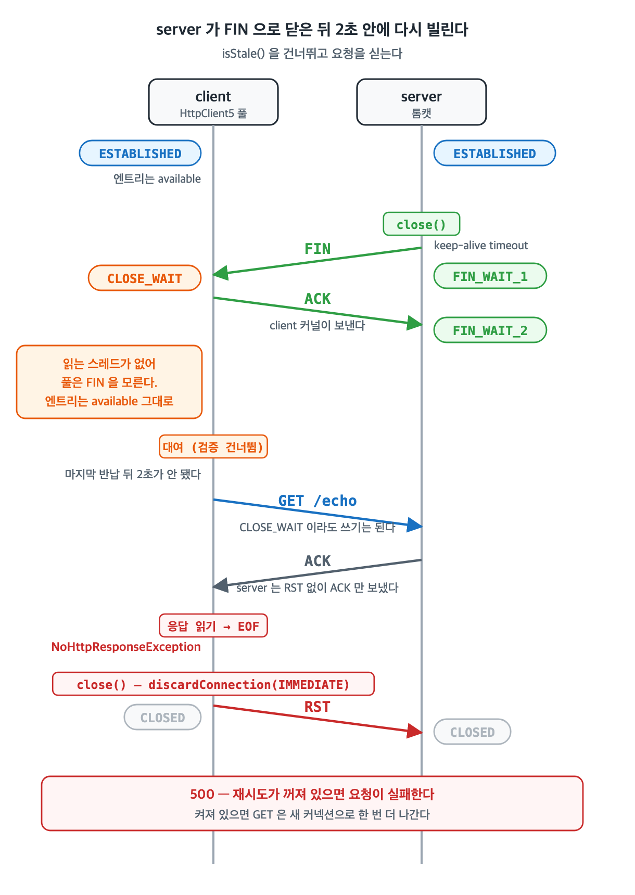
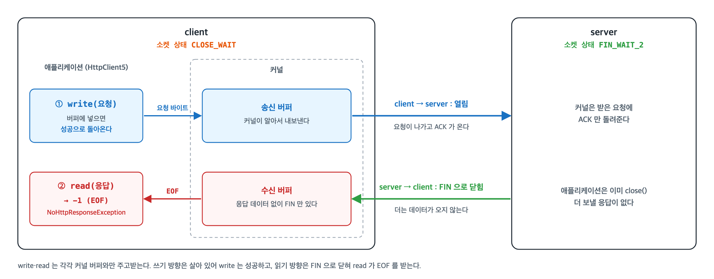

> 1편에서 HttpClient5 커넥션 풀이 커넥션을 빌려주고 돌려받는 흐름과, 쉬는 동안 끊긴 커넥션을 쓰지 않으려고 시각(keep-alive·`evictIdleConnections`·`timeToLive`)과 `isStale()` 로 거르는 설정을 봤다. <br>
> 이 글은, 그럼에도 죽은 커넥션에 요청이 실리는 경우(시각 계산이 어긋나거나 `isStale()` 이 못 막는 경우)를 정리한다. 이어서 죽은 커넥션에 요청하면 어떤 예외가 나는지, 클라이언트가 스스로 재시도하는지를 보고, 검증으로 못 거르는 경로 소실을 실측한다. <br>
> 기준 버전은 httpclient5 5.4.2 / httpcore5 5.3.3 이다.

## 죽은 커넥션을 거르는 설정

---

> 풀은 쉬고 있던 커넥션이 그사이 끊겼을 수 있다고 보고, 아래 설정으로 거른다.

| 설정 | 기준 시각 | 언제 거르나 |
| --- | --- | --- |
| keep-alive (`Keep-Alive: timeout=N`, 없으면 `RequestConfig.setConnectionKeepAlive` 기본 3분) | 반납 시각 + N → `expiryDeadline` | 대여 직전, evict 스레드 |
| `ConnectionConfig.setValidateAfterInactivity` (기본 2초) | 마지막 반납 시각(`updated`) + 값 | 대여 직전에 `isStale()` 을 부른다 |
| `HttpClientBuilder.evictIdleConnections(t)` | `updated` + t | evict 스레드 |
| `ConnectionConfig.setTimeToLive` | 커넥션을 만든 시각(`created`) + 값 | 대여 직전, evict 스레드 |

- 소켓을 직접 들여다보는 건 `isStale()` 하나다. 나머지는 모두 **시각만 보고** 버린다.
  - 즉, 서버가 알려준 timeout 이나 클라이언트가 정한 주기가 지났는지를 계산한다.
- `isStale()`은 상대가 보낸 `FIN` 이나 `RST`가 소켓에 와 있는지를 본다.

## isStale() 동작 방식

---

> `isStale()` 은 소켓 읽기 타임아웃을 1ms 로 바꿔 한 번 읽어 보고, 상대가 보낸 **FIN 이나 RST 가 와 있으면 끊긴 것으로 본다.**

### FIN 과 RST

> 둘 다 TCP 세그먼트 헤더의 플래그다. <br>
> FIN 은 "이쪽은 보낼 데이터를 다 보냈다"는 정상 종료이고, RST 는 "이 연결은 없다"는 즉시 중단이다.


| | FIN | RST |
| --- | --- | --- |
| 뜻 | 이 방향으로는 더 보내지 않는다. 반대 방향은 열려 있다 | 연결을 그 자리에서 끝낸다 |
| 보내는 때 | 애플리케이션이 소켓을 `close()` 하거나 `shutdownOutput()` 할 때 | 커널이 모르는 연결로 세그먼트를 받았을 때(소켓이 이미 완전히 사라진 연결, 아무도 듣지 않는 포트), 안 읽은 데이터가 수신 버퍼에 남은 채로 `close()` 할 때, `SO_LINGER` 0 으로 `close()` 할 때, 방화벽이 `REJECT --reject-with tcp-reset` 할 때 |
| 받은 쪽 소켓 | ACK 를 보내고 `CLOSE_WAIT` 이 된다 | 상태 없이 바로 사라진다. 응답하지 않는다 |
| 받은 쪽 자바 코드 | 읽으면 -1 (EOF). 쓰기는 여전히 된다 | 읽기·쓰기에서 `SocketException` (`Connection reset` 등) |
| 끝난 뒤 | 양쪽이 FIN 을 주고받고, 먼저 닫은 쪽에 `TIME_WAIT` 이 남는다 | `TIME_WAIT` 이 남지 않는다 |

EOF(End Of File)는 스트림이 끝나 더 읽을 데이터가 없다는 뜻이다. 소켓에서는 FIN 을 받은 뒤 그 전에 온 데이터를 다 읽고 나면 `read()` 가 -1 을 돌려주는데, 이 -1 이 EOF 다. 패킷이나 특별한 바이트가 아니라 `read()` 가 알려 주는 상태다.

| 소켓 상황 | `read()` 결과 | 뜻 |
| --- | --- | --- |
| 아직 온 데이터가 없음 | 기다리다 `SocketTimeoutException` (`SO_TIMEOUT` 이 걸려 있을 때) | 지금은 없지만 앞으로 올 수 있다 |
| FIN 을 받음 | -1 (EOF) | 상대는 더 보내지 않는다 |
| RST 를 받음 | `SocketException` | 연결이 비정상으로 끊겼다 |

정상 종료는 양쪽이 FIN 을 하나씩 보내야 끝난다. 한쪽만 FIN 을 보낸 상태를 half-close 라 한다. 연결부터 종료까지 세그먼트와 소켓 상태는 이렇게 흘러간다.


- 풀이 `GRACEFUL` 로 닫을 때(`timeToLive` 만료 등)가 이 모양이다.
  - 실측에서는 server 가 ACK 와 FIN 을 한 세그먼트로 보내 세 세그먼트로 끝났고, client 소켓은 `TIME_WAIT` 으로 남았다.
- 풀이 `IMMEDIATE` 로 닫을 때(`isStale()` 에 걸림, 요청 중 예외 등)는 **FIN 대신 RST** 를 보낸다.
  - `SO_LINGER` 를 0 으로 두고 닫기 때문이다.

`SO_LINGER` 는 `close()` 를 부른 뒤 송신 버퍼에 남은 데이터와 FIN 을 어떻게 처리할지 정하는 소켓 옵션이다.

| `SO_LINGER` | `close()` 동작 | 상대가 받는 것 | `TIME_WAIT` |
| --- | --- | --- | --- |
| 꺼짐 (기본) | 바로 돌아오고, 커널이 남은 데이터를 보낸 뒤 FIN 을 보낸다 | 데이터 → FIN | 먼저 닫은 쪽에 남는다 |
| 켜짐, N초 | 남은 데이터가 전달될 때까지 최대 N초 기다린다 | 데이터 → FIN | 남는다 |
| 켜짐, 0초 | 송신 버퍼를 버리고 바로 연결을 없앤다 (abortive close) | RST | 남지 않는다 |

```java
// org.apache.hc.core5.http.impl.io.BHttpConnectionBase — close(CloseMode) (httpcore5 5.3.3, 일부)
if (closeMode == CloseMode.IMMEDIATE) {
    try {
        // force abortive close (RST)
        baseSocket.setSoLinger(true, 0);
    } catch (final IOException ignore) {
    } finally {
        Closer.closeQuietly(baseSocket);
    }
} else {
    ...                                              // GRACEFUL: SO_LINGER 를 건드리지 않고 닫는다 → FIN
}
```

- `IMMEDIATE` 로 닫히는 커넥션은 이미 못 쓰게 된 커넥션이라, FIN 을 주고받으며 정리할 이유가 없다.
- RST 를 받은 쪽은 응답하지 않고 소켓을 바로 없앤다. 보낸 쪽도 상대의 FIN 을 기다리지 않으므로 어느 쪽에도 `TIME_WAIT` 이 남지 않는다.

### 1ms 읽기

```java
// org.apache.hc.core5.http.impl.io.BHttpConnectionBase (httpcore5 5.3.3)
private static final Timeout STALE_CHECK_TIMEOUT = Timeout.ofMilliseconds(1);

public boolean isOpen() {
    return this.socketHolderRef.get() != null;      // 클라이언트가 닫았는지만 본다
}

public boolean isStale() throws IOException {
    if (!isOpen()) {
        return true;
    }
    try {
        final int bytesRead = fillInputBuffer(STALE_CHECK_TIMEOUT);
        return bytesRead < 0;                       // EOF = 상대가 FIN 을 보냈다
    } catch (final SocketTimeoutException ex) {
        return false;                               // 1ms 동안 읽을 게 없다 = 살아 있다고 본다
    } catch (final SocketException ex) {
        return true;                                // RST 등
    }
}

private int fillInputBuffer(final Timeout timeout) throws IOException {
    final SocketHolder socketHolder = ensureOpen();
    final Socket socket = socketHolder.getSocket();
    final int oldtimeout = socket.getSoTimeout();
    try {
        socket.setSoTimeout(timeout.toMillisecondsIntBound());
        return this.inBuffer.fillBuffer(socketHolder.getInputStream());
    } finally {
        socket.setSoTimeout(oldtimeout);
    }
}
```

- classic(blocking) 클라이언트는 풀에서 쉬는 소켓을 읽는 스레드가 없다.
- 상대가 보낸 FIN·RST 는 커널이 받아 소켓 상태만 바꿔 두고, 자바 쪽은 `isStale()` 이 읽어 볼 때 처음 안다.

| 쉬는 동안 소켓에 온 것 | 1ms 읽기 결과 | `isStale()` |
| --- | --- | --- |
| 아무것도 없음 | `SocketTimeoutException` | false — 살아 있다고 본다 |
| FIN (소켓은 `CLOSE_WAIT`) | -1 (EOF) | true |
| RST | `SocketException` | true |
| 클라이언트가 이미 닫음 | 읽지 않는다 (`isOpen()` false) | true |

### FIN·RST 를 받은 커넥션을 다시 빌릴 때

server 가 쉬는 커넥션을 먼저 끊고 2초 넘게 지나 다시 빌렸을 때, router 에서 tcpdump 로 잡은 순서다.

- (가) FIN: 톰캣의 `keepAliveTimeout` 을 0.3초로 두고, client 는 keep-alive 를 60초로 고정해 서버보다 길게 잡았다.
- (나) RST: 톰캣 자리에 0.5초 동안 요청이 없으면 `SO_LINGER` 0 으로 닫는 작은 파이썬 서버를 띄웠다.


| | (가) server 가 FIN 으로 닫음 | (나) server 가 RST 로 끊음 |
| --- | --- | --- |
| 쉬는 동안 | server FIN → client ACK. client `CLOSE_WAIT`, server `FIN_WAIT_2` | server RST, 응답 세그먼트 없음. 양쪽 소켓이 사라진다 |
| 풀 엔트리 | available 그대로 | available 그대로 |
| 대여 | `isStale()` 이 stale 로 본다 | `isStale()` 이 stale 로 본다 |
| 옛 소켓으로 나간 것 | client RST | 없음 |
| 그다음 | 새 소켓 SYN… → 200 | 새 소켓 SYN… → 200 |

- (나) 는 caller 로그를 DEBUG 로 켜서 `connection http-outgoing-0 is stale` 다음에 `close connection IMMEDIATE` 가 찍히는 것을 확인했다. 1ms 읽기가 EOF 였는지 `SocketException` 이었는지는 로그에 나오지 않는다. 표의 구분은 위 코드 기준이다.
- (나) 에서 client 소켓은 RST 를 받자 커널에서 바로 사라졌다(1초 뒤 `/proc/net/tcp` 에 없음). 자바의 소켓 객체와 풀 엔트리는 남아 있다가 `isStale()` 이 읽어 볼 때 처음 끊긴 걸 안다. `IMMEDIATE` 로 닫아도 이미 없는 연결이라 아무것도 나가지 않았다.

(가) 에서 server 는 FIN 을 보낸 뒤에도 소켓이 끝나지 않았다. client 의 ACK 를 받고 client 쪽 FIN 을 기다리는 `FIN_WAIT_2` 로 남아 있다가, client 의 RST 를 받자 바로 사라졌다. client 가 FIN 으로 닫았다면 먼저 닫은 server 쪽에 `TIME_WAIT` 이 남았을 자리다.

| 시점 | client 소켓 | server 소켓 |
| --- | --- | --- |
| 응답 직후 | `ESTABLISHED` | `ESTABLISHED` |
| server FIN 뒤 (1.6초) | `CLOSE_WAIT` | `FIN_WAIT_2` |
| client RST 뒤 | 없음 | 없음 |

RST 에 대한 응답 세그먼트는 없었고, 바로 이어서 새 소켓의 SYN 이 나갔다.

## 그래도 죽은 커넥션을 쓰는 경우

---

> 서버가 클라이언트 계산보다 먼저 닫아도 FIN·RST 가 소켓에 와 있으면 `isStale()` 이 거른다. 죽은 커넥션에 요청이 실리는 건 `isStale()` 까지 놓칠 때다.

- 시각으로 거르는 설정은 서버가 클라이언트가 잡은 수명보다 먼저 닫으면 놓친다.
- 서버가 `Keep-Alive` 헤더를 안 줘서 클라이언트가 기본 3분을 잡거나, `setKeepAliveStrategy` 로 서버 값보다 길게 고정하거나, 배포·재기동, 중간 장비의 idle timeout 이 그런 경우다.
- 그래도 그것만으로 죽은 커넥션을 쓰지는 않는다. 앞의 (가)·(나) 가 바로 이 경우로, 시각 기준으로는 살아 있는 커넥션이었지만 `isStale()` 이 걸렀다.

> 뚫리는 건 아래 세 경우다.

| 경우 | 예 | `isStale()` 이 왜 못 거르나 | 요청을 실으면 |
| --- | --- | --- | --- |
| 반납 뒤 2초 안에 다시 빌린다 | 서버가 먼저 닫았는데 요청 간격이 2초보다 짧다 | 마지막 반납 뒤 `validateAfterInactivity` 가 지나지 않아 부르지 않는다 | FIN 이면 `NoHttpResponseException`, RST 면 `SocketException` (`Connection reset` 등). 바로 난다 |
| 검사 직후에 끊긴다 | 서버의 keep-alive timeout 과 거의 같은 순간에 요청을 싣는다 | 1ms 읽기를 통과한 뒤 FIN 이 온다. 검사와 요청 쓰기는 한 동작이 아니다 | 위와 같다 |
| 신호 없이 끊긴다 | 중간 장비가 연결 정보를 말없이 지움(경로 소실), 서버 호스트가 FIN 없이 사라짐 | 불러도 1ms 읽기가 `SocketTimeoutException` 으로 끝나 살아 있다고 본다 | 장비가 버리면 요청 재전송만 반복하다 `responseTimeout` 뒤 `SocketTimeoutException: Read timed out`, RST 를 돌려주면 `Connection reset` |

요청 쓰기는 세 경우 모두 대개 성공한다. 예외는 응답을 읽을 때 소켓에 무엇이 와 있느냐로 갈린다.

- 첫째는 `validateAfterInactivity` 를 0 으로 두면 막을 수 있다. 0 이면 마지막 반납 시각과 상관없이 커넥션을 다시 쓸 때마다 `isStale()` 을 부른다.
- 둘째·셋째는 검증 설정으로 막을 수 없다.

```java
// org.apache.hc.client5.http.impl.io.PoolingHttpClientConnectionManager — lease() (httpclient5 5.4.2, 일부)
if (poolEntry.hasConnection()) {                        // 풀에 있던 커넥션을 다시 쓸 때만
    final TimeValue timeValue = resolveValidateAfterInactivity(connectionConfig);   // 없으면 2초
    if (TimeValue.isNonNegative(timeValue)) {          // 음수면 검사하지 않는다
        if (timeValue.getDuration() == 0               // 0 이면 매번
                || Deadline.calculate(poolEntry.getUpdated(), timeValue).isExpired()) {
            ...
            stale = conn.isStale();
```

대신 살아 있는 커넥션도 대여마다 1ms 읽기를 거친다. 읽을 게 없으니 1ms 를 기다려 `SocketTimeoutException` 으로 끝나고, 앞뒤로 타임아웃을 1ms 로 바꿨다가 되돌리는 `setSoTimeout` 호출이 붙는다. 실제로 얼마나 드는지는 [결과 — validateAfterInactivity 0 의 비용](#validateafterinactivity-0-의-비용)에서 쟀다.

### 반납 뒤 2초 안에 다시 빌릴 때

첫째 경우를 앞의 (가) 와 같은 조건(server 0.3초, client 60초)에서, 2초가 지나기 전에 다시 빌려 재현했다.



| | 2초 안에 다시 빌림 |
| --- | --- |
| 쉬는 동안 | server FIN → client ACK. client `CLOSE_WAIT`, server `FIN_WAIT_2` |
| 대여 | `isStale()` 을 건너뛴다 |
| 그다음 세그먼트 | client 요청 → server ACK → client RST |
| 결과 | `NoHttpResponseException`, 500 |

- TCP 는 한쪽이 FIN 을 보내도 반대 방향 전송은 막지 않는다(half-close).
- `CLOSE_WAIT` 소켓에 쓴 요청도 커널 송신 버퍼에 들어가므로 `write` 는 성공한다. server 는 요청에 RST 를 보내지 않고 ACK 만 보냈다.
- 응답을 읽으면 이미 받아 둔 FIN 이 EOF 로 나온다.



`NoHttpResponseException` 은 응답 파서가 첫 줄을 읽다가 스트림 끝을 만나 `null` 을 돌려줄 때 던진다.

```java
// org.apache.hc.core5.http.impl.io.AbstractMessageParser — parse() (httpcore5 5.3.3, 일부)
final int i = buffer.readLine(this.headLine, inputStream);
if (i == -1) {
    return null;                                    // 한 줄도 읽기 전에 EOF
}

// org.apache.hc.core5.http.impl.io.DefaultBHttpClientConnection — receiveResponseHeader()
final ClassicHttpResponse response = this.responseParser.parse(this.inBuffer, socketHolder.getInputStream());
if (response == null) {
    throw new NoHttpResponseException("The target server failed to respond");
}
```

server 가 RST 를 돌려주고 client 가 EOF 보다 RST 를 먼저 처리하면 `Connection reset` 이 될 것으로 보이지만, 이 조합은 재현하지 않았다.

### 경로 소실

> 경로 소실은 이 글에서 붙인 이름으로, 양 끝 소켓은 멀쩡한데 그 사이의 길이 이 연결을 잊어버린 상태를 말한다. <br>
> - **경로**: 클라이언트에서 서버까지 패킷이 지나가는 길이다. 그 사이에는 NAT·로드밸런서·방화벽 같은 장비가 끼어 있다. <br>
> - **소실**: 그 장비가 이 연결에 대해 들고 있던 상태를 잃는 것이다.

- 이 장비들은 연결마다 상태 테이블 항목(리눅스라면 `conntrack`)을 둔다.
- NAT 라면 "caller 의 어느 포트를 바깥 어느 포트로 바꿨는지"를 여기 적어 두고, 이 항목이 있어야 다음 패킷을 같은 연결로 알아보고 넘겨준다.
- 일정 시간 패킷이 없으면 장비는 이 항목을 지운다(장비의 idle timeout).
  - 지울 때 양 끝에 FIN 이나 RST 를 보내지 않는다.
  - 클라이언트와 서버는 소켓을 여전히 `ESTABLISHED` 로 안다.
  - 그 뒤 들어온 패킷을 어떻게 다루는지는 장비마다 다르다.
    - 버릴 수도, RST 를 돌려줄 수도, 새 연결로 보고 통과시킬 수도 있다.

장비가 항목을 지운 뒤 같은 커넥션에 요청을 실어 실측했다. 환경은 [실측 환경](#실측-환경)에 있다.

| 확인한 것 | 실측 항목 |
| --- | --- |
| 장비가 패킷을 버리느냐, RST 를 돌려주느냐, 통과시키느냐에 따라 어떻게 되나 | [A1~A3](#장비가-지운-뒤의-패킷을-어떻게-다루는지가-결과를-가른다-a1a3) |
| `validateAfterInactivity` 를 0 으로 둬도 못 막는가 | [B1](#커넥션-검증으로는-못-막는다-b1) |
| 무엇으로 미리 막을 수 있나 (`evictIdleConnections`, TCP keepalive, 서버 keep-alive timeout) | [B2'·B4·B5](#미리-막는-방법은-셋이다-b2b4b5) |
| 기본 재시도가 살려 주나 | [C1·C2](#재시도는-rst-일-때만-살린다-c1c2) |

## 클라이언트가 스스로 재시도하나

---

> 한다. `HttpClientBuilder` 는 따로 설정하지 않으면 `DefaultHttpRequestRetryStrategy.INSTANCE` 로 재시도 단계를 넣고, 이 전략은 멱등 요청을 1번 더 보낸다.

```java
// org.apache.hc.client5.http.impl.classic.HttpClientBuilder — build() (httpclient5 5.4.2, 일부)
if (!automaticRetriesDisabled) {                      // disableAutomaticRetries() 를 부르면 true
    HttpRequestRetryStrategy retryStrategyCopy = this.retryStrategy;
    if (retryStrategyCopy == null) {
        retryStrategyCopy = DefaultHttpRequestRetryStrategy.INSTANCE;
    }
    execChainDefinition.addFirst(
            new HttpRequestRetryExec(retryStrategyCopy),
            ChainElement.RETRY.name());
}
```

```java
// org.apache.hc.client5.http.impl.DefaultHttpRequestRetryStrategy (httpclient5 5.4.2, 일부)
public DefaultHttpRequestRetryStrategy() {
    this(1, TimeValue.ofSeconds(1L));                 // 최대 1번, 1초는 429·503 응답 재시도 간격
}

public DefaultHttpRequestRetryStrategy(final int maxRetries, final TimeValue defaultRetryInterval) {
    this(maxRetries, defaultRetryInterval,
            Arrays.asList(                            // 재시도하지 않는 예외
                    InterruptedIOException.class,
                    UnknownHostException.class,
                    ConnectException.class,
                    ConnectionClosedException.class,
                    NoRouteToHostException.class,
                    SSLException.class),
            Arrays.asList(                            // 재시도하는 응답 코드
                    HttpStatus.SC_TOO_MANY_REQUESTS,
                    HttpStatus.SC_SERVICE_UNAVAILABLE));
}

public boolean retryRequest(final HttpRequest request, final IOException exception,
                            final int execCount, final HttpContext context) {
    if (execCount > this.maxRetries) {
        return false;                                 // 횟수 초과
    }
    if (this.nonRetriableIOExceptionClasses.contains(exception.getClass())) {
        return false;
    }
    for (final Class<? extends IOException> rejectException : this.nonRetriableIOExceptionClasses) {
        if (rejectException.isInstance(exception)) {
            return false;                             // 목록에 있는 예외의 하위 타입
        }
    }
    if (request instanceof CancellableDependency && ((CancellableDependency) request).isCancelled()) {
        return false;
    }
    return handleAsIdempotent(request);               // Method.isIdempotent(request.getMethod())
}
```

죽은 커넥션에서 나는 세 예외에 대입하면 이렇다.

| 예외 | 재시도 |
| --- | --- |
| `NoHttpResponseException` | 목록에 없다 → 멱등 메서드면 1번 더 보낸다 |
| `SocketException: Connection reset` | 목록에 없다 → 멱등 메서드면 1번 더 보낸다 |
| `SocketTimeoutException` | `InterruptedIOException` 의 하위라 하지 않는다 |

- **멱등 메서드**는 `Method` enum 의 값으로 정한다. GET·HEAD·PUT·DELETE·OPTIONS·TRACE 는 재시도하고, POST·PATCH·CONNECT 는 하지 않는다. 요청 이름만 보므로 GET 으로 상태를 바꾸는 API 도 재시도한다.
- **기다리지 않는다.** 예외 경로의 `getRetryInterval` 은 `HttpRequestRetryStrategy` 의 default 구현(`TimeValue.ZERO_MILLISECONDS`)을 그대로 쓴다. 생성자의 1초는 429·503 응답에만 쓰인다.
- **본문을 다시 못 읽으면 하지 않는다.** `HttpRequestRetryExec` 는 전략에 묻기 전에 요청 본문의 `isRepeatable()` 을 보고, false 면(`InputStreamEntity` 등) 예외를 그대로 던진다.
- **재시도가 성공하면 호출한 쪽은 실패를 모른다.** `Recoverable I/O exception ... caught` 로그만 INFO 로 남는다.

> 재시도도 풀에서 커넥션을 다시 빌린다. 같은 처지의 커넥션이 풀에 여럿 쉬고 있으면 재시도도 죽은 커넥션을 집을 수 있을 것으로 보이지만, 재현하지는 않았다.

## 실측 환경

---

> caller 와 upstream 을 서로 다른 도커 네트워크에 두고, 그 사이를 리눅스 컨테이너 하나(router)가 NAT 로 잇는다. router 의 conntrack idle timeout 을 10초로 줄여 장비 역할을 시킨다.

```
caller 10.81.0.10 ──[client]── 10.81.0.2  router  10.82.0.2 ──[server]── 10.82.0.10 upstream
                                         MASQUERADE
                                         conntrack idle timeout 10s
```

| 항목 | 값 |
| --- | --- |
| 클라이언트 | Spring Boot 3.4.4, HttpClient5 5.4.2 / httpcore5 5.3.3, JDK 21 |
| 서버 | 같은 Spring Boot 의 톰캣. `keepAliveTimeout` 60초 (`Keep-Alive: timeout=60` 을 응답에 싣는다) |
| router | alpine 3.20, iptables 1.8.10 (nf_tables), conntrack-tools 1.4.8 |
| 커널 | Docker Desktop 의 5.10.25-linuxkit |
| 공통 조건 | 장비 idle timeout 10초, 요청 사이 12초 쉼, `responseTimeout` 10초, 재시도 끔(C 제외) |

한 케이스는 이렇게 돈다.

1. caller 를 새로 띄우고 요청 1건으로 커넥션 하나를 풀에 넣는다.
2. 12초 쉰다. 그사이 router 가 conntrack 항목을 지운다.
3. 같은 풀로 요청을 한 번 더 보내고, 결과·걸린 시간·예외를 본다.

router 가 항목을 지운 뒤 들어온 패킷을 다루는 방식은 셋으로 나눴다.

| 모드 | router 설정 | 흉내 내는 장비 |
| --- | --- | --- |
| loose | `nf_conntrack_tcp_loose=1` (리눅스 기본) | 중간부터 온 패킷으로 항목을 새로 만든다 |
| drop | `tcp_loose=0` + `--ctstate INVALID -j DROP` | 모르는 연결의 패킷을 버린다 |
| reset | `tcp_loose=0` + `--ctstate INVALID -j REJECT --reject-with tcp-reset` | 모르는 연결에 RST 를 돌려준다 |

```bash
./scripts/run-pathloss.sh
```

<details markdown="1">
<summary>경로 소실 실측 — <code>scripts/run-pathloss.sh</code></summary>

```bash
#!/usr/bin/env bash
# 경로 소실: caller 와 upstream 사이의 router 가 conntrack 항목을 idle timeout(10초)으로 지운다.
# 지울 때 양 끝에 아무것도 보내지 않는다. 그 뒤 12초 쉬고 같은 커넥션에 요청을 싣는다.
set -e
cd "$(dirname "$0")/../docker"
DC="docker-compose -p pathloss -f docker-compose.pathloss.yml"
DEVICE_IDLE=10   # router 의 idle timeout
IDLE=12          # 요청 사이에 쉬는 시간. DEVICE_IDLE 보다 길다

router_mode() {   # <loose|drop|reset>
  docker exec pathloss_router_1 sh -c "
    iptables -F FORWARD
    sysctl -qw net.netfilter.nf_conntrack_tcp_timeout_established=$DEVICE_IDLE
    conntrack -F 2>/dev/null || true
    case $1 in
      loose) sysctl -qw net.netfilter.nf_conntrack_tcp_loose=1 ;;
      drop)  sysctl -qw net.netfilter.nf_conntrack_tcp_loose=0
             iptables -A FORWARD -m conntrack --ctstate INVALID -j DROP ;;
      reset) sysctl -qw net.netfilter.nf_conntrack_tcp_loose=0
             iptables -A FORWARD -p tcp -m conntrack --ctstate INVALID -j REJECT --reject-with tcp-reset ;;
    esac"
}

boot() {   # <env...>
  env "$@" $DC up -d --force-recreate upstream caller caller-route >/dev/null 2>&1
  # caller-route 가 server 대역 경로를 넣기 전에 요청이 나가면 router 를 안 거친다
  until docker exec pathloss_caller_1 cat /proc/net/route 2>/dev/null | grep -q 0000520A; do sleep 0.5; done
  until curl -sf -o /dev/null http://localhost:9180/actuator/health; do sleep 1; done
  until curl -sf -o /dev/null http://localhost:9181/echo; do sleep 1; done
}

sock() {   # caller 쪽 upstream:8080 소켓의 로컬 포트와 상태
  docker exec pathloss_caller_1 awk 'NR>1 && $3 ~ /:1F90$/ { split($2,a,":"); print a[2], $4 }' /proc/net/tcp \
    | while read -r port st; do
        case $st in 01) st=ESTABLISHED;; 08) st=CLOSE_WAIT;; 06) st=TIME_WAIT;; 04) st=FIN_WAIT1;; 05) st=FIN_WAIT2;; esac
        printf '%d:%s ' "0x$port" "$st"
      done
}

ct() {   # router 의 conntrack 항목 수
  docker exec pathloss_router_1 sh -c 'conntrack -L -p tcp --dport 8080 2>/dev/null | wc -l'
}

errs() {   # caller 로그에서 N 줄 이후의 예외 이름
  docker logs pathloss_caller_1 2>&1 | tail -n +"$1" \
    | grep -oE '[a-zA-Z.]+(Exception|Error): .{0,40}' | head -1 | sed 's/^.*\.\([A-Za-z]*Exception\)/\1/'
}

run() {   # <name> <mode> <env...>
  local name=$1 mode=$2; shift 2
  router_mode "$mode"
  boot "$@"
  curl -s -o /dev/null http://localhost:9180/call
  local before; before=$(sock)
  sleep "$IDLE"
  local idle_sock idle_ct; idle_sock=$(sock); idle_ct=$(ct)
  local n; n=$(docker logs pathloss_caller_1 2>&1 | wc -l | tr -d ' ')
  local out; out=$(curl -s -o /dev/null -m 30 -w '%{http_code} %{time_total}' http://localhost:9180/call)
  sleep 0.5
  printf '%-34s | %-5s | 첫 요청 뒤: %-22s | %ss 쉰 뒤: %-22s conntrack=%s | 다음 요청 HTTP %s s | 뒤: %-22s | %s\n' \
    "$name" "$mode" "$before" "$IDLE" "$idle_sock" "$idle_ct" "$out" "$(sock)" "$(errs "$n")"
}

$DC up -d >/dev/null 2>&1
docker exec pathloss_router_1 sh -c 'until [ -f /ready ]; do sleep 0.5; done
  iptables -t nat -C POSTROUTING -o eth1 -j MASQUERADE 2>/dev/null || iptables -t nat -A POSTROUTING -o eth1 -j MASQUERADE'

BASE="POOL_RETRY_ENABLED=false"
run "A1. 방어 없음"                        loose $BASE
run "A2. 방어 없음"                        drop  $BASE
run "A3. 방어 없음"                        reset $BASE
run "B1. validateAfterInactivity=0"       drop  $BASE POOL_VALIDATE_AFTER_INACTIVITY_MS=0
run "B2. evictIdleConnections 5s (shared)" drop  $BASE POOL_EVICT_IDLE_MS=5000
run "B2'. evictIdleConnections 5s"         drop  $BASE POOL_EVICT_IDLE_MS=5000 POOL_MANAGER_SHARED=false
run "B3. setTcpKeepIdle(5)"                drop  $BASE POOL_TCP_KEEP_IDLE_SEC=5
run "B4. SO_KEEPALIVE + 커널 keepalive 5s"  drop  $BASE POOL_TCP_KEEP_IDLE_SEC=5 CALLER_KEEPALIVE_TIME=5 CALLER_KEEPALIVE_INTVL=5
run "B5. 서버 keepAliveTimeout 5s"          drop  $BASE KEEP_ALIVE_TIMEOUT=5000
run "C1. 재시도 켬 (기본 전략)"            drop  POOL_RETRY_ENABLED=true
run "C2. 재시도 켬 (기본 전략)"            reset POOL_RETRY_ENABLED=true
```

</details>

## 결과

---

> 장비가 버리는 경우(drop) 방어가 없으면 요청은 `responseTimeout` 10초를 다 채우고 실패했다. 미리 막은 건 evict(스레드가 실제로 돌 때), 커널 TCP keepalive, 장비보다 짧은 서버 keepAliveTimeout 셋이었다.

| # | 장비 | 클라이언트 쪽 조건 | 12초 쉰 뒤 caller 소켓 / router 항목 | 다음 요청 |
| --- | --- | --- | --- | --- |
| A1 | loose | 방어 없음 | `ESTABLISHED` / 0 | **200**, 0.01초. 같은 소켓 그대로 |
| A2 | drop | 방어 없음 | `ESTABLISHED` / 0 | **500**, 10.05초. `SocketTimeoutException: Read timed out` |
| A3 | reset | 방어 없음 | `ESTABLISHED` / 0 | **500**, 0.07초. `SocketException: Connection reset` |
| B1 | drop | `validateAfterInactivity=0` | `ESTABLISHED` / 0 | 500, 10.06초. `SocketTimeoutException` |
| B2 | drop | `evictIdleConnections(5s)` + `setConnectionManagerShared(true)` | `ESTABLISHED` / 0 | 500, 10.05초. `SocketTimeoutException` |
| B2' | drop | `evictIdleConnections(5s)` | `TIME_WAIT` / 1 | **200**. 새 커넥션 |
| B3 | drop | `setSoKeepAlive(true)` + `setTcpKeepIdle(5)` | `ESTABLISHED` / 0 | 500, 10.06초. `SocketTimeoutException` |
| B4 | drop | B3 + 커널 `tcp_keepalive_time=5` | `ESTABLISHED` / **1** | **200**. 같은 소켓 그대로 |
| B5 | drop | 서버 `keepAliveTimeout` 5초, 검증은 기본 2초 | `CLOSE_WAIT` / 1 | **200**. 새 커넥션 |
| C1 | drop | 재시도 켬 (기본 전략) | `ESTABLISHED` / 0 | 500, 10.06초. `SocketTimeoutException` |
| C2 | reset | 재시도 켬 (기본 전략) | `ESTABLISHED` / 0 | **200**. 새 커넥션 |

A2 에서 서버 쪽 소켓도 읽어 봤다. 12초 쉰 뒤 caller 와 upstream 의 소켓은 둘 다 `ESTABLISHED`(`/proc/net/tcp` 상태 `01`)였고, router 의 conntrack 에는 항목이 없었다.

### 장비가 지운 뒤의 패킷을 어떻게 다루는지가 결과를 가른다 (A1~A3)

- **loose (A1)** — 문제가 드러나지 않는다. 리눅스 conntrack 은 기본값(`nf_conntrack_tcp_loose=1`)에서 연결 중간에 온 패킷으로 항목을 새로 만든다. MASQUERADE 가 원래 포트를 그대로 다시 골라 서버가 보는 4-튜플이 같았고, 같은 소켓으로 응답이 왔다.
- **drop (A2)** — 클라이언트는 요청을 보내고 응답을 기다리며 재전송만 반복한다. router 에서 tcpdump 로 보면 같은 208바이트 요청이 0.2·0.4·0.8·1.6초 간격으로 다시 나가고 모두 버려졌다(`DROP` 카운터 8). 실패는 `responseTimeout` 이 끝내 준다.
- **reset (A3)** — RST 가 바로 돌아와서 0.07초 만에 `Connection reset` 으로 끝난다.

> A1 은 포트를 그대로 다시 고를 수 있는 리눅스 router 하나의 결과다. 다른 포트를 고르는 NAT 라면 서버는 모르는 연결의 패킷을 받아 RST 를 돌려줄 것으로 보이지만, 직접 재현하지는 않았다.

### 커넥션 검증으로는 못 막는다 (B1)

`validateAfterInactivity=0` 이면 대여할 때마다 `isStale()` 을 부른다. 경로 소실에서는 FIN 도 RST 도 오지 않아 1ms 읽기가 타임아웃으로 끝나고, 검사를 통과한 커넥션에 요청이 실렸다.

### 미리 막는 방법은 셋이다 (B2'·B4·B5)

장비가 항목을 지우기 전에 셋 중 하나가 일어나면 된다.

| 방법 | 원리 | 실측 |
| --- | --- | --- |
| `evictIdleConnections(t)` | 풀이 쉬는 커넥션을 장비보다 먼저 닫는다 | B2' — 12초 시점에 소켓은 `TIME_WAIT`, 새 커넥션으로 200 |
| TCP keepalive | 쉬는 커넥션에도 프로브가 오가 장비의 항목을 살려 둔다 | B4 — 항목이 남아 같은 소켓으로 200 |
| 서버 `keepAliveTimeout` < 장비 idle timeout | 서버의 FIN 이 장비를 지나 클라이언트에 닿고, 검증이 걸러낸다 | B5 — 소켓은 `CLOSE_WAIT`, 새 커넥션으로 200 |

각 방법에는 걸리는 조건이 있었다.

**evict 는 스레드가 떠야 돈다 (B2).** `HttpClientBuilder` 는 `setConnectionManagerShared(true)` 면 `IdleConnectionEvictor` 를 만들지 않는다. B2 는 `evictIdleConnections(5s)` 를 줬는데도 소켓이 12초 뒤까지 `ESTABLISHED` 로 남아 A2 와 같이 실패했다. 또 evict 스레드는 `t` 마다 깨어 `updated + t` 가 지난 엔트리를 닫으므로, 엔트리는 최대 `2t` 가까이 쉴 수 있다. 장비 idle timeout 보다 `2t` 를 짧게 잡아야 한다.

**HttpClient5 classic 은 `setTcpKeepIdle` 을 소켓에 넣지 않는다 (B3).** `SocketConfig` 에 `setTcpKeepIdle`·`setTcpKeepInterval`·`setTcpKeepCount` 가 있지만, B3 의 소켓은 keepalive 타이머가 켜진 채로 남은 시간이 약 7200초였다(`/proc/net/tcp` 의 timer 필드 `02:000AFB95`). 커널 기본값 `tcp_keepalive_time` 2시간이 그대로 걸린 것이다.

```java
// org.apache.hc.client5.http.impl.io.DefaultHttpClientConnectionOperator#connect (5.4.2) 에서 소켓에 넣는 값
sock.setReuseAddress(socketConfig.isSoReuseAddress());
sock.setTcpNoDelay(socketConfig.isTcpNoDelay());
sock.setKeepAlive(socketConfig.isSoKeepAlive());     // 켜고 끄기만 한다
// rcvBuf, sndBuf, linger ... getTcpKeepIdle / Interval / Count 는 읽지 않는다
```

httpclient5-5.4.2 jar 전체에서 `getTcpKeepIdle` 을 부르는 클래스는 없다. httpcore5-5.3.3 안에서는 `HttpRequester`·`HttpServer`(httpcore 자체의 클래식 부트스트랩)와 `SingleCoreIOReactor`(async)만 이 값을 쓴다. B4 는 caller 컨테이너의 네트워크 네임스페이스에 `net.ipv4.tcp_keepalive_time=5`, `tcp_keepalive_intvl=5` 를 넣어 막았다. 커널 값은 그 네임스페이스(또는 호스트)의 모든 소켓에 걸린다.

> 소켓 하나에만 걸려면 `ExtendedSocketOptions.TCP_KEEPIDLE` 을 직접 넣는 소켓 팩토리(`DetachedSocketFactory`)를 `DefaultHttpClientConnectionOperator` 에 넘기는 방법이 있어 보인다. 직접 재현하지는 않았다.

**서버 쪽 값은 클라이언트가 고를 수 없다 (B5).** 서버가 장비보다 먼저 FIN 을 보내면 장비의 항목이 살아 있는 동안 FIN 이 지나가고, 경로 소실이 아니라 보통의 stale 이 된다. 클라이언트는 기본 검증(2초)으로 걸러냈다.

### 재시도는 RST 일 때만 살린다 (C1·C2)

기본 재시도 전략은 `SocketTimeoutException` 을 재시도하지 않고 `Connection reset` 은 멱등 요청이면 1번 더 보낸다. 실측도 그대로 갈렸다.

- C1 (drop) — `SocketTimeoutException` 이라 재시도하지 않고 10초를 다 쓰고 실패했다.
- C2 (reset) — GET 을 새 커넥션으로 한 번 더 보냈고 200 이 났다.

### validateAfterInactivity 0 의 비용

`validateAfterInactivity` 를 0 으로 두면 커넥션을 다시 쓸 때마다 `isStale()` 이 돌고, 살아 있는 커넥션은 1ms 를 다 기다린다.

경로 소실 실측과 별개로, router 없이 같은 도커 네트워크에 둔 톰캣(위 upstream 과 같은 앱)에 커넥션 하나로 요청을 5,000번 순서대로 보냈다. JDK 21, Docker Desktop 5.10.25-linuxkit, JIT 워밍업 한 바퀴 뒤 값이다. 커넥션 팩토리를 감싸 `isStale()` 호출 수와 걸린 시간을 셌다.

| `validateAfterInactivity` | `isStale()` 호출 | 대여 한 번 (평균) | GET 한 번 (평균) |
| --- | --- | --- | --- |
| 음수 (검사 안 함) | 0번 | 0.05ms | 0.65ms |
| 2초 (기본) | 0번 | 0.06ms | 0.56ms |
| 0 | 4,950번 | 1.55ms | 2.34ms |

- `isStale()` 한 번에 평균 1.47ms 가 들었다. 1ms 타임아웃을 다 기다린 위에 0.47ms 가 더 붙었다. 나머지를 무엇이 차지하는지는 나눠 재지 않았다.
- 요청 간격이 2초보다 짧으니 기본값에서는 한 번도 부르지 않았다.
- 0 일 때 5,000번이 아니라 4,950번인 건 톰캣이 커넥션 하나로 100개 요청을 받으면 닫기 때문이다(`server.tomcat.max-keep-alive-requests` 100, 톰캣 기본값과 같다). 새로 만든 커넥션은 검사하지 않는다.
- 로컬처럼 응답이 1ms 안팎이면 요청마다 1.5ms 가 더해져 몇 배로 느려진다. 응답이 수십 ms 걸리는 호출이면 비중은 그만큼 작다.

<details markdown="1">
<summary>측정 코드 (Bench.java)</summary>

```java
import java.lang.reflect.*;
import java.util.*;
import java.util.concurrent.atomic.AtomicLong;
import org.apache.hc.client5.http.HttpRoute;
import org.apache.hc.client5.http.classic.methods.HttpGet;
import org.apache.hc.client5.http.config.ConnectionConfig;
import org.apache.hc.client5.http.impl.classic.*;
import org.apache.hc.client5.http.impl.io.*;
import org.apache.hc.client5.http.io.*;
import org.apache.hc.core5.http.HttpHost;
import org.apache.hc.core5.http.io.HttpConnectionFactory;
import org.apache.hc.core5.http.io.entity.EntityUtils;
import org.apache.hc.core5.http.protocol.HttpCoreContext;
import org.apache.hc.core5.util.*;

// validateAfterInactivity 값에 따라 대여 한 번에 드는 시간과 isStale() 호출 수
public class Bench {
    static final AtomicLong staleCalls = new AtomicLong(), staleNanos = new AtomicLong();

    static PoolingHttpClientConnectionManager manager(long validateMs) {
        var base = ManagedHttpClientConnectionFactory.INSTANCE;
        HttpConnectionFactory<ManagedHttpClientConnection> counting = socket -> {
            ManagedHttpClientConnection real = base.createConnection(socket);
            return (ManagedHttpClientConnection) Proxy.newProxyInstance(Bench.class.getClassLoader(),
                new Class<?>[]{ManagedHttpClientConnection.class}, (p, m, a) -> {
                    long t0 = m.getName().equals("isStale") ? System.nanoTime() : 0;
                    try { return m.invoke(real, a); }
                    catch (InvocationTargetException e) { throw e.getCause(); }
                    finally { if (t0 != 0) { staleNanos.addAndGet(System.nanoTime() - t0); staleCalls.incrementAndGet(); } }
                });
        };
        return PoolingHttpClientConnectionManagerBuilder.create()
            .setConnectionFactory(counting)
            .setDefaultConnectionConfig(ConnectionConfig.custom()
                .setValidateAfterInactivity(TimeValue.ofMilliseconds(validateMs)).build())
            .build();
    }

    static String pct(long[] ns) {
        Arrays.sort(ns);
        double avg = Arrays.stream(ns).average().orElse(0) / 1000;
        return String.format("평균 %7.1fµs  p50 %7.1fµs  p99 %7.1fµs", avg, ns[ns.length / 2] / 1000.0, ns[ns.length * 99 / 100] / 1000.0);
    }

    public static void main(String[] args) throws Exception {
        HttpHost host = HttpHost.create(args[0]);
        int n = Integer.parseInt(args[1]);
        long[] cases = {-1, 2000, 0};
        String[] names = {"꺼짐(-1)", "2초(기본)", "0"};
        for (int round = 0; round < 2; round++) {   // 첫 바퀴는 JIT 워밍업
            System.out.println(round == 0 ? "--- 워밍업" : "--- 측정");
            for (int c = 0; c < cases.length; c++) {
                // 1) 대여·반납만 반복
                try (var cm = manager(cases[c])) {
                    var route = new HttpRoute(host);
                    var ep = cm.lease("x", route, null).get(Timeout.ofSeconds(5));
                    cm.connect(ep, TimeValue.ofSeconds(5), HttpCoreContext.create());
                    cm.release(ep, null, TimeValue.ofMinutes(5));
                    staleCalls.set(0); staleNanos.set(0);
                    long[] ns = new long[n];
                    for (int i = 0; i < n; i++) {
                        long t0 = System.nanoTime();
                        ep = cm.lease("x", route, null).get(Timeout.ofSeconds(5));
                        ns[i] = System.nanoTime() - t0;
                        cm.release(ep, null, TimeValue.ofMinutes(5));
                    }
                    if (round == 1) System.out.printf("대여만  %-9s %s  isStale %d번, 한 번에 평균 %.1fµs%n", names[c], pct(ns),
                        staleCalls.get(), staleCalls.get() == 0 ? 0 : staleNanos.get() / 1000.0 / staleCalls.get());
                }
                // 2) 실제 GET 을 순서대로
                try (var cm = manager(cases[c]); var client = HttpClients.custom().setConnectionManager(cm).build()) {
                    var get = new HttpGet(args[0] + "/echo");
                    client.execute(get, r -> EntityUtils.toString(r.getEntity()));
                    staleCalls.set(0); staleNanos.set(0);
                    long[] ns = new long[n];
                    for (int i = 0; i < n; i++) {
                        long t0 = System.nanoTime();
                        client.execute(get, r -> EntityUtils.toString(r.getEntity()));
                        ns[i] = System.nanoTime() - t0;
                    }
                    if (round == 1) System.out.printf("GET    %-9s %s  isStale %d번%n", names[c], pct(ns), staleCalls.get());
                }
            }
        }
    }
}
```

</details>

## 정리

---

> 경로 소실은 커넥션 검증으로 걸러지지 않고, 장비가 버리는 경우 `responseTimeout` 만큼 매달린다. 장비의 idle timeout 보다 먼저 풀이 닫거나, keepalive 로 항목을 살려 두거나, 서버가 먼저 닫게 해야 한다.

| 장비가 지운 뒤 | 방어가 없으면 | 막는 것 |
| --- | --- | --- |
| 새 연결로 받아 준다 | 드러나지 않는다 | — |
| 패킷을 버린다 | `responseTimeout` 까지 매달린 뒤 `SocketTimeoutException`. 재시도 안 됨 | evict(`2t` < 장비 idle), 커널 TCP keepalive, 서버 `keepAliveTimeout` < 장비 idle |
| RST 를 돌려준다 | 바로 `Connection reset` | 위 셋, 또는 재시도(멱등 요청만) |

- `validateAfterInactivity` 는 경로 소실을 못 거른다.
- `evictIdleConnections` 는 `setConnectionManagerShared(true)` 면 돌지 않는다.
- HttpClient5 5.4.2 classic 에서 `SocketConfig.setTcpKeepIdle` 은 무시되고, `setSoKeepAlive(true)` 만으로는 커널 기본 2시간이 걸린다.

## 참고 자료

- [socket(7) SO_LINGER (man7.org/linux/man-pages/man7/socket.7)](https://man7.org/linux/man-pages/man7/socket.7.html)
- [RFC 9293 Transmission Control Protocol (rfc-editor.org/rfc/rfc9293)](https://www.rfc-editor.org/rfc/rfc9293)
- [Netfilter conntrack sysctl (docs.kernel.org/networking/nf_conntrack-sysctl)](https://docs.kernel.org/networking/nf_conntrack-sysctl.html)
- [TCP keepalive sysctl (docs.kernel.org/networking/ip-sysctl)](https://docs.kernel.org/networking/ip-sysctl.html)
- [SocketConfig.Builder (hc.apache.org/httpcomponents-core-5.3.x/current/httpcore5/apidocs)](https://hc.apache.org/httpcomponents-core-5.3.x/current/httpcore5/apidocs/org/apache/hc/core5/http/io/SocketConfig.Builder.html)
- [Apache HttpComponents Client 5.4.2 소스 (github.com/apache/httpcomponents-client)](https://github.com/apache/httpcomponents-client/tree/rel/v5.4.2)
- [Apache HttpComponents Core 5.3.3 소스 (github.com/apache/httpcomponents-core)](https://github.com/apache/httpcomponents-core/tree/rel/v5.3.3)
